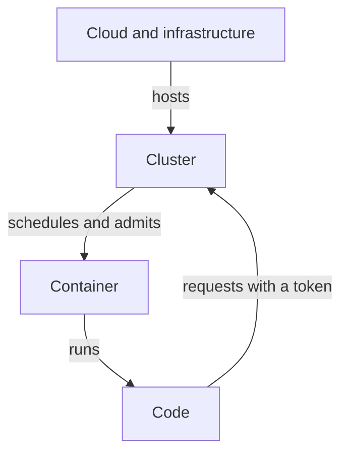

# The Four Layers And Their Trust Relationships

The `scout` application serves reports to its callers. To do that, it runs as a process in a container, the container runs on a node, and the node is a machine that someone else may own and operate. A security problem can start in any of these places. When a team says "the application is secure", the exam asks a sharper question: secure at which layer, and against whom?

The four Cs of cloud native security answer this by naming four layers: Cloud, Cluster, Container and Code. Each layer has its own assets, its own owner and its own controls. This part defines each layer, shows where it appears in a running cluster, and explains the trust relationship that links one layer to the next.

## Assets and goals

An asset is something that has value and needs protection: the reports `scout` serves, the credentials its pod holds, the CPU of the node. Security protects three goals for an asset. Confidentiality means that only authorized parties can read it. Integrity means that only authorized parties can change it, and that changes are correct. Availability means that authorized parties can use it when they need it.

Every control in this course protects at least one of these goals for at least one asset. A useful habit is to name the asset and the goal first, and the control second.

## Cloud and infrastructure

The cloud layer is the base: physical or virtual machines, networks, storage and the identities that manage them. In a public cloud, the provider operates the data center and the hypervisor (the software that splits a physical machine into virtual machines). The customer decides who may create machines, which networks can reach them, and who can read their disks.

This split is called the shared responsibility model. The provider secures the services it operates. The customer secures what the customer configures, and the contract states where the line runs. An identity that may delete or replace worker machines has power over every namespace on them, because Kubernetes runs on top of those machines.

## Cluster

The cluster layer is Kubernetes itself: the API server (the component that receives every request and decides whether to allow it), the datastore etcd (where the cluster's objects are kept), the controllers and the kubelet (the agent on each node that starts pods). Its assets are the objects in the datastore, including Secrets, and the authority to create, change or delete workloads.

The main cluster controls are authentication (who is calling), authorization with role-based access control, or RBAC (what the caller may do), admission control (which objects the API server accepts), and audit logging (a record of requests). A person or a service account with broad cluster authority can change all of these.

## Container

The container layer is the running process and its isolation. A container is an ordinary Linux process that the container runtime starts with limits. Linux namespaces restrict what the process can see, and control groups, or cgroups, restrict how much CPU and memory it can use. All containers on a node share the node's kernel. The container layer therefore depends on the kernel and the runtime being correct.

The pod field `securityContext` sets the container's privileges: the user it runs as, whether it may gain more privileges, which Linux capabilities it holds, and whether it runs in privileged mode. Privileged mode removes most of the limits that isolate the process from the node.

## Code

The code layer is the application: the logic that decides which user may see which report, how input is checked, which libraries are used and how secrets are handled. No platform control can read the intended business rule from the code. If `scout` returns one customer's report to another customer, the platform sees a normal request and a normal response.

## How the layers depend on each other

Each layer trusts the layer below it to enforce its own rules. The cluster trusts the machines not to be altered. The container trusts the cluster to start only the pods it admits. The code trusts the container to keep other processes out. This is why an outer-layer failure is serious: if the node is compromised, every control inside the cluster that runs on that node can be bypassed.



The arrows show trust from the outer layer to the inner layer, plus one path back: code holds a token and calls the cluster, so a weakness in code can reach cluster authority.

## See the layers in the playground

Each layer leaves a visible trace. The commands below show the machine, the pods placed on it, and the answer the API server gives to two different identities.

<!-- astrona:playground:renew -->

First list the node. In this playground the node is a container, and it stands in for the cloud machine:

```sh
kubectl get nodes
```

The output lists one node in the `Ready` state. Next, ask the API server whether two service accounts may list Secrets in `starfleet`:

```sh
kubectl auth can-i list secrets -n starfleet --as=system:serviceaccount:starfleet:shuttle
kubectl auth can-i list secrets -n starfleet --as=system:serviceaccount:starfleet:legacy-agent
```

The first command prints `no` and the second prints `yes`. The difference comes from the cluster layer: the service account `legacy-agent` is bound to `cluster-admin`, and `shuttle` has no binding. Finally, read the container-layer settings of `scout`:

```sh
kubectl get deployment scout -n starfleet -o jsonpath='{.spec.template.spec.containers[0].securityContext}'
```

The command prints nothing, because the Deployment sets no `securityContext`. The container runs with the runtime defaults, which is a container-layer fact that no cluster policy has changed.

## Working through a layered scenario

Suppose the `scout` image contains a vulnerable library (code layer) and its pod holds a token with broad rights (cluster layer) and runs privileged (container layer). An attacker who exploits the library runs commands in the container, reads the token and calls the API server. Each weak layer widens what the attacker can reach.

Defense in depth means several independent controls cover the same threat, so one failure does not decide the outcome. Patching the library removes the entry. A restricted `securityContext` limits what the process can do. A narrow RBAC role limits what the token allows. Each control needs an owner and a way to show that it works.

Security analysis therefore follows four questions: what is the asset, what is the access path, which layer enforces the rule on that path, and what happens if that layer fails.

## Summary of the idea

The reader now knows the four layers, the asset and owner of each, and the direction of trust between them. The open question is what each layer's controls look like in a pod specification, and how far each one actually reaches.

## Common pitfalls

> [!WARNING]
> Do not treat the four Cs as four independent switches. A strong control at an inner layer does not help when an outer layer lets an attacker bypass it. Also do not name a control without naming the asset it protects and the layer that enforces it.
