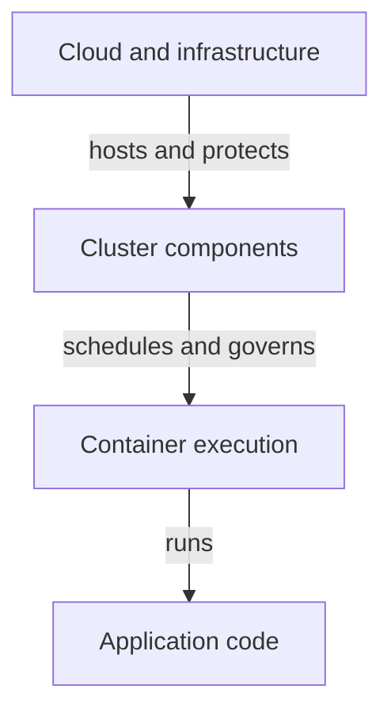

# The Four Layers And Their Trust Relationships

The `scout` application handles reports inside a container on a Kubernetes node hosted by a cloud provider. The reports, workload identity and node resources are assets: things whose confidentiality, integrity or availability need protection. Confidentiality concerns unauthorized disclosure. Integrity concerns unauthorized or incorrect change. Availability concerns access to the service when it is needed.

The four Cs of cloud native security describe Cloud, Cluster, Container and Code. They are a way to organize responsibilities and dependencies, not four independent switches. A secure application still relies on the platform that stores its credentials and executes its processes. A hardened cluster cannot make vulnerable application authorization correct by itself.

## Cloud And Infrastructure

The cloud or infrastructure layer includes machines, networks, storage and the identities used to manage them. Provider responsibilities can include physical protection and selected managed services. Customer responsibilities commonly include account permissions, workload configuration and data handling. The exact boundary follows the service contract.

An infrastructure identity with permission to replace worker machines or read their disks can have consequences beyond ordinary application access. Restrict administrative identities, protect credentials and observe changes. A namespace policy is not a complete defense against an infrastructure administrator who controls the machines implementing it.

Network exposure also begins here. A cluster endpoint in a private network has a different access path from one exposed broadly to the internet. Firewalls and routing restrict who can attempt a connection, while application programming interface (API) authentication and authorization decide which accepted caller may act. These controls complement rather than substitute for one another.

## Cluster And Container

The cluster layer includes the Kubernetes API, datastore, controllers, node agents and policy. It manages identities and resource declarations for workloads. A broad cluster administrator can change admission settings, read many resources and grant more permissions. Limit that authority and retain evidence of sensitive administrative activity.

The container layer includes image contents, process privileges, runtime isolation and resource boundaries. Linux namespaces restrict selected views; control groups constrain usage. A container sharing the host kernel still depends on kernel and runtime hardening. Privileged execution or unrestricted host mounts can weaken the intended boundary.

The layers depend on the systems beneath them while adding their own controls and responsibilities.

## Code And Application Behavior

The code layer includes input handling, authorization, dependency use and sensitive-data processing. An application that returns one customer's report to another user has a security defect even when its Pod meets a restricted profile. Correct request authorization belongs to the application or a clearly defined supporting policy system.

Code also determines whether retries duplicate transactions, whether error messages expose secrets and whether database queries handle untrusted input safely. Platform controls can reduce exposure and contain consequences, but they cannot infer every business permission or data rule.

## Working Through A Layered Scenario

Suppose an image contains a vulnerable library and its Pod mounts a powerful API token. Reducing privileges at the container layer limits some consequences. Narrowing the token's role-based access control (RBAC) grants reduces cluster impact. Patching the library addresses the code or artifact cause. Limiting network reachability reduces possible paths. Audit and runtime observations help detect misuse, while credential revocation and trusted redeployment support recovery.

Defense in depth means several independent controls address relevant parts of the threat rather than relying on one apparently strong setting. A preventive control restricts an unwanted action. A detective control records or identifies it. A corrective control supports restoration or containment. Each needs a defined owner and evidence that it actually works.

Security analysis should therefore identify the asset, likely access path and responsible layer. Then ask what happens if one control fails. This makes the four Cs useful for reasoning about an application instead of treating them as a list to memorize.

## Common pitfalls

> [!WARNING]
> A hardened outer layer does not repair application logic, and an inner-layer policy can depend on infrastructure trust. State the protected asset and the boundary each control actually enforces.
