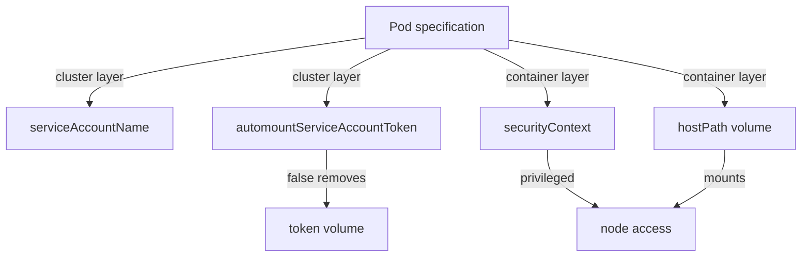

# Cluster And Container Controls In A Pod Specification

A single pod specification carries settings from two layers at once. Some fields tell the cluster how to treat the pod: which service account it uses and whether it receives a token. Other fields tell the container runtime how much of the node the process may touch. If a reader cannot tell these apart, a scenario question about "which layer is at fault" has no good answer.

This part takes two pods from the playground, the ordinary `scout` and the deliberately weak `privileged-debug`, and compares them field by field. It ends with the one setting that removes an unneeded cluster credential from a pod.

## The service account token: a cluster-layer credential

A service account is the identity that a pod uses when it calls the Kubernetes API. By default, the API server adds a projected volume to every pod. The volume is named `kube-api-access-` followed by a random suffix. It holds three files: a short-lived token that proves the identity, the certificate of the cluster's certificate authority (so the pod can trust the API server), and the namespace name.

Mounting this volume is a cluster-layer decision, and it happens at admission, before the container exists. The decision does not depend on whether the application ever calls the API. A web application that never calls the API still holds a token, and anyone who gains code execution in that container can read it.

The pod field `automountServiceAccountToken` controls this. When it is `false` in the pod specification, the API server does not add the volume. The same field exists on the `ServiceAccount` object. If both are set, the pod value wins.

## The container settings: a container-layer boundary

The container runtime reads the `securityContext` of the pod and of each container. These fields decide how isolated the process is.

- `privileged: true` gives the container nearly all the access of a process on the node, including access to the node's devices.
- `allowPrivilegeEscalation` decides whether a process may gain more privileges than its parent, for example through a set-user-ID program. Set it to `false` for ordinary workloads.
- `capabilities.drop` removes Linux capabilities, which are slices of the root user's powers. Dropping `ALL` removes every one.
- `runAsNonRoot` and `runAsUser` make the process run as a user that is not root.
- A `hostPath` volume mounts a directory of the node into the container. The container then reads (and, unless read-only, writes) node files.



The diagram sorts the pod fields by layer: the first two decide which cluster credential the pod gets, and the other two decide how far the process reaches into the node.

## Compare the two pods

The commands below use the playground. First look for the token volume in the ordinary `shuttle` pod, then list the files in it.

<!-- astrona:playground:renew -->

```sh
kubectl get deployment shuttle -n starfleet -o jsonpath='{.spec.template.spec.automountServiceAccountToken}'
kubectl exec -n starfleet deploy/shuttle -- ls /var/run/secrets/kubernetes.io/serviceaccount
```

The first command prints nothing, because the field is not set, so the default applies. The second command lists the three files `ca.crt`, `namespace` and `token`. This pod holds a credential although the `shuttle` client never calls the API.

Now read the container settings of the weak pod:

```sh
kubectl get deployment privileged-debug -n starfleet -o jsonpath='{.spec.template.spec.containers[0].securityContext}'
kubectl get deployment privileged-debug -n starfleet -o jsonpath='{.spec.template.spec.volumes[0].hostPath.path}'
```

The first command prints a JSON object with `"privileged":true`. The second prints `/etc`, the node directory that the pod mounts at `/host-etc`. Read the node's files from inside the pod:

```sh
kubectl exec -n starfleet deploy/privileged-debug -- ls /host-etc
```

The command lists the contents of the node's `/etc` directory, not the pod's own. The cluster did not stop this, because no admission control in the playground refuses `hostPath` volumes or privileged pods. A control that refuses them is a cluster-layer control that protects the container layer.

## Remove the token that is not needed

Save this as `shuttle-no-token.yaml`. It is the `shuttle` Deployment with the one extra field:

```yaml
apiVersion: apps/v1
kind: Deployment
metadata:
  name: shuttle
  namespace: starfleet
  labels:
    app: shuttle
spec:
  replicas: 1
  selector:
    matchLabels:
      app: shuttle
  template:
    metadata:
      labels:
        app: shuttle
    spec:
      serviceAccountName: shuttle
      automountServiceAccountToken: false
      containers:
        - name: shuttle
          image: curlimages/curl:8.22.0
          command: ["sh", "-c", "while true; do sleep 30; done"]
          resources:
            requests:
              cpu: 10m
              memory: 16Mi
            limits:
              memory: 32Mi
```

Apply it:

```sh
kubectl apply -f shuttle-no-token.yaml
```

Then check the result. The new pod starts without the token volume, so the directory no longer exists:

```sh
kubectl rollout status deployment/shuttle -n starfleet
kubectl exec -n starfleet deploy/shuttle -- ls /var/run/secrets/kubernetes.io/serviceaccount
```

The `ls` command fails with a message that the directory does not exist. The cluster layer no longer hands this pod a credential.

## What you now know

A pod specification mixes cluster-layer settings (service account, token mounting) and container-layer settings (privileged mode, capabilities, user, host mounts). A token is mounted by default and a privileged pod is accepted by default. Neither default is safe for a workload that does not need them. The open question is what an attacker gains when the code layer fails and uses these settings.

## Common pitfalls

> [!WARNING]
> Setting `automountServiceAccountToken: false` on a `ServiceAccount` does not override a pod that sets it to `true`; the pod value wins. Also, `privileged: false` does not remove a `hostPath` mount: privileged mode and host mounts are separate settings, and each needs its own control.
