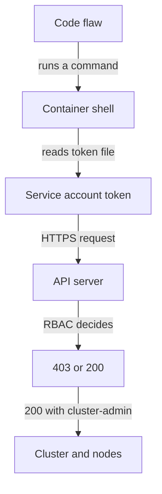

# Code Compromise And The Path To The Cluster

The code layer is the layer that the platform cannot fix. A vulnerable library, an injection flaw or a leaked password lets an attacker run commands inside a container, whatever the cluster policy says. The useful question for the exam is therefore not "how do we stop it at the code layer" but "what can the attacker reach from here, and which control stops the next step?"

This part follows one compromise through the layers. It starts with an attacker who can run commands in a container, uses the playground to show what the token in that container allows, and then shows which control cuts each step.

## What the platform cannot see

A request to `scout` that asks for a report belonging to another user looks like any other request: the same path, the same method, a valid response. Authorization of business data is a rule that lives in the code. The same is true for unchecked input, which an attacker uses to make the application run a command. The platform sees processes and network connections, not intent.

Platform controls cannot prevent these defects. They limit the damage after one occurs, and they give evidence that something happened. Fixing the defect itself (patching a library, validating input, correcting an authorization check) is a code-layer task with a code-layer owner.

## The path from code to cluster

Assume an attacker can run a shell command inside a container. The attacker cannot yet touch the cluster. The next step is to look for credentials in the container. The service account token is always at the same path, `/var/run/secrets/kubernetes.io/serviceaccount/token`, when the pod mounts it. With that token the attacker sends a request to the API server at `https://kubernetes.default.svc`, which is the cluster-internal name of the API server.

What happens next depends only on the RBAC rules bound to the service account. If the account has no rights, the API server answers HTTP status 403 (Forbidden). If the account is bound to `cluster-admin`, the API server answers 200 and the attacker can read every Secret and create privileged pods.



The diagram shows that the last arrow is the only one the cluster layer controls: RBAC decides whether a stolen token is a nuisance or a full compromise.

## Run the request from inside two pods

The playground has two pods that stand for a compromised container: `drifter` in `outpost` has a token and no rights, and `legacy-agent` in `starfleet` has a token bound to `cluster-admin`. The helper below runs the attacker's request from inside a pod and prints only the HTTP status code. It reads the token file in the pod with `cat`, and sends it as a bearer token with `curl`.

<!-- astrona:playground:renew -->

Paste the helper once. It takes a namespace and a Deployment name, and asks the API server to list Secrets in that namespace as the pod's own identity:

```sh
api_status() {
  kubectl exec -n "$1" "deploy/$2" -- sh -c 'curl -s -o /dev/null -w "%{http_code}\n" --cacert /var/run/secrets/kubernetes.io/serviceaccount/ca.crt -H "Authorization: Bearer $(cat /var/run/secrets/kubernetes.io/serviceaccount/token)" https://kubernetes.default.svc/api/v1/namespaces/'"$1"'/secrets'
}
```

Run it for both pods:

```sh
api_status outpost drifter
api_status starfleet legacy-agent
```

The first command prints `403` and the second prints `200`. The code and the container image are the same kind in both pods. Only the RBAC binding differs, so the cluster layer decided the outcome.

## Cut the path at the cluster layer

Delete the over-broad binding. This is a corrective control: it removes a grant that should not exist.

```sh
kubectl delete clusterrolebinding legacy-agent-admin
api_status starfleet legacy-agent
```

The first command prints `clusterrolebinding.rbac.authorization.k8s.io "legacy-agent-admin" deleted`. The second command prints `403`, because the same token now has no rights.

## Cut the path at the container layer

The binding fix keeps the token but limits it. A second control removes the token from pods that never need it. When `automountServiceAccountToken` is `false`, the token file does not exist, and the attacker has nothing to send. A third control, a restricted `securityContext`, limits what the attacker's commands can do in the container, even before they look for a token.

These controls are independent. If the binding is wrong, the missing token still helps. If the token is mounted, the narrow role still helps. If both fail, the `securityContext` still limits the access to the node. The layers work as a set, and the attacker has to defeat every control on the path.

## Why the code layer still needs an owner

None of these controls repairs the flaw. The attacker still runs commands in the container, can read any data the pod holds, and can reach any network destination the pod can reach. Only a code change closes the entry.

For this reason a security review of a cloud native system has two lists. The first lists the platform controls that limit damage. The second lists the code-layer practices that prevent the flaw: reviewing code, updating dependencies, validating input and keeping secrets out of source files. A team that owns only the first list is exposed to every new flaw.

The exam often tests this with a short scenario. A pod is compromised, and the question asks which control limits the effect. The answer is the control at the layer the attacker is trying to cross next, not the control at the layer where the flaw lives.

## What you now know

The platform cannot fix a flawed application, but it decides how far a flaw can spread. The service account token links the code layer to the cluster layer, and RBAC decides what that link is worth. The open question is how to build controls that prevent, detect and recover, instead of relying on one.

## Common pitfalls

> [!WARNING]
> A `403` from the API server does not mean the container is safe: the attacker still runs code there, and can reach the network and the pod's mounted data. Also do not rely on hiding the token path. Remove the token, or narrow its rights, because the path is the same in every pod.
