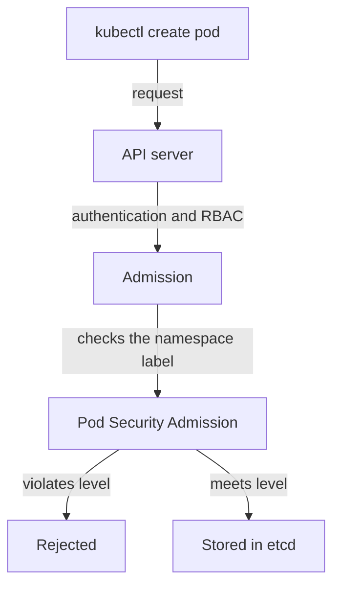

---
exam_objectives:
  - The 4Cs of Cloud Native Security
---
# Preventive Controls At Admission

The cheapest security failure to handle is the one that never happens. A preventive control stops an unwanted action before it takes effect. In Kubernetes, the strongest place for a preventive control is admission, the step where the API server decides whether to accept an object after it has accepted the caller's identity and permissions. This part shows what admission refuses, and what it cannot refuse.

The worked example is Pod Security Admission (PSA), the admission control built into the API server. It checks every new pod in a namespace against a Pod Security Standard, a named set of rules for pods.

## The three Pod Security levels

A Pod Security Standard has three levels. The `privileged` level places no restriction. The `baseline` level blocks the known routes to privilege escalation: privileged containers, host namespaces, `hostPath` volumes and unsafe capabilities. The `restricted` level adds current hardening practice: the pod must run as a non-root user, must not allow privilege escalation, must drop all capabilities (it may add back only `NET_BIND_SERVICE`), and must use a seccomp profile (a filter on the system calls a process may make) of `RuntimeDefault` or `Localhost`.

A namespace opts in with labels. The label `pod-security.kubernetes.io/enforce` names the level to enforce. The two other modes, `audit` and `warn`, are covered later. PSA is on by default in current Kubernetes releases, so a label is all that is needed.

Each mode label can have a version label, for example `pod-security.kubernetes.io/enforce-version`. It pins the rules to the version of the standard from a given Kubernetes minor release. Without it, the rules of the latest version apply. The exam may ask which label sets the level and which sets the version.

The level labels are plain text on the namespace object. Anyone who may edit the namespace can change them. This is why RBAC for namespace changes belongs to the same threat model as the control itself.

## What enforcement does and does not do

When a pod is created in a namespace with an `enforce` label, the API server checks the pod against the level. A violating pod is rejected, and the API response names the violated rule. The check happens at admission, so it applies at the moment of creation or update.

Two limits matter for the exam. First, PSA checks pods, not controllers. A Deployment that describes a violating pod is accepted, and the ReplicaSet fails later when it tries to create the pod. Second, PSA does not look at pods that already exist. A running privileged pod stays running after the label is added. A preventive control protects the future, not the past.



The diagram shows that Pod Security Admission runs after authorization and before the pod is stored, so a rejected pod never exists.

## Try an unprotected namespace

The playground namespace `outpost` has no label, so it admits any pod. To test an admission control without creating anything, use a server-side dry run: the API server runs the full request, including admission, and does not store the result.

<!-- astrona:playground:renew -->

Run a dry run of a privileged pod in `outpost`:

```sh
kubectl run privileged-test -n outpost --image=curlimages/curl:8.22.0 --dry-run=server --overrides='{"spec":{"containers":[{"name":"privileged-test","image":"curlimages/curl:8.22.0","securityContext":{"privileged":true}}]}}' -- sleep 30
```

The command prints `pod/privileged-test created (server dry run)`. The API server accepted the privileged pod, because nothing forbids it.

## Add the control

Labeling the namespace turns the control on. Run:

```sh
kubectl label namespace outpost pod-security.kubernetes.io/enforce=baseline
```

The command prints `namespace/outpost labeled`. It may also print a warning that existing pods would violate the level; the warning names `intruder`. Run the same dry run again:

```sh
kubectl run privileged-test -n outpost --image=curlimages/curl:8.22.0 --dry-run=server --overrides='{"spec":{"containers":[{"name":"privileged-test","image":"curlimages/curl:8.22.0","securityContext":{"privileged":true}}]}}' -- sleep 30
```

This time the command fails with an error that names `PodSecurity` and the setting `privileged`. The pod would violate the `baseline` level, so the API server refuses it.

## The existing pod is untouched

Check the pod that existed before the label:

```sh
kubectl get pod intruder -n outpost
```

The pod is still `Running`. The label did not remove it. The control did its job for new pods, and the old privileged pod is a problem for a different kind of control.

## Other preventive controls

Pod Security Admission is one example. RBAC prevents a caller from performing a verb at all. A NetworkPolicy prevents a connection at the network layer if the network plugin enforces it. A `ResourceQuota` prevents a namespace from using more than its share. At the cloud layer, a firewall rule or an identity policy prevents access before it reaches the cluster. At the code layer, input validation prevents a malformed request from reaching the logic.

What these have in common is timing: they act before the effect. What they share as a weakness is coverage. A control only protects what it covers, and a gap in coverage is invisible until something falls through it.

## What you now know

A preventive control refuses an action at the moment of the request. Pod Security Admission refuses pods that break the level on their namespace, and it leaves existing pods alone. The open question is how an administrator finds out about violations that were allowed or that already exist.

## Common pitfalls

> [!WARNING]
> Adding the `enforce` label does not remove running pods that violate the level, and it does not reject the Deployment that describes them. The ReplicaSet fails later, when it creates a replacement pod. Test with a server-side dry run, and check existing pods separately.
