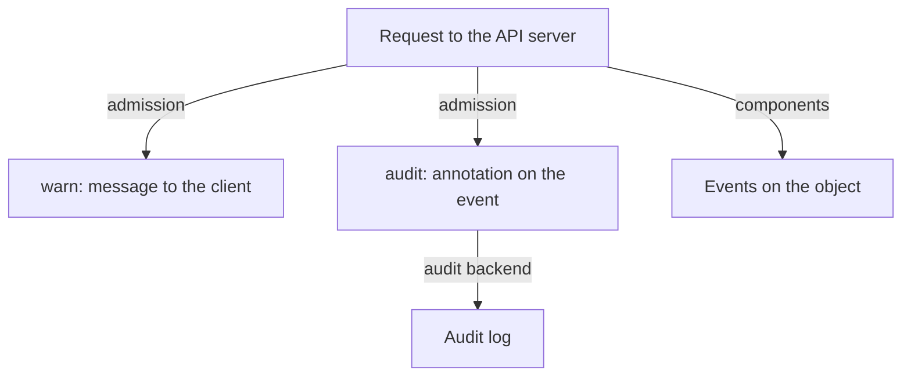

---
exam_objectives:
  - The 4Cs of Cloud Native Security
---
# Detective Controls: Audit, Warn And Events

A preventive control only blocks what its author predicted. Everything else happens, and the question becomes whether anyone finds out. A detective control does not stop an action. It records the action, or tells someone about it, so that a person or a tool can react. Without detection, a misconfiguration or an attack can last for months.

This part covers three detective sources in Kubernetes: the `warn` and `audit` modes of Pod Security Admission, the events the cluster records, and the API server audit log. It ends with a query that finds violations that already exist.

## Detection needs three things

A detective control is only useful when three conditions hold. The signal must exist: something records the action. A person or a system must read the signal. And the signal must arrive early enough for a response to matter. A log that nobody reads is storage, not a control.

For this reason, the exam treats logging as a control with an owner. Someone decides what to record, where to keep it, who may change or delete it, and who reviews it.

## The warn and audit modes

Pod Security Admission has three modes. The mode `enforce` rejects a violating pod. The mode `warn` accepts the pod and sends a warning to the client that made the request. The mode `audit` accepts the pod and adds an annotation to the audit event of the API server. Each mode has its own label with its own level, so a namespace can enforce `baseline`, and warn and audit at `restricted`.

This combination is common in practice. The enforced level is the minimum that the workloads already meet. The audit and warn levels are the target. They show which workloads would break if the namespace moved to the target, before anyone moves it.

## The API server audit log

The audit log is a record of requests that the API server handles: who sent the request, what it asked for, when, and what the API server answered. An audit policy file decides which requests are recorded and how much detail each record has. The API server writes the records to a file or sends them to a webhook backend. The audit log is not on by default. A cluster administrator turns it on by starting the API server with a policy file.

The audit annotations from PSA appear only if audit logging is on. In the playground, the audit log is not configured, so the `audit` label has an effect only in a cluster that records audit events. The label is still the correct setting, and it costs nothing.

## Events

An event is a small object that the cluster components create to report what happened to another object: a pod was scheduled, an image was pulled, a container started, a pull failed. Events are stored in the cluster for a short time, about one hour by default. They are a debugging aid and a weak security signal. They are not an audit trail, because they are short-lived and any component with the right can create them.



The diagram shows three signals from one request: a warning that only the caller sees, an annotation that reaches the audit log if it is enabled, and events that components attach to the object.

## Add the detective labels

Add both detective modes at the `restricted` level to `outpost`. Nothing is blocked by these labels.

<!-- astrona:playground:renew -->

```sh
kubectl label namespace outpost pod-security.kubernetes.io/warn=restricted pod-security.kubernetes.io/audit=restricted
```

The command prints `namespace/outpost labeled`. Now run a dry run of a plain pod that sets no `securityContext`:

```sh
kubectl run plain-test -n outpost --image=curlimages/curl:8.22.0 --dry-run=server -- sleep 30
```

The command succeeds and prints `pod/plain-test created (server dry run)`. It also prints a warning that mentions PodSecurity and the `restricted` level, and lists the fields that the pod would have to set. The pod is accepted, because `warn` never blocks.

## Find violations that already exist

The warn and audit modes see new pods. To find old ones, the API server can evaluate a label change without applying it. A server-side dry run of a label command checks the existing pods in the namespace against the new level:

```sh
kubectl label --dry-run=server --overwrite namespace outpost pod-security.kubernetes.io/enforce=restricted
```

The command prints `namespace/outpost labeled (server dry run)` with warnings for the pods that would violate `restricted`. The warnings name `intruder` and `drifter`. The namespace itself does not change.

A query can find the worst cases directly. This one lists every pod in the cluster that has a privileged container:

```sh
kubectl get pods -A -o json | jq -r '.items[] | select(any(.spec.containers[]; .securityContext.privileged == true)) | .metadata.namespace + "/" + .metadata.name'
```

The command prints `outpost/intruder`. A scheduled job that runs a query like this turns a one-time check into a detective control.

## Read what the cluster recorded

Events record what the components did. Read the events of the `outpost` namespace, oldest first:

```sh
kubectl get events -n outpost --sort-by=.lastTimestamp
```

The list shows the events for the `drifter` and `intruder` pods, such as scheduling, image pulls and container starts. Nothing in this list says that `intruder` is a risk. Events describe the lifecycle of an object, not whether the object is safe.

## What you now know

A detective control records or reports an action without blocking it. The warn mode reports to the caller, the audit mode and the audit log report to the administrators, and events report component activity for a short time. Detection finds `intruder`, but it does not remove it. The open question is how to respond.

## Common pitfalls

> [!WARNING]
> The `audit` label produces nothing useful when audit logging is not enabled on the API server. Also, a warning shown to a user is not a record: it disappears with the terminal session. Do not count either as the evidence an auditor asks for.
