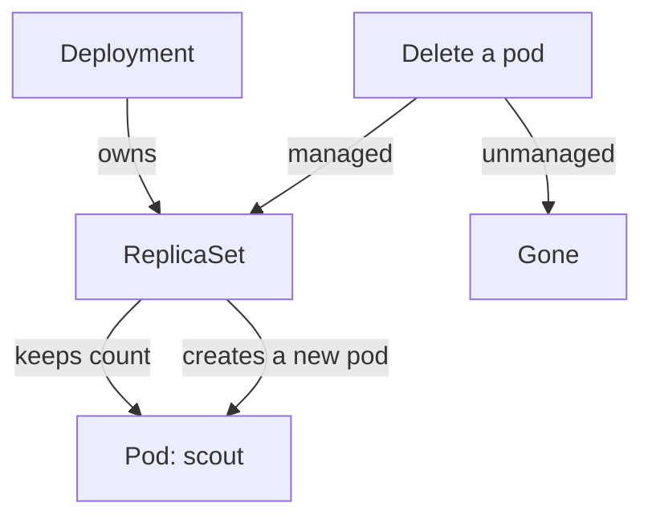

---
exam_objectives:
  - The 4Cs of Cloud Native Security
---
# Corrective Controls: Containment And Recovery

Prevention fails and detection finds the failure. The next question is what the team does about it. A corrective control limits the damage of an incident and brings the system back to a safe, working state. In Kubernetes, correction has two common forms: containment, which stops the problem from spreading, and recovery, which restores a known good state.

This part uses two incidents from the playground. One is an unmanaged privileged pod that no controller owns. The other is a failed update of a Deployment. It also shows the one corrective control that Kubernetes applies on its own.

## Containment and recovery

Containment limits what the problem can reach: delete a pod, revoke a credential, block a network path, scale a Deployment to zero. Containment is quick and often loses some state. Recovery restores the service: roll back to the previous version, restore from a backup, redeploy from a trusted image. A real response uses both, and the order matters. Contain first, so that recovery does not rebuild the problem.

Evidence is the third need. Before deleting a pod, an investigator may want its logs and its specification. A corrective action that destroys evidence has a cost, and the team decides it with that cost in mind.

## Which controller owns the pod

A pod that a Deployment manages has an owner. If the pod is deleted, the ReplicaSet notices that the count is below the desired number and creates a replacement. A pod with no owner is gone for good when deleted. This difference decides how to contain each kind.



The diagram shows that deleting a managed pod only triggers a replacement, so containment of a managed workload must change the Deployment, and containment of an unmanaged pod is the delete itself.

## Compare a managed and an unmanaged pod

Run these commands in the playground. First list the owner of each pod.

<!-- astrona:playground:renew -->

```sh
kubectl get pods -n outpost -o custom-columns=NAME:.metadata.name,OWNER:.metadata.ownerReferences[0].kind
```

The `drifter` pod shows the owner `ReplicaSet`, and the `intruder` pod shows `<none>`. Delete the managed pod and watch the controller work:

```sh
kubectl delete pod -n outpost -l app=drifter
kubectl get pods -n outpost
```

The first command prints a line that the pod was deleted. The second lists a `drifter` pod again, now with a new name and a young age. The ReplicaSet restored the count. This is a corrective control built into Kubernetes, and it also means that deleting a compromised managed pod does not remove the cause.

## Contain the unmanaged pod

The privileged pod `intruder` has no owner. Delete it:

```sh
kubectl delete pod intruder -n outpost
```

The command prints `pod "intruder" deleted`. Nothing replaces it. If the namespace enforces `baseline`, a replacement created by hand would also be rejected, which shows how a preventive control keeps a corrective action from being undone.

## Recover from a failed change

Change the image of `probe` to a tag that does not exist, as a failed release would:

```sh
kubectl set image deployment/probe probe=mccutchen/go-httpbin:does-not-exist -n starfleet
kubectl rollout status deployment/probe -n starfleet --timeout=30s
```

The first command prints `deployment.apps/probe image updated`. The second does not finish before the timeout, because the new pod cannot pull its image. The old pod keeps serving, because the rolling update never removed it. Look at the history that the Deployment kept:

```sh
kubectl rollout history deployment/probe -n starfleet
```

The output lists two revisions. Roll back to the earlier one:

```sh
kubectl rollout undo deployment/probe -n starfleet
kubectl rollout status deployment/probe -n starfleet
```

The first command prints `deployment.apps/probe rolled back`. The second prints that the rollout completed successfully. The Deployment uses the template of the earlier revision again.

## Why recovery needs a safe source

`kubectl rollout undo` restores the previous revision of the Deployment. It does not know whether that revision was safe. If an attacker changed the Deployment two revisions ago, an undo to the previous revision keeps the attack. Real recovery restores from a source that the team trusts: version-controlled manifests, a signed image, or a backup taken before the incident.

## What you now know

A corrective control contains an incident and restores a good state. Unmanaged pods are contained by deleting them, and managed pods by changing their controller. A rollback recovers from a failed or unwanted change, and the quality of the recovery depends on the quality of the source. Preventive, detective and corrective controls together form defense in depth.

## Common pitfalls

> [!WARNING]
> Deleting a pod that a Deployment manages only makes the ReplicaSet create a new one. Change or scale the Deployment instead. Also remember that a rollback restores the previous revision, which is not always a safe revision.
