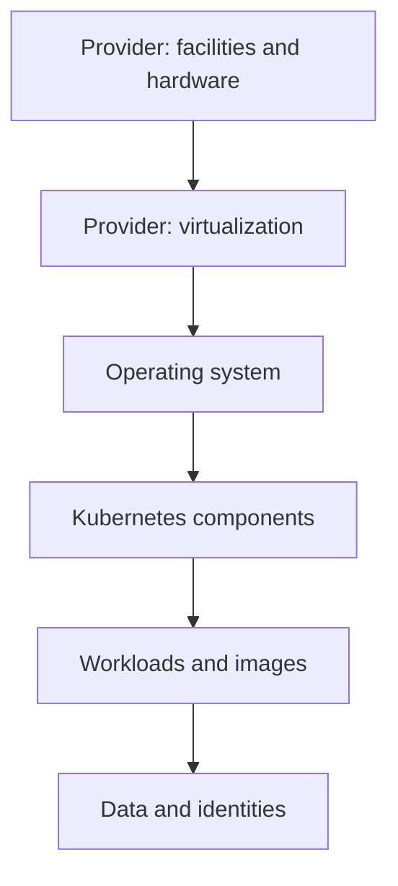

# Shared Responsibility And Infrastructure Access

A team moves `scout` to a managed Kubernetes service and assumes that the provider now secures everything underneath. Then a build job with an overly broad credential changes production workloads, and nobody can say whose duty it was to prevent it. The answer depends on a written split of duties called the shared responsibility model. This part explains that split, shows which pieces of a cluster a provider can take over, and ends with a look at the parts of a cluster that a self-managed operator owns.

## What shared responsibility means

Shared responsibility is the division of security duties between a cloud provider and its customer. The provider runs the data centers, the physical hardware, the network backbone and the virtualization layer (the software that splits one physical server into many virtual machines). The customer decides what runs on top and who may use it. The exact line moves with the service model, and the service agreement, not the marketing name, defines it.

The exam uses three service models. In Infrastructure as a Service (IaaS), the provider supplies virtual machines, disks and networks, and the customer owns everything from the operating system upward. In Platform as a Service (PaaS), the provider also operates the runtime, so the customer owns the application and its data. In Software as a Service (SaaS), the provider operates the whole application, and the customer owns the data it enters and the accounts that use it.



The diagram lists the layers from the data center to the data. The provider always owns the first two boxes. Who owns the rest depends on whether the cluster is self-managed or managed.

## Self-managed and managed clusters

In a self-managed cluster, the customer installs and runs the control plane. The control plane is the set of components that make decisions for the cluster: the API server (the front door for every request), etcd (the database that stores all cluster objects), the scheduler and the controller manager. The customer also owns the worker nodes, which are the machines that run the pods. That means patching the node operating system, rotating certificates, backing up etcd and replacing broken machines.

In a managed Kubernetes service, the provider runs the control plane. The provider patches the API server, keeps etcd available and usually backs it up. Worker nodes vary. In a standard managed node group, the customer still chooses the machine image and the update schedule. In a more managed offering, the provider also runs the nodes, and the customer sees only pods.

Whatever the offering, some duties stay with the customer. The customer chooses which identities may call the API server, which images run, which secrets are stored, what data leaves the cluster and who may change cloud resources. A managed control plane with a patched API server does not stop an authorized but over-privileged identity from deleting workloads.

A practical way to read a responsibility matrix is to ask four questions for each control. Who configures it? Who patches or renews it? Who monitors it? Who recovers it after a failure? A control for which no party answers all four is an operating gap, even when the provider has strong internal security.

## Seeing what a self-managed operator owns

The playground is a self-managed cluster, so you can see the control plane components that a provider hides in a managed service. Start with the system namespace, where the cluster's own components run.

<!-- astrona:playground:renew -->

```sh
kubectl -n kube-system get pods
```

The list shows pods for the API server, etcd, the scheduler and the controller manager, next to the DNS and networking components. In a managed service these control plane pods run in the provider's account and do not appear in your cluster. The customer sees only the API endpoint.

Each control plane component starts with command-line flags that set its security behavior. Read the flags of the API server with `jq`, a tool that filters JSON:

```sh
kubectl -n kube-system get pods -l component=kube-apiserver -o json | jq -r '.items[0].spec.containers[0].command[]'
```

The output is one flag per line. Look for `--authorization-mode`, which lists the authorizers (the components that decide whether an identity may do an action) in order. A cluster that uses role-based access control (RBAC) lists `RBAC` there. The flag `--client-ca-file` names the certificate authority that signs client certificates. In a self-managed cluster, you own these choices and the files they point to. In a managed service, the provider sets them, and you may only be allowed to change a few of them through the provider's console or API.

You can also check what the nodes run:

```sh
kubectl get nodes -o wide
```

The columns show the node operating system image, the kernel version and the container runtime. In a self-managed cluster, you patch all three. In a managed node group, you choose when to roll nodes to a newer image. In a fully managed node offering, the provider does it.

## Two accounts, two boundaries

A cloud environment has two permission systems that are easy to confuse. The cloud account has its own identity and access management (IAM) system, which controls who may create machines, disks and networks. The cluster has RBAC, which controls who may create pods and read secrets. A person with cluster-admin rights inside the cluster is not automatically an administrator of the cloud account, and the reverse is also true. A cloud account administrator can often reach the cluster by other routes, for example by reading the machine disks or by creating a new credential for the cluster.

That is why a compromise of the customer's cloud account is serious even when the provider's own systems are intact. The provider kept its promises, and the attacker still used legitimate customer permissions. Detection then depends on the customer's logs: cloud audit logs record who called the cloud API, and the cluster audit log records who called the Kubernetes API.

## A responsibility matrix for one cluster

The table below fills in the matrix for the three situations that the exam compares. The rows are controls, and each cell says who normally owns the control. Treat it as a starting point: the service agreement has the final word.

| Control | Self-managed cluster | Managed control plane | Fully managed nodes |
| --- | --- | --- | --- |
| Data center and hardware | Provider | Provider | Provider |
| Control plane patching | Customer | Provider | Provider |
| etcd backup | Customer | Provider (verify the retention) | Provider (verify the retention) |
| Node operating system patching | Customer | Customer | Provider |
| API endpoint network access | Customer | Customer | Customer |
| Workload identities and RBAC | Customer | Customer | Customer |
| Images and application code | Customer | Customer | Customer |
| Application data backup | Customer | Customer | Customer |

The three rows that never change are the ones that matter most for the exam: the customer always decides who may reach the API endpoint, which identities may act, and what code and data run. When a scenario says that a provider "manages" the cluster and then asks why a workload was changed by an attacker, the cause is nearly always in these rows.

## A scenario to reason through

The provider keeps the API server of a managed cluster patched. A customer gives a build job a credential that can administer every cluster and every cloud resource in the account. A malicious dependency in the build reads that credential and uses it to change running workloads and to create new virtual machines.

The provider fulfilled its duty: the API server was patched. The customer failed at identity scoping. The fix is on the customer side: give the build job a role that can update only the Deployments it ships, use separate credentials for build, routine operation and emergency administration, revoke the exposed credential, and read the audit logs to see which calls the credential made. The same scenario in the exam is usually written with different nouns, so practice naming the layer, the owner and the missing control.

## What this part showed

You can now describe the three service models and the split of duties in self-managed and managed clusters. You saw the control plane that a provider hides, and the flags that make its security decisions. A written responsibility matrix answers who configures, patches, monitors and recovers each control, and every gap is the customer's to close.

The next question is what an identity can do once it is inside the account or the cluster. Control over infrastructure is only as safe as the identities that hold it.

## Common pitfalls

> [!WARNING]
> "Managed Kubernetes" does not mean the provider secures your workloads, identities or data. It also does not mean you own nothing: read the service agreement for each control. A patched control plane does not limit what a valid but over-privileged credential can do.
