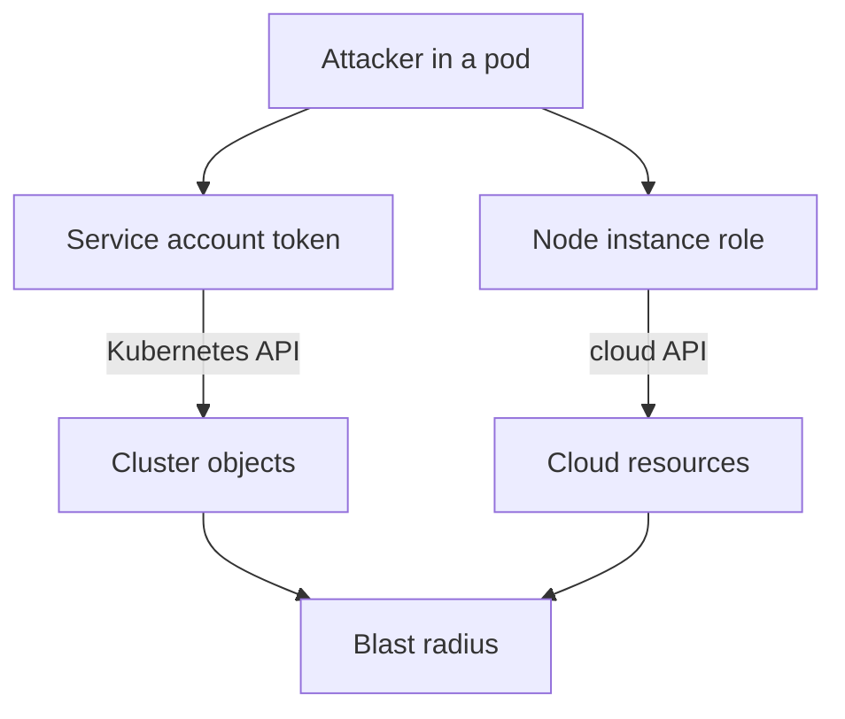

---
exam_objectives:
  - Cloud Provider and Infrastructure Security
---
# Infrastructure Identities And Blast Radius

When an attacker steals one credential, the damage depends on what that credential is allowed to do. A credential that can read one configuration object is a small problem. A credential that can administer the whole cluster, or the whole cloud account, is an incident that spreads to every workload. This part explains the identities that exist around a cluster, how a pod receives one, and how to measure and shrink the blast radius, which is the set of assets that one identity can affect if it is misused.

## The identities around a cluster

A cluster has several kinds of identities, and each one lives in a different system. A human administrator signs in to the cloud account with a cloud identity, and signs in to the cluster with a client certificate or a token from an identity provider. A build pipeline has its own account in the cloud and often a credential inside the cluster. A pod that calls the Kubernetes API uses a service account, which is a Kubernetes identity that belongs to a namespace and is meant for software, not people.

The cloud also has identities for machines. A virtual machine can be given an instance role, which is a cloud identity attached to the machine itself. Every process on the machine can then obtain temporary credentials for that role. Cloud providers also offer workload identity features that bind one Kubernetes service account to one cloud role, so a single pod receives cloud permissions without the whole node sharing them. Which feature is available, and how it is named, depends on the provider.

The principle behind all of them is the same. Each workload should have its own identity, and each identity should have only the permissions its job needs. This is least privilege. A shared identity for many workloads makes it impossible to tell them apart in logs and gives every workload the permissions of the most privileged one.



The diagram shows two routes from one compromised pod: the service account token reaches the Kubernetes API, and the node's instance role reaches the cloud API. The blast radius is the union of both.

## How a pod receives a service account token

By default, Kubernetes mounts a token into every pod. The kubelet (the agent on each node that starts pods) asks the API server for a short-lived, signed token for the pod's service account and mounts it as a projected volume, which is a volume built from several sources, at `/var/run/secrets/kubernetes.io/serviceaccount`. The directory holds `token`, `ca.crt` and `namespace`. A process in the pod can read the token and send it to the API server as proof of identity.

Most application pods never call the Kubernetes API. They still receive a token, which is an unnecessary credential. If an attacker runs code in such a pod through a vulnerability, the token is one more thing to try. The field `automountServiceAccountToken` turns the mount off. It can be set on a service account or on a pod. If both are set, the pod's value wins.

The playground starts with the default behavior. Check which files the `shuttle` pod can read:

<!-- astrona:playground:renew -->

```sh
kubectl -n starfleet exec deploy/shuttle -- ls /var/run/secrets/kubernetes.io/serviceaccount
```

The command lists `ca.crt`, `namespace` and `token`. The pod never needed them, because `shuttle` only sends HTTP requests to other Services. Switch the mount off in the pod template with a patch, which changes only the named field:

```sh
kubectl -n starfleet patch deployment shuttle -p '{"spec":{"template":{"spec":{"automountServiceAccountToken":false}}}}'
kubectl -n starfleet rollout status deployment/shuttle
```

The patch changes the pod template, so the Deployment controller starts a new pod and removes the old one. The old pod keeps its token until it is gone, which is why the rollout must finish before you check. Run the first command again:

```sh
kubectl -n starfleet exec deploy/shuttle -- ls /var/run/secrets/kubernetes.io/serviceaccount
```

This time `ls` reports that the directory does not exist. The new pod has no projected token volume, so a process in it has no Kubernetes credential to steal.

## Measuring the blast radius of an identity

Removing the token from pods that do not need it is one control. The other is to limit what the tokens that remain can do. Kubernetes can answer the question directly with `kubectl auth can-i`, which asks the API server whether an identity may perform an action. The `--as` flag asks the question for another identity. The playground has a service account called `build-runner`, which stands in for a pipeline identity. Ask what it may do:

```sh
kubectl auth can-i '*' '*' --as=system:serviceaccount:starfleet:build-runner
kubectl auth can-i delete nodes --as=system:serviceaccount:starfleet:build-runner
kubectl auth can-i get secrets --all-namespaces --as=system:serviceaccount:starfleet:build-runner
```

All three answer `yes`. The first answer means every verb on every resource in every namespace. The service account name has the fixed form `system:serviceaccount:<namespace>:<name>`. Find out why by reading the bindings that name it:

```sh
kubectl get clusterrolebindings -o json | jq -r '.items[] | select(.subjects[]? | select(.name == "build-runner")) | .metadata.name + " -> " + .roleRef.name'
```

The output shows one binding that gives `build-runner` the `cluster-admin` ClusterRole. A pipeline that only needs to update Deployments in `starfleet` now has the power to delete nodes and read every secret in the cluster. If its credential leaks, the attacker has all of that power. That is a blast radius of the whole cluster.

The fix is a Role that names only the verbs and resources the pipeline needs, bound with a RoleBinding in one namespace. A Role is a set of permissions inside one namespace, and a RoleBinding gives a Role to a subject in that namespace. Save this as `role-build-runner.yaml`:

```yaml
apiVersion: rbac.authorization.k8s.io/v1
kind: Role
metadata:
  name: deployment-updater
  namespace: starfleet
rules:
  - apiGroups: ["apps"]
    resources: ["deployments"]
    verbs: ["get", "list", "patch", "update"]
---
apiVersion: rbac.authorization.k8s.io/v1
kind: RoleBinding
metadata:
  name: build-runner-deployment-updater
  namespace: starfleet
subjects:
  - kind: ServiceAccount
    name: build-runner
    namespace: starfleet
roleRef:
  apiGroup: rbac.authorization.k8s.io
  kind: Role
  name: deployment-updater
```

Apply it and remove the broad binding:

```sh
kubectl apply -f role-build-runner.yaml
kubectl delete clusterrolebinding build-runner-admin
```

Then check the result:

```sh
kubectl auth can-i patch deployments -n starfleet --as=system:serviceaccount:starfleet:build-runner
kubectl auth can-i delete nodes --as=system:serviceaccount:starfleet:build-runner
kubectl auth can-i patch deployments -n outpost --as=system:serviceaccount:starfleet:build-runner
```

The first answer is `yes`. The second and third are `no`: the Role is valid only in `starfleet`, and it never mentioned nodes. The blast radius shrank from the cluster to one verb set on one resource in one namespace.

## Separate identities for separate jobs

The same idea applies to cloud accounts. A deployment pipeline, a routine operator and an emergency administrator should use different identities with different strengths of authentication. Strong authentication, such as multi-factor authentication for people, protects the powerful ones. Credentials for automation should be short-lived where the platform supports it, and permanent keys should be avoided. Changes to sensitive permissions and credentials should be logged and watched, because a new administrator credential is a common step in an attack.

## What this part showed

A cluster has human, pipeline, machine and workload identities in more than one system. A pod receives a service account token by default, and `automountServiceAccountToken: false` removes it from pods that never call the API. `kubectl auth can-i --as` measures what an identity can do, and a Role plus RoleBinding replaces a cluster-wide grant with a narrow one.

One route is still open. A compromised pod can often reach the machine's own cloud credentials through a local address that the platform provides for every virtual machine. That address is the next problem.

## Common pitfalls

> [!WARNING]
> Changing a pod template does not change pods that already run: the old pod keeps its token until the rollout replaces it. Also, removing a service account token from a pod does not remove the node's cloud role, and deleting a binding does not undo what a leaked credential already did, so revoke and rotate the credential too.
