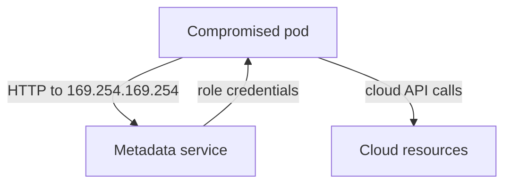

---
exam_objectives:
  - Cloud Provider and Infrastructure Security
---
# The Instance Metadata Service And Egress Control

A pod has a vulnerability that lets an attacker make the pod send a request to any address the attacker chooses. The attacker does not need the pod's service account token. If the node runs on a cloud virtual machine, a single request to one special local address can return the credentials of the machine's cloud role. This part explains that address, why it is dangerous, which controls exist at the cloud level, and how a Kubernetes NetworkPolicy can keep pods away from it.

## What the instance metadata service is

Cloud providers give every virtual machine a small HTTP service that describes the machine to itself. It is called the instance metadata service. It answers at a link-local address, which is an address that is valid only on the local network segment and is never routed across the internet. On the large public clouds this address is `169.254.169.254`. A process on the machine sends a plain HTTP request to it, with no password, because the network path itself is treated as proof that the caller is on the machine.

The service returns facts about the machine, such as its identifier, its region and its network settings. It can also return temporary credentials for the instance role attached to the machine. The credentials let the caller use the cloud API with the role's permissions. Software on the machine uses this feature so that no permanent key has to be stored on disk.

The problem is that a pod runs on a node, and by default a pod's traffic to `169.254.169.254` leaves the pod network and reaches the node's metadata service. A pod is not the machine, but the network cannot tell them apart. Any code that can send an HTTP request from inside a pod can ask for the node's role credentials.



The diagram shows the path: the pod asks the metadata service, receives credentials, and then calls the cloud API with the node's permissions.

## Why the node role is a large blast radius

The instance role belongs to the node, so every pod on the node can obtain the same credentials. The role often has permissions that the node needs, such as pulling images from a registry, attaching disks or describing machines. If an administrator also gave the role broad permissions for convenience, a compromised pod inherits them. This is how a flaw in one small application becomes access to cloud storage or to other machines.

Attackers often reach the metadata service through server-side request forgery (SSRF), a flaw where the application fetches a URL that an attacker controls. The attacker supplies the metadata address as the URL, and the application returns the response, including credentials. This is why the exam links the metadata service to application vulnerabilities and not only to node compromise.

## Cloud-level controls

The provider offers settings that reduce the risk, and they are the customer's to enable. The names differ per provider, but the ideas are the same.

- Require a session-oriented version of the metadata service. On one large provider this is Instance Metadata Service version 2 (IMDSv2): the caller must first send a request to get a session token and then send that token in a header. A simple forwarded request from an SSRF flaw usually cannot do both steps.
- Lower the hop limit. The hop limit is the number of network hops a metadata response may travel. Setting it to one keeps the response from reaching a pod that sits behind the node's network namespace.
- Give the node role the smallest permission set it needs, and use workload identity so pods obtain only their own cloud role.
- Turn the metadata service off on nodes that do not need it, where the platform allows it.

These controls live in the cloud account, not in Kubernetes. A cluster operator who only edits Kubernetes objects cannot enable them, so the responsibility matrix from the cloud side matters here.

## Blocking the address from inside the cluster

Kubernetes can add a second layer. A NetworkPolicy is a Kubernetes object that selects pods and says which traffic they may send or receive. Its `policyTypes` list says whether it controls `Ingress` (incoming traffic), `Egress` (outgoing traffic) or both. When a pod is selected by an Egress policy, only the destinations that the policy allows remain reachable. The destinations are written as `to` entries, and an `ipBlock` entry matches a range of IP addresses written as a CIDR, which is an address followed by a prefix length. An `ipBlock` can carry an `except` list of sub-ranges that the block does not match.

That gives a clear pattern: allow egress to every address except the metadata address. Save this as `networkpolicy-deny-metadata-egress.yaml`:

<!-- astrona:playground:renew -->

```yaml
apiVersion: networking.k8s.io/v1
kind: NetworkPolicy
metadata:
  name: deny-metadata-egress
  namespace: starfleet
spec:
  podSelector: {}
  policyTypes:
    - Egress
  egress:
    - to:
        - ipBlock:
            cidr: 0.0.0.0/0
            except:
              - 169.254.169.254/32
```

The empty `podSelector` selects every pod in the namespace. The single egress rule matches all IPv4 addresses except the one `/32` address, which is a range holding exactly one address. Apply it:

```sh
kubectl apply -f networkpolicy-deny-metadata-egress.yaml
```

Then check the result by reading the stored object back:

```sh
kubectl -n starfleet get networkpolicy deny-metadata-egress -o jsonpath='{.spec.egress[0].to[0].ipBlock}'
```

The command prints the `cidr` and the `except` list. Now check that ordinary traffic still works. The `shuttle` pod sends a request to the `scout` Service:

```sh
kubectl -n starfleet exec deploy/shuttle -- curl -s -o /dev/null -m 5 -w '%{http_code}\n' http://scout.starfleet.svc.cluster.local/healthz
```

The command prints `200`, because the policy leaves every other destination open. A policy that listed no egress rules at all would block all outgoing traffic, including requests to the cluster DNS Service, and would break the workloads.

## The limits of this control

A NetworkPolicy only works when the cluster's network plugin enforces it. The plugin is the component that implements pod networking, called the Container Network Interface (CNI) plugin. The API server accepts NetworkPolicy objects even when no plugin enforces them, and nothing warns you. Check your plugin's documentation before you rely on the policy.

The policy also covers only pods that use the pod network. A pod that sets `hostNetwork: true` shares the node's network namespace and is not controlled by a pod-level egress policy in the same way. Blocking the metadata address is one layer: the cloud settings above remain the primary control, and the policy is the Kubernetes-side backstop.

## What this part showed

The instance metadata service hands role credentials to any HTTP caller on the machine, which includes every pod on the node. Cloud settings such as a session-oriented metadata version and a low hop limit are the main defense. A NetworkPolicy with an `ipBlock` and an `except` entry adds a Kubernetes-side block that you can read and review in the object itself.

You now have three layers for identity and credentials: scope what an identity can do, remove tokens that no one needs, and block the route to node credentials. The module's other question, how network and storage boundaries protect the API endpoint, the nodes and the data, belongs to the control plane and nodes themselves.

## Common pitfalls

> [!WARNING]
> A NetworkPolicy object is not proof that traffic is blocked: only a network plugin that enforces policies makes it effective. Do not write an egress policy with no rules to "block only the metadata address": that blocks everything, including DNS. Use an `ipBlock` with `except` for the single address.
