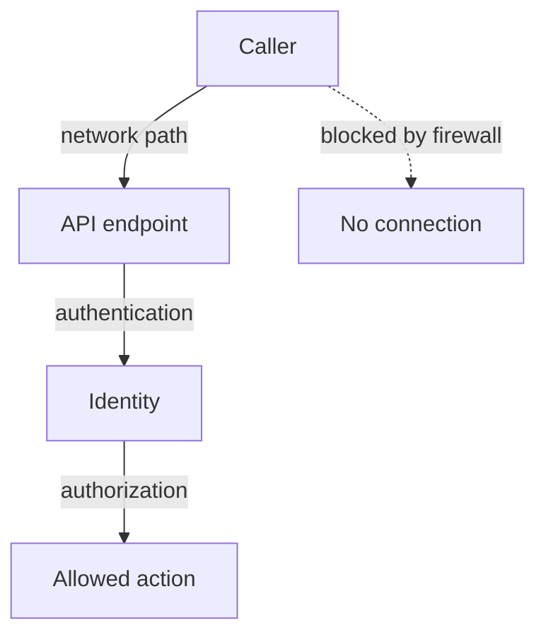

---
exam_objectives:
  - Cloud Provider and Infrastructure Security
---
# API Endpoint Exposure And Anonymous Access

Every action on a cluster passes through one door: the API server. A team decides to keep that door safe by putting it on a private network, and then assumes that nothing else needs protecting. Later a misconfigured binding lets any caller who reaches the endpoint read pods, and the private network is the only thing between the cluster and an attacker. This part separates the three controls that guard the API endpoint, so that you can tell which one failed in a scenario.

## Three controls on one request

A request to the API server meets three separate controls in a fixed order. First comes the network path. The caller must be able to open a connection to the endpoint, which depends on addresses, firewalls, private endpoints and allowed source ranges. Then comes authentication, which decides who the caller is. Last comes authorization, which decides what that identity may do.



The diagram shows that a blocked network path stops the request before any identity check, while a caller that reaches the endpoint depends on authentication and authorization alone.

In managed services, the network controls are cloud settings. The provider can expose the endpoint publicly, restrict it to a list of allowed source address ranges, or make it reachable only from a private network. In a self-managed cluster, the customer sets the same things with firewalls and load balancers. The customer owns this choice in both cases.

These controls do not replace each other. A private endpoint does not authorize anyone: a user inside the private network with a valid credential still needs RBAC permissions. A strong RBAC setup does not hide an endpoint: a public endpoint still accepts connections from the whole internet and exposes the API server's code to attack, for example through a vulnerability in the server itself. The safe design uses all three layers.

## What anonymous access is

Authentication can end in one of three outcomes. The API server recognizes the caller, rejects the credential, or finds no credential at all. If anonymous authentication is enabled, a request with no credential is not rejected at this stage. The API server treats it as the user `system:anonymous` in the group `system:unauthenticated`, and it passes the request to authorization.

Authorization then applies the RBAC rules. By default a small ClusterRole called `system:public-info-viewer` is bound to the `system:unauthenticated` and `system:authenticated` groups. It allows reading a few non-sensitive paths, such as `/healthz`, `/livez`, `/readyz` and `/version`. Nothing else is allowed. Anonymous authentication is enabled by default in the kube-apiserver. It can be turned off with the flag `--anonymous-auth=false`, which makes the API server reject credential-less requests with an authentication error.

The danger is a binding that gives more than the default. A well-meant `ClusterRoleBinding` that names the group `system:unauthenticated` gives its role to everyone who can open a connection to the endpoint, with no credential. The only remaining control is the network path.

## Finding anonymous access in the playground

The playground contains such a binding on purpose. `kubectl auth can-i` can ask the question for the anonymous identity. The flags `--as` and `--as-group` impersonate a user and a group, so the API server answers as if that caller had asked.

<!-- astrona:playground:renew -->

```sh
kubectl auth can-i list pods -n starfleet --as=system:anonymous --as-group=system:unauthenticated
```

The answer is `yes`. An unauthenticated caller can list the pods of `starfleet`. In a normal cluster the answer would be `no`. Compare it with a path that the default role allows:

```sh
kubectl auth can-i get /version --as=system:anonymous --as-group=system:unauthenticated
```

This answer is also `yes`, because of `system:public-info-viewer`. That one is expected. The first one is the problem. Find the binding that grants it. Each ClusterRoleBinding lists its subjects, so filter for the group:

```sh
kubectl get clusterrolebindings -o json | jq -r '.items[] | select(.subjects[]? | .name == "system:unauthenticated") | .metadata.name + " -> " + .roleRef.name'
```

The output lists two bindings. One is the built-in `system:public-info-viewer` binding. The other, `public-view`, gives the `view` ClusterRole to `system:unauthenticated`, which is the unwanted one. The `view` role lets a caller read most namespaced objects, but not secrets. Delete the unwanted binding:

```sh
kubectl delete clusterrolebinding public-view
```

Then check the result by asking the first question again:

```sh
kubectl auth can-i list pods -n starfleet --as=system:anonymous --as-group=system:unauthenticated
```

The answer is now `no`. The built-in binding stays, so the `/version` question still answers `yes`.

## Reading the API server flags

The API server flags show whether anonymous access is switched off. The flag is only present when someone sets it, so an absent flag means the default:

```sh
kubectl -n kube-system get pods -l component=kube-apiserver -o json | jq -r '.items[0].spec.containers[0].command[]' | grep -c 'anonymous-auth'
```

The command prints a count. A count of `0` means the flag is not set, so anonymous authentication has its default value. Many managed services leave anonymous authentication enabled and rely on RBAC, because health checks may need some unauthenticated paths. Whether you can change the flag depends on who runs the control plane, which brings back the responsibility split.

## Other ways in

Anonymous requests are not the only way to reach the API server without a personal account. Service account tokens work from anywhere that can reach the endpoint, not only from inside the cluster. A token stolen from a pod can be used from the attacker's own machine if the endpoint is public. Long-lived client certificates have the same property: the API server cannot revoke a certificate, so a leaked one is valid until it expires. That is why short-lived credentials and an endpoint that only the right networks can reach are used together.

Audit logging records what happened. The API server can write an audit log, a record of each request, with the user, the verb, the resource and the result. The customer must switch it on and ship it somewhere safe. In a managed service, the provider usually offers the log as a feature to enable.

## What this part showed

The network path, authentication and authorization are three controls that guard the API endpoint, and each fails differently. Anonymous authentication turns a request without credentials into `system:anonymous` in `system:unauthenticated`, which the default RBAC rules limit to a few public paths. A binding that names that group removes the credential requirement for its role. You found such a binding with `can-i` and `jq` and removed it.

The API server is not the only way to the cluster's power. A pod that runs on a node can sometimes reach the node itself, and the next question is how.

## Common pitfalls

> [!WARNING]
> A private or restricted endpoint does not authorize any caller, and RBAC does not hide a public endpoint. Do not bind roles to `system:unauthenticated` or `system:anonymous`, and do not treat `--anonymous-auth=false` as a replacement for scoped RBAC: both are needed. Also remember that deleting a binding does not undo reads that already happened.
