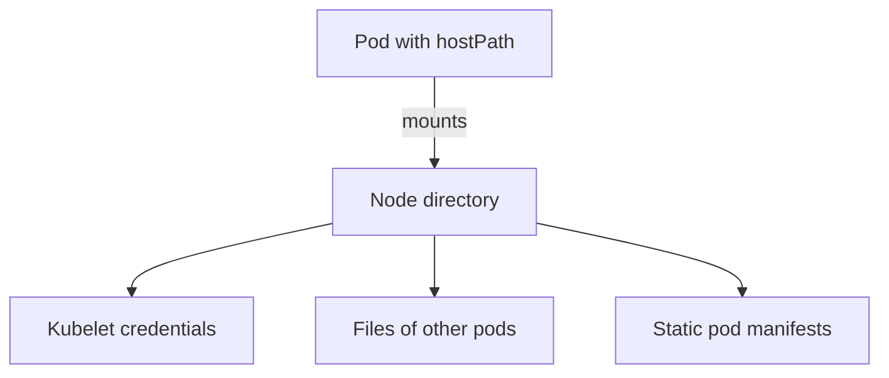

---
exam_objectives:
  - Cloud Provider and Infrastructure Security
---
# Node Access And Host Paths

A cluster user may create pods in one namespace, and the team treats that as a small permission. Then a pod arrives that mounts a directory of the node it runs on. From inside the pod, the user reads files that belong to the node and to every other pod on it. This part explains why access to a node is access to everything on that node, how a host path volume creates that access, and which control stops it.

## What a node is and what it holds

A node is a machine, physical or virtual, that runs pods. It runs a kubelet, which starts and monitors containers, and a container runtime, which creates the containers. A container is a process that the Linux kernel isolates with namespaces and control groups, but it shares the node's kernel and, unless told otherwise, does not see the node's files.

A node holds sensitive material. The kubelet keeps credentials to talk to the API server. The files of every pod on the node, including mounted secrets, are stored under the kubelet's directory. On a control plane node, the static pod manifests (files the kubelet reads to start the control plane components) and the cluster's certificates are also on disk. Someone who reads these files can often impersonate the node or the control plane.

This is why the infrastructure layer is the base of the cluster's trust. A compromise of the node operating system beats every control that runs above it, because those controls run on the node.

## How a host path volume opens the node

A pod normally sees only its own container file system. A `hostPath` volume is a volume type that mounts a file or directory of the node into the pod. It is meant for node-level agents such as log collectors. For any other pod, it is a hole in the isolation.



The diagram shows that a mounted node directory exposes what the node stores, not only what the pod owns.

The playground has a Deployment called `node-inspector` that mounts the node's `/etc/kubernetes` directory at `/node-etc` and runs as root. On a node that runs the control plane, that directory holds the static pod manifests and the cluster's certificates.

<!-- astrona:playground:renew -->

```sh
kubectl -n starfleet get deployment node-inspector -o json | jq '.spec.template.spec.volumes'
```

The output shows a volume with a `hostPath` entry that names `/etc/kubernetes`. Now read through the mount:

```sh
kubectl -n starfleet exec deploy/node-inspector -- ls /node-etc/manifests
```

The command lists the static pod manifest files of the control plane components. A user who can create the `node-inspector` pod has reached the node's file system and can read the definitions of the API server and etcd. A privileged container with the node's root directory mounted would reach even more, because it could change files.

## How RBAC fails to stop it

RBAC decides whether a user may create a pod. It does not look inside the pod. A user with permission to create pods in one namespace may therefore create a pod that mounts the node, unless another control inspects the pod specification.

The control for that is admission. An admission controller is code in the API server that checks or changes a request after authorization and before the object is stored. Pod Security Admission is the built-in admission controller that checks pods against the Pod Security Standards. The standards define three levels. The `privileged` level has no restrictions. The `baseline` level blocks known escalations. The `restricted` level follows current hardening practice.

The `baseline` level forbids host path volumes, host namespaces (`hostNetwork`, `hostPID` and `hostIPC`) and privileged containers. You pick the level and the mode with namespace labels. The mode `enforce` rejects pods that break the level, `audit` records a violation in the audit log, and `warn` shows a warning to the user. The label name is `pod-security.kubernetes.io/<mode>`.

## Testing the level before enforcing it

A server-side dry run shows what a label would do without changing the namespace. `--dry-run=server` sends the request to the API server, which runs all checks and then discards the result:

```sh
kubectl label --dry-run=server --overwrite namespace starfleet pod-security.kubernetes.io/enforce=baseline
```

The command prints a warning that existing pods in the namespace violate the new level, and it names `node-inspector` and the reason, a host path volume. The label itself is not applied. This is the safe way to test a level: a label that enforces a level never removes pods that already run, but it makes their next restart fail.

Enforce the level, then delete the pod's Deployment, which is the correct fix for a workload that needs the node's files and has no good reason to have them:

```sh
kubectl label --overwrite namespace starfleet pod-security.kubernetes.io/enforce=baseline
kubectl -n starfleet delete deployment node-inspector
```

Prove that the API server now refuses such a pod. Save this as `pod-hostpath-test.yaml`:

```yaml
apiVersion: v1
kind: Pod
metadata:
  name: hostpath-test
  namespace: starfleet
spec:
  containers:
    - name: probe
      image: curlimages/curl:8.22.0
      command: ["sleep", "30"]
      volumeMounts:
        - name: node-etc
          mountPath: /node-etc
  volumes:
    - name: node-etc
      hostPath:
        path: /etc/kubernetes
```

Send it to the API server as a dry run, so that nothing is created:

```sh
kubectl apply --dry-run=server -f pod-hostpath-test.yaml
```

Then check the result: the command fails with a Forbidden error whose text says the pod violates PodSecurity `baseline` and names the host path volume. The workloads that already comply with `baseline`, such as `scout`, keep running and can be restarted.

## Other node-level exposure

A host path is one route. The node can also be reached through the kubelet's own API, which listens on a port on each node. If it allows anonymous requests or accepts requests without authorization, an attacker on the network can run commands in pods. A secure kubelet disables anonymous access and uses webhook authorization, which asks the API server to decide. A `hostNetwork: true` pod shares the node's network namespace and can reach services that listen only on the node's loopback address. Both are node boundaries that Pod Security Standards and kubelet settings control.

In managed services the provider hardens the node image and the kubelet defaults, and the customer still owns which pods may run. This is the same split as before: the platform is the provider's, and the admission policy is the customer's.

## What this part showed

Access to a node is access to its files, its credentials and every pod on it. A `hostPath` volume mounts node files into a pod. RBAC cannot stop it, because RBAC does not read the pod specification. Pod Security Admission can: the `baseline` level forbids host path volumes, privileged containers and host namespaces, and a dry run tests a level before it is enforced.

Stopping an attacker from reaching the node protects the data that the cluster holds. The next question is what happens to that data when someone reads the storage directly.

## Common pitfalls

> [!WARNING]
> An enforce label does not remove pods that already run: they keep their host path until they are deleted or restarted. Also do not assume read-only mounts are safe: a read-only host path still exposes credentials and certificates. And do not rely on a pod running as a non-root user to protect node files, because file permissions on the node decide, and many node files are readable by more than root.
