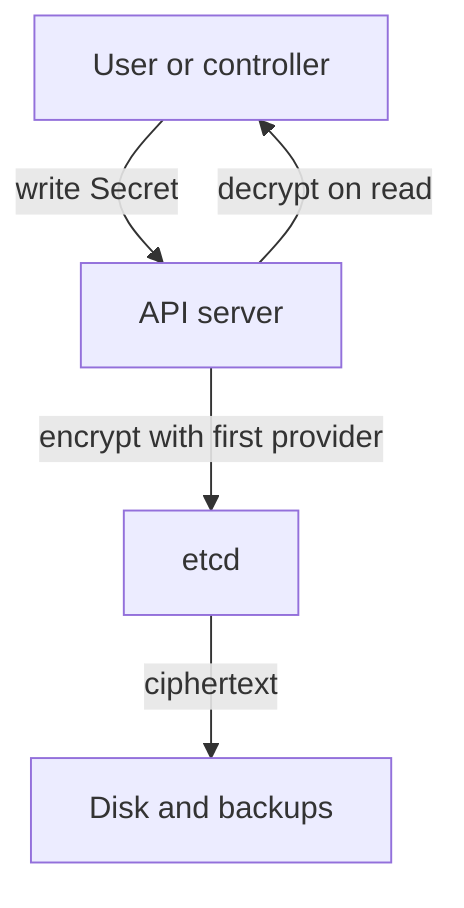

---
exam_objectives:
  - Cloud Provider and Infrastructure Security
---
# Data At Rest, Keys And Backups

A cluster stores everything it knows in one place: the Secrets, the configuration and the state of every workload. A disk is lost or a backup is copied, and the people who find it read the cluster's passwords in plain text. Encryption at rest exists for that case. This part explains what the cluster stores and where, how Kubernetes encrypts its own data, what disk encryption adds, and which paths still expose plain data.

## Where cluster data lives

Kubernetes keeps all API objects in etcd, a distributed key-value database. Every Deployment, ConfigMap, Secret and RBAC rule is a record in etcd. The API server is the only component that should read and write it, and it does so over a network connection that uses certificates. Whoever reads the etcd files, or a copy of them, reads the cluster state.

A Secret is the Kubernetes object meant for small sensitive values, such as passwords and tokens. The value is stored base64-encoded. Base64 is an encoding that turns bytes into text, not encryption: anyone can decode it. By default the API server writes the encoded value into etcd without encrypting it, so a copy of the etcd data contains every secret in readable form.

The playground has a Secret called `drive-credentials`. Read it as an authorized user and decode it:

<!-- astrona:playground:renew -->

```sh
kubectl -n starfleet get secret drive-credentials -o jsonpath='{.data.token}' | base64 -d
```

The command prints the value that was stored. No key was needed, only the permission to get the secret. Anyone with `get` on secrets, anyone who reads the etcd data and anyone who finds a backup has the same ability.

## Encryption at rest in the API server

The API server can encrypt chosen resources before it writes them to etcd. The feature is called encryption at rest. It is switched on by the flag `--encryption-provider-config`, which names a file with an `EncryptionConfiguration` object. This file is read by the API server on the control plane node. It is not applied with `kubectl`.

The file lists resources and the providers that protect them. A provider is the method that encrypts and decrypts. The main providers are `identity`, which stores the data unencrypted, `aescbc`, `aesgcm` and `secretbox`, which encrypt with a key stored in the file, and `kms`, which asks an external Key Management Service (KMS) to do the work. The first provider in the list encrypts new writes. On a read, the API server tries the providers in order until one can decrypt the data.

```yaml
apiVersion: apiserver.config.k8s.io/v1
kind: EncryptionConfiguration
resources:
  - resources:
      - secrets
    providers:
      - aescbc:
          keys:
            - name: key1
              secret: <base64-encoded 32-byte key>
      - identity: {}
```

This sample encrypts Secrets with a local AES-CBC key. The `identity` provider at the end lets the API server still read secrets that were written before encryption was turned on. The sample key is a placeholder: never put a real key in documentation or version control. Objects written earlier stay unencrypted until they are written again, so after enabling encryption the operator rewrites them, for example with `kubectl get secrets --all-namespaces -o json | kubectl replace -f -`.



The diagram shows that encryption and decryption happen in the API server, so etcd and every backup of it hold ciphertext.

A local key in the file protects against theft of the etcd data, but not against theft of the file, because the key sits on the same control plane node. A KMS provider is stronger: the key stays in an external service and the API server sends it only data keys to wrap. Managed services usually expose this as a setting where the customer chooses the key in the cloud's key service.

Check whether the playground cluster uses the feature:

```sh
kubectl -n kube-system get pods -l component=kube-apiserver -o json | jq -r '.items[0].spec.containers[0].command[]' | grep -c 'encryption-provider-config'
```

The count is `0` when the flag is absent. In that case the Secret above is stored unencrypted in etcd. The playground does not change this, because the flag belongs to a control plane file that only the operator of the node can edit.

## What encryption at rest does not protect

Encryption at rest protects the stored copy: the etcd files, snapshots and the disk. It does not protect the data in use. The API server decrypts a Secret for any caller that RBAC allows, so a user with `get` on secrets reads plain text. A pod that mounts the Secret sees plain text too. That is why access control on secrets matters as much as encryption.

The playground shows the second gap. The service account `scout` has a Role that allows `get` and `list` on secrets in `starfleet`:

```sh
kubectl auth can-i get secrets -n starfleet --as=system:serviceaccount:starfleet:scout
```

The answer is `yes`. `scout` serves HTTP and never needs the secret. If an attacker takes over the `scout` pod, the attacker's first call returns every Secret in the namespace, however well etcd is encrypted. The fix is a Role that grants only the objects the workload reads, for example one ConfigMap named `fleet-settings`. Save this as `role-scout-config.yaml`:

```yaml
apiVersion: rbac.authorization.k8s.io/v1
kind: Role
metadata:
  name: scout-config-reader
  namespace: starfleet
rules:
  - apiGroups: [""]
    resources: ["configmaps"]
    resourceNames: ["fleet-settings"]
    verbs: ["get"]
---
apiVersion: rbac.authorization.k8s.io/v1
kind: RoleBinding
metadata:
  name: scout-config-reader
  namespace: starfleet
subjects:
  - kind: ServiceAccount
    name: scout
    namespace: starfleet
roleRef:
  apiGroup: rbac.authorization.k8s.io
  kind: Role
  name: scout-config-reader
```

Apply it and remove the broad grant:

```sh
kubectl apply -f role-scout-config.yaml
kubectl -n starfleet delete rolebinding scout-secrets
```

Then check the result:

```sh
kubectl auth can-i get secrets -n starfleet --as=system:serviceaccount:starfleet:scout
kubectl auth can-i get configmaps/fleet-settings -n starfleet --as=system:serviceaccount:starfleet:scout
```

The first answer is `no`. The second answer is `yes`: `can-i` reads the part after the slash as the name of one object, and the new Role allows `get` on exactly that ConfigMap. The service account now reads its settings and can no longer read any Secret.

## Disk encryption, keys and backups

Disk encryption is a separate control that the cloud or the operating system provides. It encrypts the whole volume under the node and under persistent volumes. It protects a stolen or discarded disk. It does not protect against a running node: the operating system sees plain data, so a process on the node reads files normally. Disk encryption and API-level encryption therefore protect different copies of the data and do not replace each other.

Keys are the weak point of any encryption. Key access must be limited to the services that need it, rotation must be planned, and recovery must be tested, because losing the key means losing the data. Backups carry the same data as the live system. An etcd snapshot taken with `etcdctl snapshot save` is a full copy of the cluster state, including Secrets. If encryption at rest is on, the snapshot holds ciphertext, and the key must be stored apart from it. A backup stored with broad read access is a second path to the same secrets.

## What this part showed

Secrets are encoded, not encrypted, and the API server stores them in etcd unless encryption at rest is configured. The `EncryptionConfiguration` file lists resources and providers, the first provider encrypts new writes, and a KMS provider keeps the key outside the cluster. Encryption at rest protects the stored copy, but not the reads that RBAC allows, so a Role that grants only the needed objects is a separate control. Disk encryption, key management and backup access complete the picture.

You now have the three boundaries of the infrastructure layer: the endpoint, the node and the stored data.

## Common pitfalls

> [!WARNING]
> Base64 is not encryption, and encryption at rest does not hide a Secret from a caller that RBAC allows to read it. Do not store the encryption key next to the data it protects, and do not forget to rewrite existing Secrets after turning encryption on. Also check who can read backups: a snapshot is a copy of every Secret.
