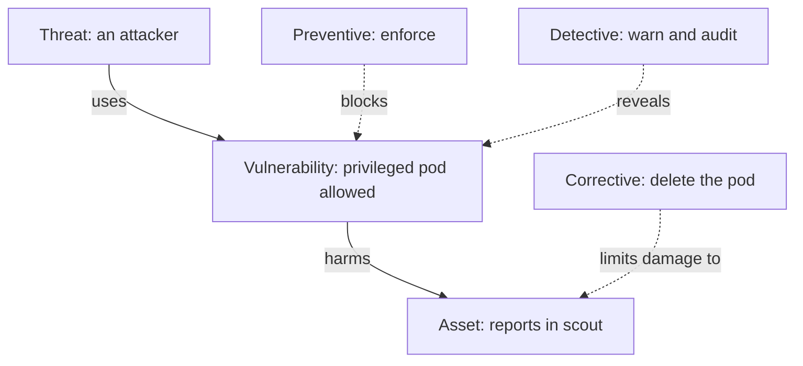

# From A Security Goal To A Verifiable Control

The `scout` service in the `starfleet` namespace stores confidential reports. A team writes the sentence "no pod may run with extra privileges" in a security policy and considers the matter closed. Nothing in the cluster reads that sentence. A pod that asks for extra privileges is still created. This part explains the words the KCSA (Kubernetes and Cloud Native Security Associate) exam uses to talk about this gap, and it shows one control working in three different ways on the same pod.

## Threat, vulnerability, risk and control

A threat is something that can cause harm, for example an attacker who wants the reports in `scout`. A vulnerability is a weakness that lets the threat succeed, for example a pod that may run with the `privileged` setting and so reach the node. Risk is the combination of how likely the harm is and how bad it would be in this environment. A security control is a measure that reduces that risk.

These four words describe a chain. A threat uses a vulnerability, the result harms an asset, and a control interrupts the chain at some point. The asset is the thing you protect. Write the asset first, because "make the cluster secure" is too vague to test. "Only approved pods run in `starfleet`" names the asset (the namespace) and the expected behavior, and you can check it.

Risk always depends on context. A privileged pod in a throwaway test cluster is a smaller risk than the same pod next to confidential reports. The exam expects you to say "it depends on likelihood and impact", not "it is always critical".

## Preventive, detective and corrective controls

Controls are grouped by what they do to the chain of harm. A preventive control stops the harmful action before it happens. A detective control notices the action and records or reports it, but lets it happen. A corrective control reduces the damage after the action, or restores the system to a good state.

In Kubernetes, one feature can play more than one of these roles. Pod Security Admission is built into the API server (the control plane component that receives every request). It checks each new pod against a Pod Security Standards level. The levels are `privileged` (no restrictions), `baseline` (blocks known privilege escalations) and `restricted` (follows current hardening practice). You pick what happens on a violation with a mode label on the namespace:

- `enforce`: the API server rejects the pod. This is a preventive control.
- `warn`: the API server accepts the pod and sends a warning to the user. This is a detective control, because it reveals the violation.
- `audit`: the API server accepts the pod and adds an annotation to the audit log event. This is also a detective control, with a record for later review.

Deleting the offending pod, or the Deployment that creates it, is a corrective action. The mode labels have the form `pod-security.kubernetes.io/<mode>: <level>`.



The diagram shows that the three control types act on different points of the same chain. A policy sentence is not in the diagram, because it acts on nothing.

## Seeing one control work three ways

The playground has a `starfleet` namespace with no Pod Security labels, so it checks nothing. It also runs a Deployment called `debug-tools` with a privileged container, on purpose. First ask the API server what a stricter level would say about the pods that already run. A server-side dry run sends the request through admission and then discards it.

<!-- astrona:playground:renew -->

```sh
kubectl label --dry-run=server --overwrite namespace starfleet pod-security.kubernetes.io/warn=baseline
```

The command prints warnings that name the pod of `debug-tools` and the settings that break `baseline`. Nothing in the cluster changed. Now set the detective modes for real.

Save this as `namespace-starfleet-detective.yaml`:

```yaml
apiVersion: v1
kind: Namespace
metadata:
  name: starfleet
  labels:
    pod-security.kubernetes.io/warn: baseline
    pod-security.kubernetes.io/audit: baseline
```

Apply it:

```sh
kubectl apply -f namespace-starfleet-detective.yaml
```

Then check the result. Create a privileged pod with a server-side dry run, so nothing is left behind. The file below is the pod to try.

Save this as `pod-trial-privileged.yaml`:

```yaml
apiVersion: v1
kind: Pod
metadata:
  name: trial-privileged
  namespace: starfleet
spec:
  containers:
    - name: trial
      image: curlimages/curl:8.22.0
      command: ["sleep", "60"]
      securityContext:
        privileged: true
```

Run it as a dry run:

```sh
kubectl apply --dry-run=server -f pod-trial-privileged.yaml
```

The request succeeds and the output ends with `pod/trial-privileged created (server dry run)`, but a warning above it says the pod violates PodSecurity `baseline`. The control detected the violation and did not stop it. Now change the mode of the same label to `enforce` and repeat the request.

```sh
kubectl label --overwrite namespace starfleet pod-security.kubernetes.io/enforce=baseline
kubectl apply --dry-run=server -f pod-trial-privileged.yaml
```

This time the API server refuses the pod with an error that contains `violates PodSecurity "baseline:latest"` and names the field `privileged`. The same rule is now a preventive control.

## What a control does not do

Look at the pod of `debug-tools` once more with `kubectl -n starfleet get pods`. It is still running. The `enforce` label only decides about new pods, so it never removes a pod that already runs. A control that prevents is not a control that cleans up. The corrective step is a separate action.

```sh
kubectl -n starfleet delete deployment debug-tools
```

The output is `deployment.apps "debug-tools" deleted from starfleet namespace`. Deleting the Deployment, not only the pod, matters, because the Deployment controller would otherwise start a new pod to replace the deleted one, and the new pod would be rejected by the label and hidden in the ReplicaSet events.

## Policy, control and evidence

A policy states the intended rule. A control makes the rule happen or makes a violation visible. Evidence shows that the control is in effect. For the privileged pod, the evidence is the label on the namespace and the rejection of a test pod, not the sentence in the policy document.

A control also needs an owner who reviews it, a defined response when it fails, and a way to handle justified exceptions. Labels can be removed, and the audit log can stop collecting. A control that nobody reviews slowly stops matching the policy.

You now know the vocabulary and have seen that the mode decides the control type. The open question is where the list of controls comes from, and how a team shows that it covers the list.

## Common pitfalls

> [!WARNING]
> A written policy is not a control. `warn` and `audit` do not block anything, so a namespace that only warns still admits privileged pods. Setting `enforce` does not remove pods that already run. A passed test pod shows the control works for that one pod spec and not that every risk is covered.
