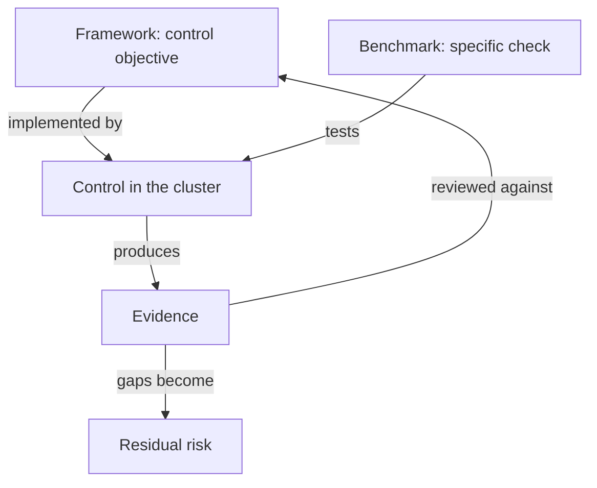

# Frameworks, Benchmarks And Evidence

A security team can invent controls one by one, but it then has no way to know what it forgot. Auditors, customers and regulators also ask the same question: how do you show that your controls are complete and working? Frameworks and benchmarks exist to answer both questions in a shared language. This part explains what each kind of document is for, the names the KCSA (Kubernetes and Cloud Native Security Associate) exam uses, and how a team collects evidence from a live cluster.

## Frameworks, standards and benchmarks

A framework is a structured list of security activities or control goals. It tells an organization what to cover, but usually not how to configure a particular product. A standard or regulation is a framework that an organization must or chooses to be assessed against. A benchmark is a detailed list of configuration recommendations for one product, with a check for each one.

The documents the exam names fall into these groups:

- The NIST Cybersecurity Framework (CSF), from the United States National Institute of Standards and Technology, organizes work into functions such as Identify, Protect, Detect, Respond and Recover. Version 2.0 adds Govern.
- The CIS Kubernetes Benchmark, from the Center for Internet Security, lists configuration checks for the control plane, the worker nodes and the policies in a cluster. Each item says how to audit it and how to remediate it.
- PCI DSS (Payment Card Industry Data Security Standard) is a standard for organizations that handle payment card data. It requires controls such as network segmentation and access control, and it is audited.
- NIST SSDF (Secure Software Development Framework) and SLSA (Supply-chain Levels for Software Artifacts, pronounced "salsa") describe practices and levels for building software and its artifacts safely.
- STRIDE is a threat modeling method, not a control list. It is covered in the next part.

The important difference is the level of detail. A framework says "restrict who can administer the system". A benchmark says which flag or object must have which value. A team uses the framework to organize work and the benchmark to check configuration.

## From objective to evidence

Every framework entry turns into the same chain. The control objective states the goal. The control is what the team builds. The evidence is the observable result that proves the control is in effect. An auditor reads evidence, not intentions.



The diagram shows that the framework sets the question, the benchmark tests the control, and the evidence goes back to the framework. A gap in the evidence is residual risk, which is the risk that remains after the controls.

Good evidence shows the effective state, not the planned state. A manifest file in a Git repository says what someone asked for. It does not show what the API server accepted, or what another tool changed later. Evidence from the live API is stronger than evidence from a file.

## Collecting evidence with kubectl and jq

Some CIS Benchmark items can be checked through the Kubernetes API. The items about control plane files and kubelet flags cannot, because they are properties of files and processes on the nodes. Tools such as kube-bench run those node checks. Here you collect API evidence yourself with `kubectl` and `jq` (a command-line JSON processor). The playground has a `starfleet` namespace, an `outpost` namespace and a privileged Deployment called `debug-tools`.

First, which namespaces enforce a Pod Security level? The expression `// "none"` prints `none` when the label is missing.

<!-- astrona:playground:renew -->

```sh
kubectl get namespaces -o json | jq -r '.items[] | [.metadata.name, (.metadata.labels["pod-security.kubernetes.io/enforce"] // "none")] | @tsv'
```

The output has one line per namespace. Namespaces that the playground did not label show `none`. That line is a finding: no preventive control exists there.

Second, which running pods have a privileged container?

```sh
kubectl get pods -A -o json | jq -r '.items[] | select(any(.spec.containers[]; .securityContext.privileged == true)) | "\(.metadata.namespace)/\(.metadata.name)"'
```

The output lists the `debug-tools` pod in `starfleet`. Third, which cluster role bindings grant the `cluster-admin` role, the role that allows every action on every resource?

```sh
kubectl get clusterrolebindings -o json | jq -r '.items[] | select(.roleRef.name == "cluster-admin") | .metadata.name'
```

Fourth, which pods receive a service account token? The kubelet (the agent on each node) mounts a token into every pod at `/var/run/secrets/kubernetes.io/serviceaccount` unless the pod or its service account sets `automountServiceAccountToken` to `false`. A pod that never calls the API does not need the token, and a stolen token is a credential.

```sh
kubectl get pods -A -o json | jq -r '.items[] | select(any(.spec.containers[].volumeMounts[]?; .mountPath == "/var/run/secrets/kubernetes.io/serviceaccount")) | "\(.metadata.namespace)/\(.metadata.name)"'
```

The command lists the workload pods in `starfleet` and `outpost`, and it also lists system pods in `kube-system`. Each command is a small, repeatable test with a clear pass or fail meaning. A team can run the same commands every week and compare the results, and that history is the evidence.

## Mapping the findings to framework functions

The four queries above also fit the functions of the NIST Cybersecurity Framework. The namespace and privileged pod lists are Identify activities, because they find what exists and where the weak points are. Adding an `enforce` label is a Protect activity. Reviewing the audit annotations that `audit` mode writes is a Detect activity. Removing a pod and restoring a good state belongs to Respond and Recover.

A mapping like this lets an auditor read the cluster state in the framework's own words. It also shows which function has no evidence yet. A team that has many Protect controls and no Detect evidence knows where to work next.

## Reading a finding

A finding is a difference between the objective and the evidence. Decide what it means before you fix it. The `debug-tools` pod breaks the objective "no privileged pods". The team can remove the pod (the risk disappears), restrict it, or accept the risk with a written reason. Each choice is valid in the right context. What is not valid is to leave the finding without an owner.

A benchmark also needs judgment. A generic checklist item can be wrong for your workload. The correct response is to record why the item does not apply and which other control covers the same risk. That record is a documented exception, and an auditor accepts it more readily than silence.

Passing a benchmark does not make a cluster secure. The benchmark covers the configuration items that its authors chose. It does not cover your application logic, your credentials in other systems or a new vulnerability. A clean report is evidence about those items only.

You now know how a framework turns into a control and evidence, and how to gather the evidence from the API. The remaining question is how a team decides which risks deserve a control at all, and what to do with the risk that a control leaves behind.

## Common pitfalls

> [!WARNING]
> A framework is not a configuration guide, and a benchmark is not a threat model. Evidence from a manifest file does not prove the live state. A clean `jq` query is evidence about that one question only. A node-level CIS item cannot be checked with `kubectl`, so a clean API audit does not cover it.
