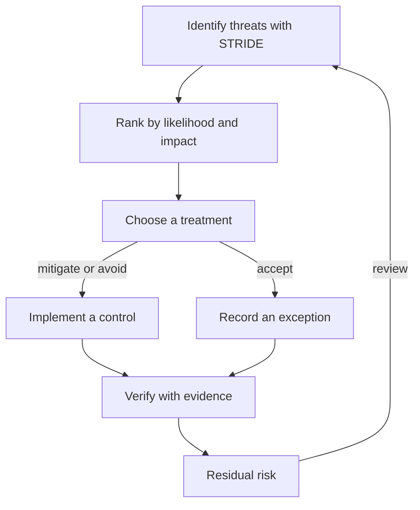

# Threat Modeling And Residual Risk

A team cannot build every possible control, so it must decide where to spend effort. Threat modeling is the practice of listing what can go wrong with a system before it goes wrong, and ordering the list by risk. This part explains the STRIDE categories that the KCSA (Kubernetes and Cloud Native Security Associate) exam uses, the four ways to treat a risk, and how a justified exception is recorded and watched.

## The STRIDE categories

STRIDE is a mnemonic from Microsoft. Each letter names one kind of threat, and each kind violates one security property. Reading a design with these six questions finds threats that a checklist can miss.

| Letter | Threat | Property it breaks | Cluster example |
| --- | --- | --- | --- |
| S | Spoofing | Authentication | A client presents a stolen service account token |
| T | Tampering | Integrity | A user changes a Deployment image through a broad role |
| R | Repudiation | Non-repudiation | An action leaves no audit log entry, so nobody can prove who did it |
| I | Information disclosure | Confidentiality | A pod reads a Secret that it does not need |
| D | Denial of service | Availability | One pod uses all the memory of a node |
| E | Elevation of privilege | Authorization | A pod runs privileged and reaches the node |

Each row points to a type of control. Authentication and short-lived credentials answer spoofing. Role-based access control (RBAC) and admission checks answer tampering and elevation of privilege. The audit log answers repudiation. Limiting what a pod can read answers information disclosure. Resource requests, limits and quotas answer denial of service.

A threat model works on a diagram of the system. You mark the trust boundaries, which are the places where data or requests cross from one level of trust to another, for example from the internet to a Service, or from a pod to the API server. Then you apply the six questions at each boundary.

## From threats to risk

A threat becomes a risk when you add likelihood and impact for your environment. A simple scale of low, medium and high for each is enough for the exam. A high likelihood and high impact threat comes first. A low likelihood and low impact threat may be accepted.

Once you rank a risk, you have four standard treatments:

- Mitigate: add or strengthen a control to reduce likelihood or impact.
- Avoid: remove the activity that creates the risk, for example delete the privileged workload.
- Transfer: move part of the risk to another party, for example to a cloud provider by contract or to an insurer.
- Accept: keep the risk on purpose, with a written reason and an owner.

Residual risk is what remains after the treatment. Mitigation almost never brings the risk to zero. The honest statement is "the privileged pod is blocked by `enforce` in `starfleet`, and the remaining risk is a user who can change the namespace labels". The next risk in the chain is now visible and can be ranked too.



The diagram shows a loop, not a line: residual risk goes back into the next review.

## Accepting a risk on purpose

Some teams really need a privileged pod, for example a node diagnostics tool. Removing it is not always possible, so the team accepts the risk but limits its reach. In Kubernetes the Pod Security labels work per namespace, so the exception gets its own namespace. The namespace allows `privileged`, but it still warns and audits at `baseline`, so every use of the exception is visible. That is acceptance with a compensating detective control.

The playground has a `starfleet` namespace with a privileged Deployment called `debug-tools`. First give `starfleet` a preventive control, and then create the exception namespace.

<!-- astrona:playground:renew -->

Save this as `namespace-starfleet-enforce.yaml`:

```yaml
apiVersion: v1
kind: Namespace
metadata:
  name: starfleet
  labels:
    pod-security.kubernetes.io/enforce: baseline
    pod-security.kubernetes.io/warn: baseline
```

Apply it:

```sh
kubectl apply -f namespace-starfleet-enforce.yaml
```

Then check the result. The command reports a warning about the existing `debug-tools` pod, and the label is applied. Now save this as `namespace-ops-exception.yaml`:

```yaml
apiVersion: v1
kind: Namespace
metadata:
  name: ops
  labels:
    pod-security.kubernetes.io/enforce: privileged
    pod-security.kubernetes.io/warn: baseline
    pod-security.kubernetes.io/audit: baseline
```

Apply it:

```sh
kubectl apply -f namespace-ops-exception.yaml
```

Then check the result by trying the same privileged pod in both namespaces with a server-side dry run. Save this as `pod-trial-privileged.yaml`, using the name `trial-privileged` and the image `curlimages/curl:8.22.0` with `securityContext.privileged: true`, and without a namespace in the file:

```yaml
apiVersion: v1
kind: Pod
metadata:
  name: trial-privileged
spec:
  containers:
    - name: trial
      image: curlimages/curl:8.22.0
      command: ["sleep", "60"]
      securityContext:
        privileged: true
```

Run the pod in each namespace:

```sh
kubectl -n starfleet apply --dry-run=server -f pod-trial-privileged.yaml
kubectl -n ops apply --dry-run=server -f pod-trial-privileged.yaml
```

The first command is refused with a `violates PodSecurity "baseline:latest"` error. The second command succeeds, with a warning that the pod would violate `baseline`. The risk is not gone in `ops`. It is accepted, contained in one namespace and visible through the warning and the audit annotation.

## Keeping the exception honest

An exception needs three things to stay honest: a named owner, a reason and a review date. The cluster cannot store these in a Pod Security label, so teams put them in annotations or in their risk register. Without a review, the exception grows. Another team notices that `ops` allows privileged pods and uses it for its own workload.

Control the people who can change the labels, too. Anyone who may update a namespace can remove `enforce` from it. That is a residual risk of the control itself, and an RBAC rule on `namespaces` is the control that covers it. Each control has a limit, and the next control covers it. This is the idea behind the layers of defense in depth.

You can now go from a threat to a ranked risk, a treatment and a recorded exception, and you have seen a contained exception work in a cluster. A framework, a benchmark and a threat model all help, but all of them describe a rule. The next step in a real platform is to enforce a team's own rules automatically, for rules that Pod Security cannot express.

## Common pitfalls

> [!WARNING]
> Accepting a risk is a decision with an owner, not a default. An exception namespace that only allows `privileged` and has no `warn` or `audit` label hides its use. Residual risk never reaches zero, so a report that says "risk eliminated" is wrong. STRIDE finds threats, but it does not rank them, so you still need likelihood and impact.
