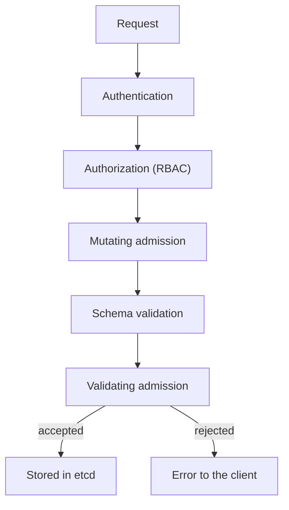

# From A Written Policy To An Admission Check

A security policy says "every container must have a memory limit", because one container without a limit can use all the memory of a node and stop its neighbors. People forget rules, and reviewers miss them. The cluster itself can check the rule on every request, before anything is stored. This part explains the admission step of the Kubernetes API server and builds one check with a ValidatingAdmissionPolicy, which is a policy written as data and evaluated inside the API server.

## Where admission happens

Every request to the Kubernetes API server (the control plane component that receives all requests) passes through a fixed order of steps. First the server authenticates the caller, which proves who it is. Then it authorizes the request, which decides whether that caller may do the action. After that, admission controllers run. An admission controller is code in the API server that can change or reject a request after authorization and before the object is stored.

Admission has two phases. Mutating admission can change the object, for example add a default value. Validating admission can only accept or reject. A request that passes both phases is stored in etcd, the key-value database of the cluster.



The diagram shows that validating admission is the last gate before storage, so a rule placed there applies to every client: `kubectl`, a pipeline and a controller.

RBAC (role-based access control) answers "may this user create a Deployment". It does not look at what the Deployment contains. Admission answers "is this Deployment acceptable". The two controls are different layers, and a team needs both.

## The ValidatingAdmissionPolicy

A ValidatingAdmissionPolicy is an object in the API group `admissionregistration.k8s.io/v1`. It is a built-in feature, generally available since Kubernetes 1.30, so no webhook server and no extra tool are needed. It has two parts that you create separately. The policy says what to match and what to check. The binding says where the policy applies and what happens on a failure.

The policy has three fields to know:

- `matchConstraints.resourceRules` lists the API groups, versions, operations and resources that the policy looks at.
- `validations` is a list of rules. Each rule has an `expression` written in CEL, the Common Expression Language. If the expression returns `false`, the rule fails.
- `failurePolicy` says what happens when the policy itself cannot be evaluated: `Fail` rejects the request and `Ignore` lets it through.

Inside a CEL expression, the variable `object` is the new object from the request. The expression `object.spec.replicas <= 5` is a valid rule. The rule below uses the standard CEL macro `all`, which is true when the test holds for every item of a list.

The policy below has a rule for Deployments. Every container in the pod template must set `resources.limits.memory`. The `has()` function tests that a field exists, and it stops the expression from failing when the field is missing. The `message` is what the client reads when the rule fails.

## Creating the check

Start with the policy alone to see that it does nothing yet. The playground has the `starfleet` namespace with `scout`, `probe` and `shuttle`. The `probe` Deployment has no memory limit, on purpose.

<!-- astrona:playground:renew -->

Save this as `validatingadmissionpolicy-require-memory-limits.yaml`:

```yaml
apiVersion: admissionregistration.k8s.io/v1
kind: ValidatingAdmissionPolicy
metadata:
  name: require-memory-limits
spec:
  failurePolicy: Fail
  matchConstraints:
    resourceRules:
      - apiGroups: ["apps"]
        apiVersions: ["v1"]
        operations: ["CREATE", "UPDATE"]
        resources: ["deployments"]
  validations:
    - expression: "object.spec.template.spec.containers.all(c, has(c.resources) && has(c.resources.limits) && 'memory' in c.resources.limits)"
      message: "Every container must set resources.limits.memory."
      reason: Invalid
```

Apply it:

```sh
kubectl apply -f validatingadmissionpolicy-require-memory-limits.yaml
```

Then check the result. A server-side dry run creates a Deployment without a limit through the full admission chain and then discards it:

```sh
kubectl -n starfleet create deployment trial-nolimits --image=ghcr.io/stefanprodan/podinfo:6.15.0 --dry-run=server
```

The command succeeds with `deployment.apps/trial-nolimits created (server dry run)`. A policy without a binding has no effect, because nothing tells the API server where to use it.

## The binding

A ValidatingAdmissionPolicyBinding connects a policy to a scope. `policyName` names the policy. `validationActions` says what the API server does on a failure, and `matchResources` narrows the scope, for example with a `namespaceSelector` that matches namespace labels. Every namespace has the label `kubernetes.io/metadata.name` with its own name, so a selector can pick one namespace without a label of your own.

Save this as `validatingadmissionpolicybinding-require-memory-limits.yaml`:

```yaml
apiVersion: admissionregistration.k8s.io/v1
kind: ValidatingAdmissionPolicyBinding
metadata:
  name: require-memory-limits-starfleet
spec:
  policyName: require-memory-limits
  validationActions: ["Deny"]
  matchResources:
    namespaceSelector:
      matchLabels:
        kubernetes.io/metadata.name: starfleet
```

Apply it:

```sh
kubectl apply -f validatingadmissionpolicybinding-require-memory-limits.yaml
```

Then check the result. The API server needs a short time to compile the policy and start using the binding, so repeat the command after a few seconds if it still succeeds:

```sh
kubectl -n starfleet create deployment trial-nolimits --image=ghcr.io/stefanprodan/podinfo:6.15.0 --dry-run=server
```

The API server now rejects the request. The error starts with `ValidatingAdmissionPolicy 'require-memory-limits' with binding 'require-memory-limits-starfleet' denied request:` and ends with your message. The error names both objects, so you always know which policy to read. The same command with `-n outpost` is still accepted, because the binding selects only `starfleet`.

## Why this is a control

This check is a preventive control, because the API server stops the request. It is also evidence: the policy and the binding are objects that anyone can read with `kubectl get`, so an auditor does not need to trust a document. The check belongs to the cluster and applies to every client, which a rule in a pipeline script does not.

You now know where admission sits, how a policy and a binding work together, and how to prove a rejection. A new strict rule can break working systems, so the next question is how to turn a rule on without causing an outage.

## Common pitfalls

> [!WARNING]
> A policy without a binding does nothing. A policy does not check initContainers unless the expression does, and the rule above reads only `containers`. The API server needs a moment to start using a new binding, so a dry run right after the apply can still succeed. A `kubectl create deployment` dry run proves only the one request you sent.
