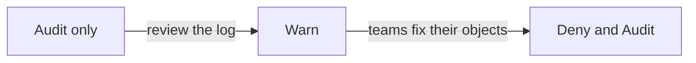

# Warn, Audit And Deny: Rolling Out A Control

A new admission rule is a risk of its own. If the rule rejects a Deployment that a team needs tonight, the team loses time and often asks to switch the rule off. Security teams therefore introduce a control in steps, so that they see the effect before the rule blocks anything. This part explains the three validation actions of a binding, how to move from observing to blocking, and how a binding limits its scope or makes an exception.

## The three validation actions

A binding has a field `validationActions`, a list that says what the API server does when a validation fails. The list can contain these values:

- `Deny`: the API server rejects the request. This is a preventive control.
- `Warn`: the API server accepts the request and returns a warning to the client. This is a detective control for the person who sent the request.
- `Audit`: the API server accepts the request and records the failure in the audit event of the request. The audit log (a chronological record of API requests) is a detective control for the security team.

You can combine `Audit` with either of the others. You cannot combine `Deny` with `Warn`, because both would report the same failure to the same client. A common choice during the final rollout is `["Deny", "Audit"]`: the request is blocked and the failure is also on record.

The policy object stays the same in all three cases. Only the binding changes. That is useful, because one policy can have several bindings with different actions in different namespaces, for example `Deny` in production and `Warn` in a development namespace.

## A rollout in three steps

A safe rollout follows the order of increasing effect. Each step gives the team information before the next one.



The diagram shows the order: record first, warn the authors second, block last.

In the first step, the binding uses `Audit` only. Nobody notices, and the security team learns from the audit log which requests would fail. In the second step, the binding uses `Warn`, so the authors of the requests see the message in their terminal and can fix the objects. In the third step, the binding uses `Deny` together with `Audit`. The objects that still fail now stop, and the failures stay on record.

You can see all three steps in the playground. The playground has no policy yet, so create the policy and a binding that starts in the observing step. Save the policy first.

<!-- astrona:playground:renew -->

Save this as `validatingadmissionpolicy-require-memory-limits.yaml`:

```yaml
apiVersion: admissionregistration.k8s.io/v1
kind: ValidatingAdmissionPolicy
metadata:
  name: require-memory-limits
spec:
  failurePolicy: Fail
  matchConstraints:
    resourceRules:
      - apiGroups: ["apps"]
        apiVersions: ["v1"]
        operations: ["CREATE", "UPDATE"]
        resources: ["deployments"]
  validations:
    - expression: "object.spec.template.spec.containers.all(c, has(c.resources) && has(c.resources.limits) && 'memory' in c.resources.limits)"
      message: "Every container must set resources.limits.memory."
      reason: Invalid
```

Apply it:

```sh
kubectl apply -f validatingadmissionpolicy-require-memory-limits.yaml
```

Now save this as `validatingadmissionpolicybinding-require-memory-limits.yaml`. It starts in the observing step with `Warn`:

```yaml
apiVersion: admissionregistration.k8s.io/v1
kind: ValidatingAdmissionPolicyBinding
metadata:
  name: require-memory-limits-starfleet
spec:
  policyName: require-memory-limits
  validationActions: ["Warn"]
  matchResources:
    namespaceSelector:
      matchLabels:
        kubernetes.io/metadata.name: starfleet
```

Apply it:

```sh
kubectl apply -f validatingadmissionpolicybinding-require-memory-limits.yaml
```

Then check the result with the dry run of a Deployment without a memory limit. Wait a few seconds after the apply:

```sh
kubectl -n starfleet create deployment trial-nolimits --image=ghcr.io/stefanprodan/podinfo:6.15.0 --dry-run=server
```

The request succeeds and `kubectl` prints a line that starts with `Warning:` and contains the policy name and your message. The control detected the violation and did not block it. Now move the same binding to the blocking step. A merge patch replaces the whole `validationActions` list:

```sh
kubectl patch validatingadmissionpolicybinding require-memory-limits-starfleet --type=merge -p '{"spec":{"validationActions":["Deny","Audit"]}}'
```

Run the dry run again after a few seconds. The request is now rejected with `denied request` and your message. The policy did not change, and the one binding field changed what happens.

## Existing objects and updates

A binding checks requests, not stored objects. The `probe` Deployment in `starfleet` has no memory limit, and it keeps running after you set `Deny`. The rule bites when someone creates or updates a Deployment. A change of the pod template of `probe` is an update, so the API server evaluates the new object, and an update that leaves the limit out is rejected.

This matters for the evidence. A policy in `Deny` mode does not mean that every object in the cluster complies. To find the objects that still do not comply, query the cluster:

```sh
kubectl get deployments -A -o json | jq -r '.items[] | select(any(.spec.template.spec.containers[]; (.resources.limits.memory // null) == null)) | "\(.metadata.namespace)/\(.metadata.name)"'
```

The output lists `starfleet/probe`. The system Deployments in `kube-system` can appear too, because the policy is bound to `starfleet` only. Status changes by the Deployment controller do not trigger the rule, because the policy matches the `deployments` resource, not `deployments/status`.

## Scope and exceptions

The `matchResources` field decides where the control applies. A `namespaceSelector` picks namespaces by their labels. An `objectSelector` picks objects by their own labels. Because both use label selectors, they support `matchExpressions`, so a binding can apply to every namespace that does not have a label such as `control-exception`.

An exception must be an explicit decision, so make the exception visible in the cluster state. A labeled namespace is evidence that someone chose to leave the rule out, and the label can be listed with a query. Do not keep exceptions in a chat message. Without a record, the next review cannot tell an intended exception from a missing control.

You can now introduce a rule in steps, change its effect with one field and limit its scope. A rule that is correct for the objects it names can still miss objects of other kinds, which is the last question for this module.

## Common pitfalls

> [!WARNING]
> `Deny` and `Warn` cannot be used together in one binding. Changing a binding from `Warn` to `Deny` does not clean up existing objects, so the first update of an old object can fail unexpectedly. A selector that matches no namespace is a binding that checks nothing, and a wrong label is the usual cause. Allow a few seconds for a changed binding to take effect before you test it.
