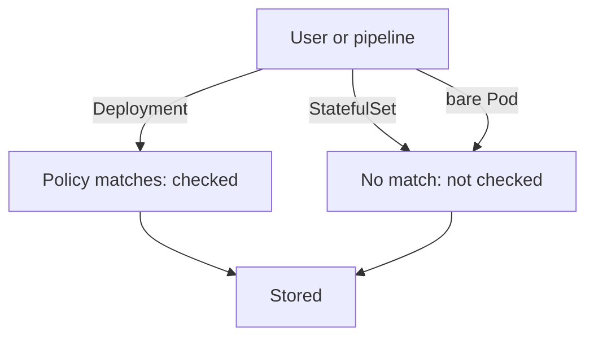

# Evidence, Gaps And Residual Risk

After a team switches a policy to `Deny`, someone will ask whether the rule is now complete. The honest answer is "for the requests it matches, in the places the binding covers". A control has edges, and every edge is a place where the protected property can still be lost. This part shows how to test a control from both sides, how to find a gap with a request that the control does not match, and how to write down the residual risk.

## Test both the allowed and the denied case

A control that rejects everything looks perfect in a test that only sends bad requests. A good test sends one request that must be rejected and one that must be accepted. If both results are as expected, the rule is neither too weak nor too strict.

The playground has the `starfleet` namespace with `scout`, `probe` and `shuttle`. `probe` has no memory limit. Create the policy and a binding that denies in `starfleet`. Save this as `validatingadmissionpolicy-require-memory-limits.yaml`:

<!-- astrona:playground:renew -->

```yaml
apiVersion: admissionregistration.k8s.io/v1
kind: ValidatingAdmissionPolicy
metadata:
  name: require-memory-limits
spec:
  failurePolicy: Fail
  matchConstraints:
    resourceRules:
      - apiGroups: ["apps"]
        apiVersions: ["v1"]
        operations: ["CREATE", "UPDATE"]
        resources: ["deployments"]
  validations:
    - expression: "object.spec.template.spec.containers.all(c, has(c.resources) && has(c.resources.limits) && 'memory' in c.resources.limits)"
      message: "Every container must set resources.limits.memory."
      reason: Invalid
```

Apply it:

```sh
kubectl apply -f validatingadmissionpolicy-require-memory-limits.yaml
```

Then save this as `validatingadmissionpolicybinding-require-memory-limits.yaml`:

```yaml
apiVersion: admissionregistration.k8s.io/v1
kind: ValidatingAdmissionPolicyBinding
metadata:
  name: require-memory-limits-starfleet
spec:
  policyName: require-memory-limits
  validationActions: ["Deny", "Audit"]
  matchResources:
    namespaceSelector:
      matchLabels:
        kubernetes.io/metadata.name: starfleet
```

Apply it:

```sh
kubectl apply -f validatingadmissionpolicybinding-require-memory-limits.yaml
```

Then check the denied case. Wait a few seconds for the binding to take effect. A Deployment without a limit must be rejected:

```sh
kubectl -n starfleet create deployment trial-nolimits --image=ghcr.io/stefanprodan/podinfo:6.15.0 --dry-run=server
```

The request ends with `denied request` and your message. Now the accepted case. Save this as `deployment-trial-limits.yaml`:

```yaml
apiVersion: apps/v1
kind: Deployment
metadata:
  name: trial-limits
  namespace: starfleet
spec:
  replicas: 1
  selector:
    matchLabels:
      app: trial-limits
  template:
    metadata:
      labels:
        app: trial-limits
    spec:
      containers:
        - name: trial
          image: ghcr.io/stefanprodan/podinfo:6.15.0
          resources:
            limits:
              memory: 64Mi
```

Run it as a dry run:

```sh
kubectl apply --dry-run=server -f deployment-trial-limits.yaml
```

The output is `deployment.apps/trial-limits created (server dry run)`. The rule rejects the object without a limit and accepts the object with one. Neither test proves that the rule has no edge.

## Finding a gap

The policy matches the resource `deployments` in the group `apps`. A pod that a user creates directly is a different resource, and so are a StatefulSet, a DaemonSet and a CronJob. The policy does not match them, so the same missing limit passes. Try a bare pod without a limit:

```sh
kubectl -n starfleet run trial-pod --image=ghcr.io/stefanprodan/podinfo:6.15.0 --dry-run=server
```

The output is `pod/trial-pod created (server dry run)`. The control does not cover pods, and that is a gap in the policy, not a fault in Kubernetes. Closing it takes either more rules in `matchConstraints.resourceRules` with an expression for each shape of object, or a second policy that matches `pods`. The pod template of every workload ends up as a pod, so a rule on `pods` catches the result of each controller. A rule on pods has a limit too, because it sees a pod only when the pod is created.



The diagram shows that the policy checks only the requests it matches, and everything else goes to storage unchecked.

## Other limits of an admission control

Admission has more edges that the exam expects you to name:

- It runs only on requests. Objects stored before the binding existed are not re-checked until someone updates them.
- `failurePolicy: Ignore` lets requests through when the policy cannot be evaluated. `Fail` is safer for a security rule, but a broken policy then blocks work.
- Users with permission to edit the binding or the policy can switch the control off. RBAC on `validatingadmissionpolicies` and `validatingadmissionpolicybindings` is the control that protects the control.
- A rule on a field checks the declared value only. A memory limit does not say whether the number is sensible.

Evidence collected with `kubectl` and `jq` shows the other side. To list the bindings and the actions they use, run this query:

```sh
kubectl get validatingadmissionpolicybindings -o json | jq -r '.items[] | "\(.metadata.name) policy=\(.spec.policyName) actions=\(.spec.validationActions | join(","))"'
```

The output has one line per binding with the policy and the actions. A binding with only `Audit` is a control that observes. This list, together with the tests above, is the evidence that an auditor reads.

## Writing down the residual risk

Residual risk is the risk that remains after the control. For this policy, a clear statement is: "Deployments in `starfleet` cannot be created or updated without a memory limit. Bare pods, StatefulSets and objects stored before the binding are not checked. The people who can edit the binding can remove the control." Each sentence names a way the original threat, a pod that uses all the memory of its node, can still appear. The team can accept each one, treat it with another control, or give it an owner and a review date.

A team that cannot name the residual risk of a control does not understand the control yet. A clean test result says the rule works for the requests it matches. It does not say that the property you wanted, such as bounded memory use, holds everywhere.

You now know how to test a control from both sides, find the requests that bypass it and state what remains. The exam asks these questions in scenarios, with a control and a bypass, so practice naming which request the control does not see.

## Common pitfalls

> [!WARNING]
> A rejected test request does not prove the rule is complete. A policy on `deployments` does not see bare pods, StatefulSets or DaemonSets. Setting `Deny` does not fix existing objects. A user who can edit the binding can turn the control off, so protect the binding itself with RBAC.
