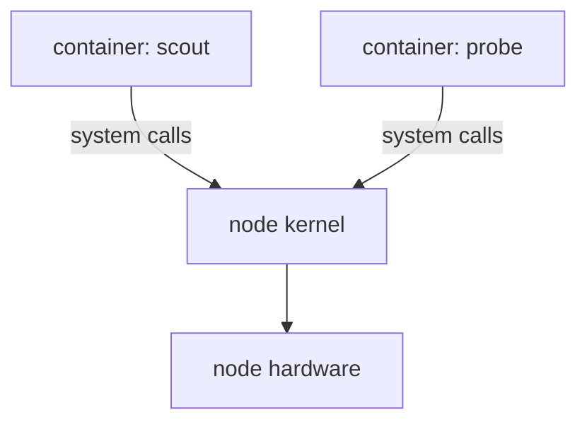

# Process Isolation And Its Security Limits

A container looks like a small machine. It has its own process list, its own host name and its own files. A new learner often concludes that a container is a small virtual machine, and then trusts it like one. That conclusion is wrong, and the exam asks about it directly. This part explains what the Linux kernel really does to make a container, what it does not do, and what that means for security.

## A container is a process with restricted views

A container is a normal Linux process, or a small group of processes, that the container runtime starts with two kinds of restriction. The first kind changes what the process can see. The second kind limits how much it can use. The container runtime (for example containerd) sets up both before it starts the program of the image.

The first kind of restriction is the **Linux namespace**. A Linux namespace gives a process its own view of one kind of system resource. The kernel has several kinds, and each one hides a different thing:

- The PID namespace (process identifier) gives the container its own process list. The first process in it has PID 1, and it cannot see processes outside.
- The network namespace gives the container its own network interfaces, IP address, routing table and port numbers.
- The mount namespace gives the container its own file system view, built from the image.
- The UTS namespace (UNIX time-sharing) gives the container its own host name.
- The IPC namespace (inter-process communication) gives it its own shared memory and message queues.
- The user namespace maps user identifiers, so that root inside can be a normal user outside. Kubernetes uses it only when a pod asks for it.

A Linux namespace is not a Kubernetes namespace. A Kubernetes namespace is a name scope for API objects such as pods and Services. It does not change anything in the kernel. This difference is a common exam trap, so keep the two terms apart: "Linux namespace" for the kernel feature, "Kubernetes namespace" for the API scope.

## Control groups limit use

The second restriction is the **control group**, called a cgroup. A cgroup is a kernel feature that puts a group of processes under one set of limits and counts their use of the central processing unit (CPU), memory and other resources. When a pod sets `resources.limits.memory`, the kubelet and the container runtime write that value into the cgroup of the container. If the processes use more memory than the limit, the kernel stops one of them.

Namespaces and cgroups answer different questions. A namespace answers "what can this process see?". A cgroup answers "how much can this process use?". Neither one answers "which kernel code can this process call?". That third question matters for security, because all containers on a node call the same kernel.

## One kernel for every container on the node

A virtual machine has its own guest kernel, running on virtual hardware that a hypervisor provides. A container has no kernel of its own. Every container on a worker node uses the kernel of that node. The diagram shows this for two pods on one node.



The diagram shows that the isolation between `scout` and `probe` is a set of restricted views, and that both containers send their system calls to the same node kernel.

A system call is a request from a program to the kernel, for example to open a file or start a process. The kernel checks each call. If a kernel bug lets a process do something it should not, that process can leave its namespaces and affect the node and every other container on it. This is the main security limit of a container: the isolation is only as strong as the kernel and the runtime that set it up. Hardening such as dropping capabilities and filtering system calls reduces the number of kernel paths a process can reach, but it does not give a separate kernel.

## See the restricted views

The playground has the `shuttle` pod in `starfleet`. Run `ps` inside it to list its processes:

<!-- astrona:playground:renew -->

```sh
kubectl exec deploy/shuttle -n starfleet -- ps
```

The list is short. It shows the shell loop of the container and the `ps` command itself, not the processes of the node and not the processes of `scout`. That is the PID namespace at work. Now print the host name:

```sh
kubectl exec deploy/shuttle -n starfleet -- hostname
```

The command prints the name of the pod, for example `shuttle-` followed by the generated suffix. The kubelet sets the host name inside the UTS namespace to the pod name. The node has a different host name, which the container cannot see.

Pods can share a Linux namespace on purpose. The playground has a `crew-share` Deployment with two containers and `shareProcessNamespace: true` in the pod spec. Run `ps` from the `main` container:

```sh
kubectl exec deploy/crew-share -n starfleet -c main -- ps
```

This time the list contains the sleep loop of the `side` container as well, and PID 1 is the pause process of the pod. The pause process is a tiny process that holds the namespaces of the pod open. Containers in one pod already share the network namespace, so that they reach each other on `localhost`. With `shareProcessNamespace`, one container can also read the arguments, environment and files of the other through `/proc`. Kubernetes documents this as a trade-off: it helps debugging and it removes the process separation between the containers.

## Containers and virtual machines together

A virtual machine is a stronger boundary because a flaw in the guest kernel does not reach the host kernel directly. It costs more start time and memory. Most Kubernetes clusters combine both: the worker nodes are virtual machines, and the containers run on them. In that design, two containers on the same node still share one kernel. Two containers on different nodes do not.

Some workloads need the separate-kernel boundary for single pods. A sandboxed container runtime, such as gVisor or Kata Containers, gives each pod its own kernel layer or its own lightweight virtual machine. The cluster selects it with a `RuntimeClass`. The exam expects you to know the idea, not to install either tool.

## What weakens the boundary

Namespaces and cgroups only help if the container is started with the normal restrictions. A pod spec can remove them. A `privileged: true` container gets almost all capabilities and access to host devices. A `hostPID: true` pod joins the PID namespace of the node. A `hostPath` volume mounts a directory of the node. Root inside a container is also a real concern: user ID 0 in a container is user ID 0 on the node unless a user namespace maps it away, so a flaw that escapes the container gives the attacker root on the node.

## Capabilities and system-call filters

Root is not one single power in Linux. The kernel splits the powers of root into **capabilities**, for example `NET_ADMIN` to change network settings and `SYS_ADMIN` to do a wide range of administrative work. A container normally starts with a reduced default set. The field `securityContext.capabilities.drop` removes capabilities from a container, and `drop: ["ALL"]` removes every one of them.

A **seccomp profile** (secure computing mode) is a filter for system calls. When a pod sets `seccompProfile.type: RuntimeDefault`, the container runtime applies its default filter, which blocks many rarely used system calls. A smaller set of reachable system calls means less kernel code that a compromised process can attack.

These two controls do not create a new boundary. They shrink what a process inside the existing boundary can do. That is the reason the exam describes them as hardening of the container, not as isolation like a virtual machine.

You have now seen what a container isolates and what it shares. Which pod fields decide how much is shared, and what a compromised container can still reach in the cluster, are the next questions.

## Common pitfalls

> [!WARNING]
> A Linux namespace is a kernel feature and a Kubernetes namespace is an API scope. A container is not a virtual machine: containers on one node share its kernel. Limits in a cgroup control resource use, not visibility. Running as root in a container is not safe because the image is packaged, and `shareProcessNamespace` removes process separation between the containers of a pod.
