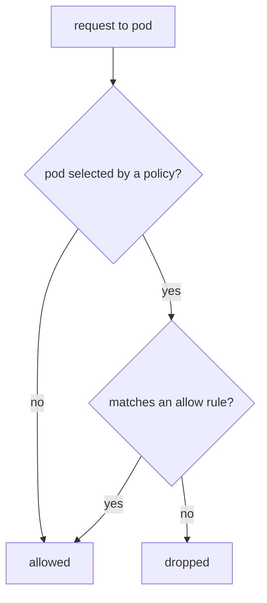

# Network Segmentation With NetworkPolicy

By default, every pod in a Kubernetes cluster can send packets to every other pod, in every namespace. That default makes a cluster easy to start and easy to attack: a compromised `drifter` pod can probe every Service in `starfleet`. A `NetworkPolicy` is the Kubernetes object that divides this flat network into segments. This part shows the default, writes the first policies, and explains the rules that cause most exam mistakes.

## The default and the object

A **NetworkPolicy** is an API object that selects a group of pods and lists the traffic those pods may accept (ingress), send (egress) or both. **Ingress** is traffic coming into a pod. **Egress** is traffic leaving a pod. A policy only describes rules. The network plugin, also called the CNI plugin (Container Network Interface), reads the policies and enforces them on the node. The Kubernetes documentation says it directly: a NetworkPolicy has no effect unless the network plugin supports it. The API server accepts the object either way, and `kubectl` shows no error.

Three rules decide what a policy does:

1. A pod that no policy selects is not restricted. All its traffic is allowed.
2. A pod that at least one policy selects for a direction accepts only the traffic that the union of those policies allows in that direction. Everything else is denied.
3. Policies are additive. There is no deny rule and no order. Adding a policy can only allow more traffic, never less.

The second rule is the reason for the **default deny** pattern. A policy that selects every pod in a namespace and lists no allowed traffic puts all pods in that direction into the "restricted" state with an empty allow list. Other policies then add the specific paths that must work.



The diagram shows that a pod with no policy allows everything, and that a selected pod allows only traffic that matches an allow rule of any policy.

## Write a default deny and an allow rule

The playground has no policy yet. First confirm that `shuttle` can call `probe`. The container port of `probe` is 8080, and its Service listens on port 80:

<!-- astrona:playground:renew -->

```sh
kubectl exec deploy/shuttle -n starfleet -- curl -s --max-time 5 -o /dev/null -w '%{http_code}\n' http://probe/status/200
```

The command prints `200`. Now save this as `networkpolicy-default-deny-ingress.yaml`. An empty `podSelector` selects every pod in the namespace of the policy. The `policyTypes` list says that the policy is about ingress, and no `ingress` rule follows, so nothing is allowed:

```yaml
apiVersion: networking.k8s.io/v1
kind: NetworkPolicy
metadata:
  name: default-deny-ingress
  namespace: starfleet
spec:
  podSelector: {}
  policyTypes:
    - Ingress
```

Apply it:

```sh
kubectl apply -f networkpolicy-default-deny-ingress.yaml
```

Then check the result. Repeat the request from `shuttle`:

```sh
kubectl exec deploy/shuttle -n starfleet -- curl -s --max-time 5 -o /dev/null -w '%{http_code}\n' http://probe/status/200
```

If the network plugin of your cluster enforces NetworkPolicy, the request now times out after five seconds and `curl` prints `000`. If the plugin does not enforce it, the command still prints `200`. Both outcomes teach the same fact: the object only describes intent, and the plugin decides whether the intent becomes real. Production clusters need a plugin that enforces policies, for example Calico or Cilium.

Next, allow exactly one path. Save this as `networkpolicy-allow-shuttle-to-probe.yaml`. The policy selects the `probe` pods and allows ingress only from pods labeled `app: shuttle` in the same namespace, on TCP port 8080:

```yaml
apiVersion: networking.k8s.io/v1
kind: NetworkPolicy
metadata:
  name: allow-shuttle-to-probe
  namespace: starfleet
spec:
  podSelector:
    matchLabels:
      app: probe
  policyTypes:
    - Ingress
  ingress:
    - from:
        - podSelector:
            matchLabels:
              app: shuttle
      ports:
        - protocol: TCP
          port: 8080
```

Apply it:

```sh
kubectl apply -f networkpolicy-allow-shuttle-to-probe.yaml
```

The port in a policy is the port of the pod, not the port of the Service. The Service port 80 maps to the container port 8080, and the policy must name 8080. With an enforcing plugin, the request from `shuttle` works again and the request from `drifter` in `outpost` stays blocked.

## Selectors: AND and OR

Each item in a `from` list is a peer. The peers of one rule are combined with OR: traffic that matches any peer is allowed. A single peer can hold both a `namespaceSelector` and a `podSelector`, and then both must match, which is AND. The YAML difference is one dash:

```yaml
# OR: any pod in starfleet, or any pod labeled app=shuttle in the policy namespace
- from:
    - namespaceSelector:
        matchLabels:
          kubernetes.io/metadata.name: starfleet
    - podSelector:
        matchLabels:
          app: shuttle

# AND: only pods labeled app=shuttle that are in the namespace starfleet
- from:
    - namespaceSelector:
        matchLabels:
          kubernetes.io/metadata.name: starfleet
      podSelector:
        matchLabels:
          app: shuttle
```

This snippet is only for reading. Kubernetes sets the label `kubernetes.io/metadata.name` on every namespace, with the namespace name as value, so a policy can select a namespace by name. A `podSelector` alone in a peer matches pods only in the namespace of the policy. A peer with an empty `namespaceSelector: {}` matches every namespace, and a rule with no `from` at all matches every source.

## Egress and DNS

Egress rules limit what a pod may send. A default deny for egress also blocks DNS requests to the cluster DNS Service in `kube-system`, so a pod can no longer resolve Service names. A policy that restricts egress therefore needs an allow rule for UDP and TCP port 53 to the DNS pods. Forgetting it is the most common reason that "everything stopped working" after an egress policy.

You now know how a policy selects pods, why additive allow lists need a default deny, and how one dash changes OR into AND. The next question is what the network cannot protect: the resources a segment may consume and the identities it holds.

## Common pitfalls

> [!WARNING]
> A NetworkPolicy has no effect when the network plugin does not enforce it, and the API server shows no warning. Policies add allow rules and never deny. The port in a rule is the container port, not the Service port. A peer with both selectors is AND and two peers are OR. An egress policy without a DNS rule breaks name resolution.
