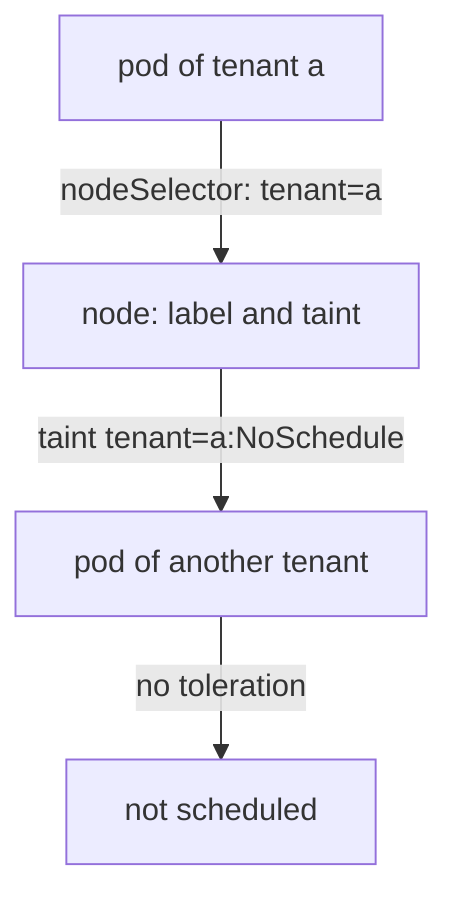

# Stronger Boundaries: Sandboxes And Dedicated Nodes

Network policies, quotas and token settings all run on top of one shared node kernel. If two tenants do not trust each other, a flaw in that kernel or in the container runtime can bypass every one of those controls at once. For such workloads Kubernetes offers boundaries that act below the pod: a separate runtime for each pod, separate nodes for each tenant, or a separate cluster. This part explains each option, what it protects and what it costs.

## Three ways to avoid sharing a kernel

The options differ in how far the workloads are apart. A closer boundary is cheaper and shares more.

1. **A sandboxed runtime for single pods.** The pod runs in a sandbox that has its own kernel layer. In gVisor, a user-space program implements most system calls so that the container does not call the node kernel directly. In Kata Containers, each pod runs in a lightweight virtual machine with its own guest kernel. A flaw in the application reaches the sandbox first.
2. **Dedicated nodes for each tenant.** The pods of a tenant run only on nodes that no other tenant uses. A kernel flaw still affects all pods on that node, but they all belong to the same tenant.
3. **A separate cluster for each tenant.** The tenant has its own API server, its own nodes and its own administrators. This is the strongest split, and it adds the cost of running and updating many clusters.

Whatever you choose, the boundary still depends on what stays shared. Two clusters in the same cloud account can share cloud credentials. Two nodes can share a storage backend. Name the shared parts in the design.

## RuntimeClass selects a sandbox

A **RuntimeClass** is a cluster-wide API object (`node.k8s.io/v1`) that names a container runtime configuration. Its main field is `handler`, which must match a runtime handler that the container runtime on the node has configured. The object does not install anything. The administrator installs and configures the sandbox on the node first, and the RuntimeClass then gives it a name that pods can use.

A pod selects a runtime with `spec.runtimeClassName`. If that name does not exist, or the runtime on the node cannot run the handler, the pod does not start. A RuntimeClass can also carry `scheduling`, which adds a `nodeSelector` and `tolerations` so that pods using it land only on nodes that have the runtime, and `overhead`, which tells the scheduler how many resources the sandbox itself uses.

The playground has a RuntimeClass named `sandboxed` with the handler `runsc`, which is the name that gVisor commonly uses. No node in the playground has that handler, so you only read the object:

<!-- astrona:playground:renew -->

```sh
kubectl get runtimeclass
kubectl get runtimeclass sandboxed -o jsonpath='{.handler}{"\n"}'
```

The first command lists `sandboxed` and its handler. The second prints `runsc`. A pod with `runtimeClassName: sandboxed` would not run here, because the node cannot run that handler. That is the intended lesson: a RuntimeClass is only a name that points to a configuration that the node must have.

## Dedicated nodes with labels and taints

Dedicated nodes use two scheduling tools that work in opposite directions. A **node label** with a pod `nodeSelector` pulls a pod toward the nodes that carry the label. A **taint** on a node pushes pods away unless the pod has a matching **toleration**. A tenant needs both: the taint keeps other tenants off its nodes, and the selector keeps its own pods on them.



The diagram shows that the taint keeps the pod of another tenant away from the node, and that the selector sends the pod of tenant a to it.

The playground has one node. Label and taint it, so that you can watch the scheduler decide:

```sh
kubectl label nodes --all tenant=a
kubectl taint nodes --all tenant=a:NoSchedule
```

The commands print `labeled` and `tainted` for the node. A `NoSchedule` taint stops new pods without a toleration from landing on the node. It does not remove pods that already run there. Start a pod without a toleration in `starfleet`:

```sh
kubectl run untolerated --image=curlimages/curl:8.22.0 -n starfleet --command -- sleep 3600
kubectl get pod untolerated -n starfleet
```

The pod stays in the `Pending` state. `kubectl describe pod untolerated -n starfleet` shows a scheduling event that says no node is available because of an untolerated taint. Now save this as `pod-tenant-a.yaml`. It selects the label and tolerates the taint:

```yaml
apiVersion: v1
kind: Pod
metadata:
  name: tenant-a-client
  namespace: starfleet
spec:
  serviceAccountName: shuttle
  nodeSelector:
    tenant: a
  tolerations:
    - key: tenant
      operator: Equal
      value: a
      effect: NoSchedule
  containers:
    - name: client
      image: curlimages/curl:8.22.0
      command: ["sh", "-c", "while true; do sleep 30; done"]
      resources:
        requests:
          cpu: 10m
          memory: 16Mi
        limits:
          memory: 32Mi
```

Apply it:

```sh
kubectl apply -f pod-tenant-a.yaml
```

Then check the result:

```sh
kubectl wait --for=condition=Ready pod/tenant-a-client -n starfleet --timeout=120s
```

The command returns when the pod is ready: the scheduler accepted it because of the toleration and the selector. Remove the taint and the test pod afterward, so that the node accepts other pods again:

```sh
kubectl taint nodes --all tenant=a:NoSchedule-
kubectl delete pod untolerated -n starfleet
```

## What a toleration does not do

A toleration only allows a pod onto a tainted node. It does not force the pod there, and it does not stop other pods that carry the same toleration. Any user who can create pods in any namespace can add a toleration to their own pod. For this reason, dedicated nodes need an admission control that restricts who may use a toleration or a node label, or the isolation can be bypassed by anyone with the right to create pods. The `PodNodeSelector` and `PodTolerationRestriction` admission plugins exist for this, and so do policy engines.

Dedicated nodes also leave shared pieces: the control plane, the cluster-wide network, the storage classes and the administrators. The exam expects you to state these limits when it asks whether a design is "isolated".

You now have the whole range from a namespace to a separate cluster, and you know which parts each one still shares. A boundary is a statement about what stays shared, and the right choice follows the trust between the workloads.

## Common pitfalls

> [!WARNING]
> A RuntimeClass object does not install a sandbox; the node must have the handler. A taint alone does not keep a tenant's pods on its nodes, and a node selector alone does not keep other tenants away. A toleration is under the control of whoever creates the pod unless an admission control limits it. A separate cluster can still share cloud accounts and external services.
