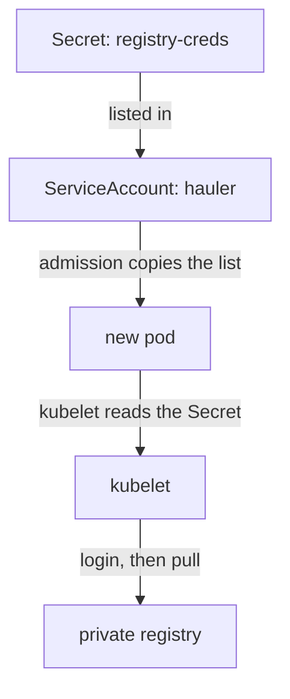

# Credentials And Image Verification Evidence

A container image is stored in a registry, and a registry often requires a login before it hands out an image. The kubelet, the agent on each node that starts pods, has to pull the image before a container can run. If the cluster has no credentials, the pull fails and the pod never starts. If the credentials leak, someone else can read the private images or even push a changed one. This chapter shows how Kubernetes stores and delivers registry credentials, and what a registry can and cannot prove about an image.

## Registries, repositories and pull credentials

A registry is a server that stores and serves container images. A repository is one named collection of related images inside a registry, for example `ghcr.io/stefanprodan/podinfo`, where `ghcr.io` is the registry and `stefanprodan/podinfo` is the repository. A public repository can be pulled without a login. A private repository needs credentials, and most companies run a private registry for their own images.

Kubernetes does not log in to a registry for you. You give it the credentials as an image pull secret. This is a Secret object of the type `kubernetes.io/dockerconfigjson`. A Secret is a Kubernetes object that holds a small piece of sensitive data. The data of this type is a JSON document with one entry per registry server, and each entry holds a user name and a password.

The pull secret must be in the same namespace as the pod that uses it, because a pod can only reference Secrets in its own namespace. A cluster with ten namespaces that pull from one private registry therefore needs ten copies of the secret. The kubelet reads the secret when it pulls the image, and it sends the credentials only to the registry server named in the entry.

Create a pull secret in the `dockyard` namespace now. The registry `registry.starfleet.example` does not exist, and that is fine: Kubernetes stores the secret without contacting the registry.

<!-- astrona:playground:renew -->

```sh
kubectl -n dockyard create secret docker-registry registry-creds \
  --docker-server=registry.starfleet.example \
  --docker-username=fleet-puller \
  --docker-password=pull-token-001
```

The command prints `secret/registry-creds created`. Read the type that the command chose:

```sh
kubectl -n dockyard get secret registry-creds -o jsonpath='{.type}'
```

The command prints `kubernetes.io/dockerconfigjson`. The password is stored in the secret, so the next question is who can read it.

## A Secret is encoded, not encrypted

The API server returns the content of a Secret in the field `.data`, base64 encoded. Base64 is a way to write bytes as text. It is not encryption, and anyone who can run `kubectl get secret` can undo it:

```sh
kubectl -n dockyard get secret registry-creds -o jsonpath='{.data.\.dockerconfigjson}' | base64 -d
```

The command prints the JSON document, and the user name and the password are readable in it. The same is true on disk: by default the API server stores Secrets in etcd, the cluster database, without encryption. An administrator can turn on encryption at rest with an `EncryptionConfiguration` file for the API server, and then etcd holds ciphertext.

Two controls protect a pull secret. The first is access control: with role-based access control (RBAC), only the identities that need to read Secrets in the namespace get the `get` and `list` verbs on `secrets`. The `list` verb returns the content of every Secret, so it needs the same care as `get`. The second is the registry account itself: use an account that can only pull, so a stolen secret cannot push.

## Delivering the secret through a service account

A pod can list the secret in its own `imagePullSecrets` field. That works, but every Deployment in the namespace then has to repeat it, and one forgotten Deployment fails to pull. A service account is the identity a pod uses to call the Kubernetes API, and it can carry the list instead. The ServiceAccount admission controller, a step inside the API server, copies the service account's `imagePullSecrets` into each new pod that uses the account.

Patch the service account `hauler`:

```sh
kubectl -n dockyard patch serviceaccount hauler -p '{"imagePullSecrets":[{"name":"registry-creds"}]}'
```

The command prints `serviceaccount/hauler patched`. Now ask the API server to admit a new pod without storing it. A server-side dry run runs every admission step and returns the pod that would be stored:

```sh
kubectl -n dockyard run pull-check --image=registry.starfleet.example/fleet/hauler:2.4 --overrides='{"spec":{"serviceAccountName":"hauler"}}' --dry-run=server -o jsonpath='{.spec.imagePullSecrets[*].name}'
```

The command prints `registry-creds`. The pod manifest never mentioned the secret: the ServiceAccount admission controller added it. The change affects only pods created after the patch, because admission runs when a pod is created, so running pods keep the list they had.



The diagram shows that the secret reaches the registry only through the kubelet, after the ServiceAccount admission controller copied it into the pod.

## What a registry can prove about an image

A successful pull shows that the credentials were valid and that the registry served some content. It does not show that the content is the one you intended or that it is safe. Four kinds of evidence answer four different questions.

A digest answers which exact content this is. It is a hash of the image manifest, written like `sha256:` followed by 64 hexadecimal characters. If one byte of the image changes, the digest changes.

A signature answers who vouches for this content. A publisher signs the digest with a private key, or with a short-lived certificate in the keyless model of the Sigstore project, and stores the signature in the registry next to the image. A verifier needs the matching public key or the expected identity. A valid signature proves that the holder of the key signed this digest. It does not prove that the code is free of defects.

Provenance answers how the content was built. A provenance record names the source revision and the build system, and the SLSA framework (Supply-chain Levels for Software Artifacts) defines levels for how strongly such a record is protected. A software bill of materials (SBOM) answers which components are inside, in a format such as SPDX or CycloneDX. A vulnerability scan answers which components have a known problem: a scanner such as Trivy compares the components with a database of Common Vulnerabilities and Exposures (CVE) entries.

None of these answers replaces another. A signed image can contain a vulnerable library, a clean scan result can be about a different image than the one you run, and an SBOM only lists components. A delivery process is strong when every piece of evidence is tied to the same digest that the cluster later runs.

You now know how a pull secret is created, why it is readable, how a service account delivers it, and what the evidence around an image means. The open question is how a pod names the content to run, because a name that can point to different content weakens every piece of evidence above.

## Common pitfalls

> [!WARNING]
> A pull secret is base64 encoded, not encrypted. Anyone who can `get` or `list` Secrets in the namespace can read the password. Patching a service account does not change running pods, and a pull secret in another namespace is invisible to the pod. A signature, a clean scan and a valid login prove three different things, and none proves the image is safe.
