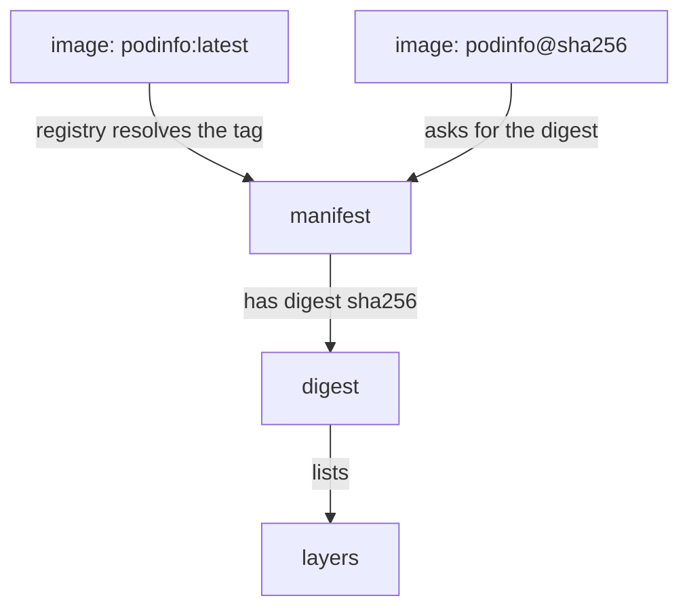

# Repository Policy And The Deployed Artifact

A team verifies an image on Monday, and on Friday the cluster runs an image with the same name. Is it the same content? With a tag, nobody can say for sure. This chapter explains how a Deployment refers to an image, why a tag cannot carry any verification result, and how a digest fixes the content. It also shows how the pull policy decides when the kubelet asks the registry again.

## Three parts of an image reference

An image reference in a pod spec has up to three parts. Take `ghcr.io/stefanprodan/podinfo:6.15.0`. The part `ghcr.io/stefanprodan/podinfo` is the repository, including the registry host. The part after the colon, `6.15.0`, is the tag. A third part, written after an at sign, is the digest, for example `podinfo@sha256:<64 hexadecimal characters>`.

A tag is a label that the repository owner can move. The owner can push a different image and give it the tag `6.15.0` again, and from then on the tag points to different content. The tag `latest` is only a name that is used when no tag is written, and it moves with almost every release. A digest is the hash of the image manifest. The manifest lists the image layers, which are the stored file changes that make up the image, and the image configuration. Because the digest is a hash of that content, it cannot point to anything else.

This is why the Kubernetes documentation says that tags can be moved to point to different images, while digests are fixed. Every piece of verification evidence, such as a signature, a scan report or an SBOM, belongs to a digest. Evidence about `podinfo:6.15.0` is evidence about whatever the tag pointed to on that day.

## Reading the digest a pod really runs

Kubernetes records what it pulled. For each container the pod status holds two fields: `image`, the reference that the spec asked for, and `imageID`, the identifier of the image that the container runtime resolved. The `imageID` normally includes the digest, but the exact format depends on the container runtime. Read both for the pods in `starfleet`:

<!-- astrona:playground:renew -->

```sh
kubectl -n starfleet get pods -o jsonpath='{range .items[*]}{.metadata.name}{"  "}{.status.containerStatuses[0].image}{"  "}{.status.containerStatuses[0].imageID}{"\n"}{end}'
```

The command prints one line per pod with the name, the requested image and the resolved identifier. The `image` field shows the tag that the Deployment used. The `imageID` field is the evidence of what ran. A delivery process that records this value can later prove which content a pod used. A process that only records the tag cannot.

## Pinning a Deployment to a digest

To pin an image, replace the tag with `@` and the digest. The Deployment `relay` in `dockyard` uses `ghcr.io/stefanprodan/podinfo:latest`, and the release process recorded the approved digest in the ConfigMap `release-record`. Read it and put it into the Deployment:

```sh
DIGEST=$(kubectl -n dockyard get configmap release-record -o jsonpath='{.data.relay-digest}')
kubectl -n dockyard set image deployment/relay "relay=ghcr.io/stefanprodan/podinfo@${DIGEST}"
```

The second command prints `deployment.apps/relay image updated`. The first argument names the container, `relay`, and the second part is the new reference. The Deployment has zero replicas, so Kubernetes creates no pod and pulls nothing. When a reference has both a tag and a digest, the container runtime uses only the digest to pull. A tag next to a digest is then only a comment, and it can mislead a reader, so a pinned reference is clearer without it.

A digest has a cost: someone must update it for every release. Release pipelines do this by writing the digest into the manifest, or by a controller that opens a change when the tag moves. The cost buys a stable fact: two clusters with the same reference run the same content.



The diagram shows that a tag is resolved to a manifest by the registry at pull time, while a digest names the manifest directly.

## The pull policy decides when the registry is asked

The field `imagePullPolicy` tells the kubelet when to pull. `IfNotPresent` pulls only when the node does not already have the image. `Always` asks the registry every time a container starts: the runtime resolves the tag to a digest and downloads only layers it does not have. `Never` never pulls.

When you leave the field out, the API server sets a default when it first creates the object. The default is `Always` when the tag is `latest` or when no tag is given. It is `IfNotPresent` for any other tag and when a digest is used. Compare the two Deployments:

```sh
kubectl -n dockyard get deployment relay -o jsonpath='{.spec.template.spec.containers[0].imagePullPolicy}'
kubectl -n starfleet get deployment scout -o jsonpath='{.spec.template.spec.containers[0].imagePullPolicy}'
```

The first command prints `Always`, and the second prints `IfNotPresent`. The first value was set when `relay` was created with the tag `latest`. The Kubernetes documentation says that the value is set when the object is created and is not updated when the tag or the digest changes later. So after the pinning above, `relay` still has `Always`. With a digest this is harmless, because the same digest always gives the same content, but it is a good habit to read the value that the API server stored instead of guessing it from the image name.

A node cache adds one more difference. With `IfNotPresent`, a node that already has an image under the same tag skips the registry, so two nodes can run different content under one tag. A digest removes that difference. A policy of `Always` does not replace a digest either, because it only checks the registry, and the registry can answer with new content.

## Repository policy: who may change what a name points to

A repository also has a write side. Registry permissions separate the right to pull from the right to push, and a registry can mark tags as immutable so that a pushed tag can never be moved. Immutable tags help, but they depend on a setting that the registry owner controls, and a digest needs no such setting.

A sound repository policy therefore has three rules. Only the build system may push to the production repository, and it uses a credential that people do not hold. Workloads and nodes use accounts that can only pull. Deployments refer to digests, so a later push cannot change what they run.

## What goes wrong at pull time

If the pull fails, the pod shows `ErrImagePull`, and after repeated attempts `ImagePullBackOff`. The back-off is a growing delay between attempts, up to five minutes. The pod event holds the reason. A reference that does not exist is a different problem from a login that the registry rejects, and from a certificate that the node does not trust. Increasing the replica count only adds more failing pods. Read the event, then correct the reference, the secret or the trust.

You can see this with `relay`. The digest in the record is only an example value, so the registry has no such image. Scale the Deployment to one replica, read the event and scale it back:

```sh
kubectl -n dockyard scale deployment relay --replicas=1
kubectl -n dockyard describe pod -l app=relay
kubectl -n dockyard scale deployment relay --replicas=0
```

The second command lists the pod events. Read the pull failure in them and see that the pod does not become ready. A pull that works only proves the content was downloaded, and a failed one tells you to look at the reference first.

A pod that runs is not the end either. The deployed artifact is the digest in `imageID`. A review of the cluster compares that value with the digests the release process approved, and any difference means that something other than the approved artifact is running.

You now know that a tag is a movable label, that a digest names exact content, and that the pull policy is set once at creation. The open question is what is inside the content that the digest names, because a pinned image can still hold a secret or a tool that an attacker can use.

## Common pitfalls

> [!WARNING]
> A tag is not an identity. Evidence checked for a tag may not describe the content that runs later. A reference with both a tag and a digest pulls by the digest only. `imagePullPolicy` is set when the object is created, so changing the image does not change it. `ImagePullBackOff` is a delay between retries, not a cause; read the event to find the cause.
