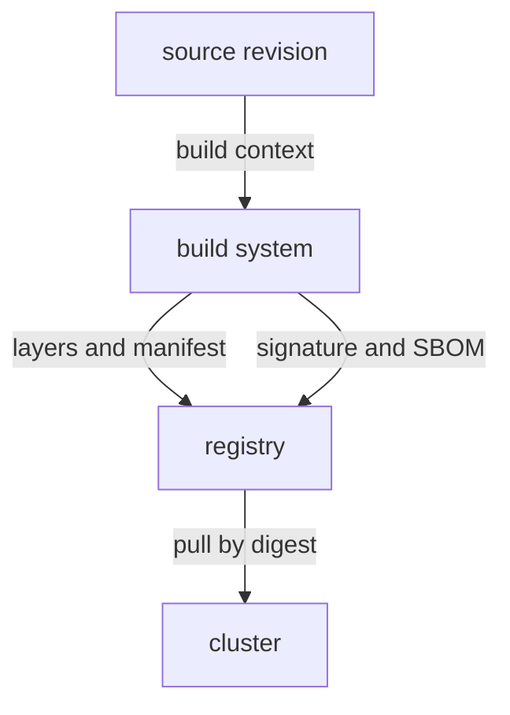

# Build Inputs And Image Contents

An image is built from instructions and files, and the result is shared with everyone who may pull it. Anything that enters the build can end up inside the image, including a password that a developer forgot. A digest and a signature only confirm what the image is, not what it contains. This chapter follows the content from the build instructions to the layers in the registry, and shows what an attacker finds there.

## Layers and the build context

A Dockerfile is a text file with the instructions that build an image. Most instructions, such as `COPY` and `RUN`, add a layer. A layer is a stored set of file changes, and the image is the ordered list of its layers. The registry stores each layer once, and every user who can pull the image can download every layer.

The build context is the set of files that the builder may use, usually the directory that the build command points to. A `COPY . /app` instruction copies the whole context. If the directory holds a `.env` file, a private key or a cloud credentials file, the copy puts it into a layer. A `.dockerignore` file lists paths that the builder must leave out of the context.

Deleting a file in a later instruction does not solve it. Consider this fragment:

```dockerfile
FROM python:3.13
COPY . /app
RUN rm /app/.env
```

The third instruction adds a layer that hides `.env` in the final file system. The second layer still holds the file, and anyone who unpacks that layer can read it. The same is true for a secret passed as a build argument or written by a `RUN` command: it can end up in the image history. A secret that was ever in a layer must be treated as leaked, and the credential must be revoked at the issuer.

## Keeping build tools and secrets out of the runtime image

A multi-stage build uses several `FROM` instructions in one Dockerfile. The first stage holds compilers, package managers and test files. The last stage starts from a small base and copies only the built program from the earlier stage. Only the last stage becomes the image that is pushed, so the tools never reach the registry.

```dockerfile
FROM golang:1.25 AS build
COPY . /src
RUN cd /src && go build -o /out/app ./cmd/app

FROM gcr.io/distroless/static-debian12:nonroot
COPY --from=build /out/app /app
ENTRYPOINT ["/app"]
```

The second stage is a distroless base image, an image that holds the program's runtime files but no shell and no package manager. A smaller image has fewer components that a scanner can flag and fewer tools for an attacker who gets code execution. The `nonroot` variant also sets a user that is not root. The final choice is still the author's: the `COPY --from` line decides exactly what crosses into the runtime stage.

Build credentials need their own handling. A token that downloads a private dependency during the build is not needed at runtime. Modern builders can mount a secret during one `RUN` instruction without storing it in a layer. A registry pull credential and an application database credential are different again: the first lets a node pull the image, and the second lets the process reach its data service after it starts. The runtime credential should reach the pod as a Secret at deployment time, never as a file in the image.

## Base images, dependencies and updates

Every image starts from a base image, and the final image inherits its operating system packages. An old base image carries known vulnerabilities even when the application code is perfect. Pin the base image by digest so that a rebuild is repeatable, and rebuild regularly to receive fixed packages. A pinned base that nobody updates grows more vulnerable every month.

Dependencies follow the same rule. A lock file pins the exact versions that the build uses, so the build is repeatable and a malicious new release does not slip in. A software bill of materials generated during the build records those components for later analysis. When a new vulnerability is published, the SBOM tells the team which images contain the component without pulling and opening every image.

A scan at build time sees the vulnerabilities known that day. New entries appear after the image is pushed, so a registry or a scheduled job should scan stored and running images again. The result is a list of findings that need a decision: update the component, accept the risk with a reason, or remove the image.

## Running as a non-root user and what the image decides at runtime

An image can set the default user of its process with the `USER` instruction. If it sets none, the process runs as root inside the container. Root inside a container is not root on the node, but it holds more rights than the application needs, and a flaw in the application then gives the attacker those rights. An image that sets a numeric non-root user lets a cluster policy such as `runAsNonRoot` work without extra changes.

An image can also add files that are executable and writable by the application, such as a package manager or a shell. An attacker who gets code execution uses these tools to download more code. A read-only root file system, set in the pod's security context, blocks most of that, but only works if the application writes its files to a mounted volume. The image author and the platform team therefore share the work: the image provides a minimal, non-root program, and the pod specification limits what that program may do.

## Registry access control and transport

A registry has its own access control, separate from Kubernetes RBAC. A good registry gives each team its own repositories and separate accounts for pushing and pulling. It records who pushed which digest. It serves content over Transport Layer Security (TLS), so that the node can check the server certificate and a network attacker cannot change the layers in transit.

A node that is told to trust an insecure registry accepts any server on that address. Production clusters should not use this setting. A private registry with its own certificate authority needs that authority in the trust store of each node, and a certificate error at pull time means a trust problem, not a missing image.

Many organizations also run a registry mirror or pull-through cache. It keeps a copy of public images in the private registry, so builds do not depend on a public service and a scan can run once on the copy. The cluster then pulls only from the approved registry, which is the basis for the admission rules a platform team can enforce.

## Questions a reviewer asks about an image

A reviewer who must decide whether an image is fit to run can work through a short list of questions. Each question points to a piece of evidence or a build decision that the previous sections describe.

- Which base image does it start from, and is that base pinned by digest and rebuilt on a schedule?
- Does any layer contain files that are not part of the application, such as keys, `.env` files or test data?
- Which user does the process run as, and does the image hold a shell or a package manager that the program does not need?
- Is there a software bill of materials for this exact digest, and when was it last scanned?
- Who pushed this digest, from which build, and is there a signature from the expected identity?

If the answer to any question is unknown, the team has found a gap in its process, not a reason to run the image anyway.

## The build system as a trust boundary

The build system holds the keys that sign images and the credential that pushes them. Whoever controls it controls what the registry serves. Run builds in an isolated environment that is created for each build, give it a push credential that is limited to one repository, and keep the signing key out of reach of the code that is being built. Review changes to the build definition like production code, because a changed pipeline can sign a changed image.



The diagram shows that the build system is the only writer to the registry, and the cluster only pulls from it.

You now know what enters an image, why a deleted file can still be read, and how multi-stage builds, small bases and repeatable inputs reduce what an attacker can use. The next question is how a cluster can enforce a rule about which images may run, instead of trusting each team to follow it.

## Common pitfalls

> [!WARNING]
> Deleting a file in a later layer does not remove it from the earlier layer. A secret that entered an image must be revoked, not just hidden. A distroless or small image has fewer components but is not automatically free of vulnerabilities. A pinned base image that is never rebuilt keeps its old vulnerabilities. A signature on the image does not show that the build was clean.
