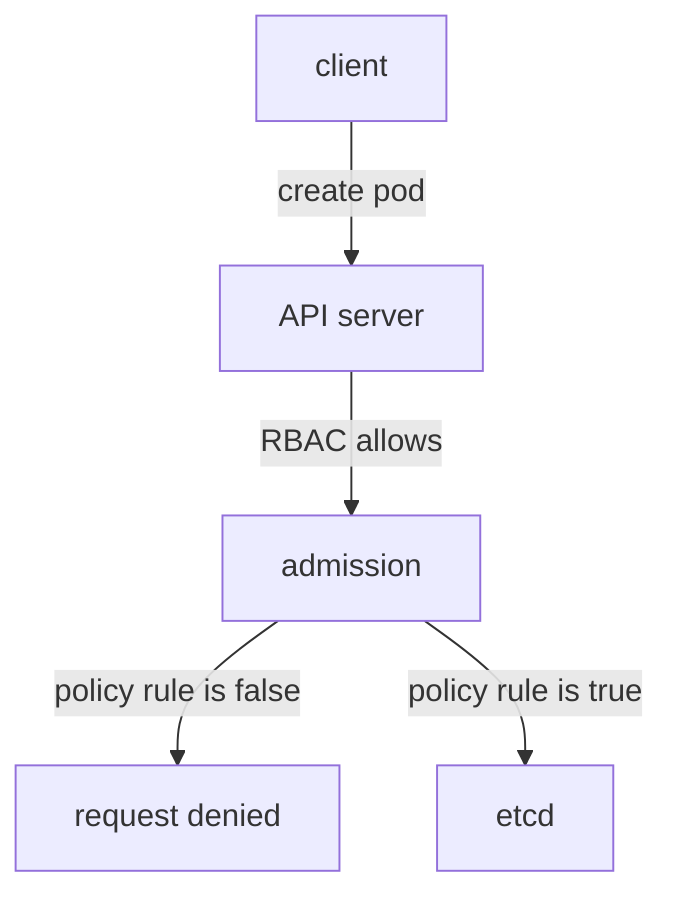

# Approved Registries At Admission

A team can write down that every image must come from the company registry, and one developer can still run `docker.io/library/busybox` in a test namespace on a busy afternoon. A rule that depends on people remembering it is not a control. A control that the cluster enforces works every time, for every pod. This chapter shows how the API server checks the image of every new pod against a list of approved registries, using a `ValidatingAdmissionPolicy`.

## Where the check runs

When a client sends a request that creates or changes an object, the API server first authenticates the client and authorizes the request with role-based access control (RBAC). If the request is allowed, it goes through admission. Admission is a set of steps inside the API server that can change a request (mutating admission) or reject it (validating admission). Only after admission does the API server store the object in etcd, the cluster database.

RBAC decides who may create pods. It cannot look inside the pod. Admission sees the whole object, including the image of every container, and can reject a pod that RBAC allowed. That is the layer where a registry rule belongs.

A `ValidatingAdmissionPolicy` is a built-in way to write a validating rule without running a separate server. It became generally available in Kubernetes 1.30 with the API version `admissionregistration.k8s.io/v1`. The rule is written in the Common Expression Language (CEL), a small language for expressions that the API server evaluates. A policy has no effect until a `ValidatingAdmissionPolicyBinding` connects it to a scope and chooses an action.



The diagram shows that the policy rule runs after RBAC and before the pod is stored, so a denied pod never exists.

## The cluster before any policy

Start with the baseline. In the playground no policy exists, so every image is admitted. A server-side dry run runs all admission steps and then discards the object, so it tests a rule without creating a pod:

<!-- astrona:playground:renew -->

```sh
kubectl -n dockyard run baseline-check --image=docker.io/library/busybox:1.37 --dry-run=server
```

The command prints `pod/baseline-check created (server dry run)`. Nothing was stored. The next step makes the same command fail.

## Writing the policy

The policy below matches pods that are created or updated. The `images` variable collects the image of every container, and of every init container when the pod has any. An init container is a container that runs and finishes before the main containers start, and it pulls its own image, so it needs the same check. The macro `has()` tests that an optional field exists, because reading a missing `initContainers` would raise an error. The validation uses `startsWith` with a trailing slash on each prefix.

Save this as `validatingadmissionpolicy-approved-registries.yaml`:

```yaml
apiVersion: admissionregistration.k8s.io/v1
kind: ValidatingAdmissionPolicy
metadata:
  name: approved-registries
spec:
  failurePolicy: Fail
  matchConstraints:
    resourceRules:
      - apiGroups: [""]
        apiVersions: ["v1"]
        operations: ["CREATE", "UPDATE"]
        resources: ["pods"]
  variables:
    - name: images
      expression: >-
        object.spec.containers.map(c, c.image) +
        (has(object.spec.initContainers) ? object.spec.initContainers.map(c, c.image) : [])
  validations:
    - expression: >-
        variables.images.all(i,
        i.startsWith('registry.starfleet.example/') || i.startsWith('ghcr.io/stefanprodan/'))
      message: "Images must come from registry.starfleet.example/ or ghcr.io/stefanprodan/."
```

Apply it:

```sh
kubectl apply -f validatingadmissionpolicy-approved-registries.yaml
```

Then check the result by running the baseline command again. A policy without a binding does nothing, so the command still succeeds. The `failurePolicy: Fail` setting means that an error while the API server evaluates the rule rejects the request instead of letting it through. The other value, `Ignore`, lets the request through on an error, which turns a broken rule into no rule.

## Binding the policy to a scope

The binding says where the policy applies and what happens on a failure. The field `validationActions` takes `Deny`, `Warn` and `Audit`. `Deny` rejects the request. `Warn` admits the request and sends a warning to the client. `Audit` admits the request and adds an annotation to the audit event. A `namespaceSelector` limits the binding to the namespaces with matching labels. Kubernetes labels every namespace with `kubernetes.io/metadata.name`, so that label selects one namespace by name.

Save this as `validatingadmissionpolicybinding-approved-registries-dockyard.yaml`:

```yaml
apiVersion: admissionregistration.k8s.io/v1
kind: ValidatingAdmissionPolicyBinding
metadata:
  name: approved-registries-dockyard
spec:
  policyName: approved-registries
  validationActions: ["Deny"]
  matchResources:
    namespaceSelector:
      matchLabels:
        kubernetes.io/metadata.name: dockyard
```

Apply it:

```sh
kubectl apply -f validatingadmissionpolicybinding-approved-registries-dockyard.yaml
```

Then check the result. The API server needs a few seconds before it enforces a new binding, so repeat the first command if it still succeeds:

```sh
kubectl -n dockyard run denied-check --image=docker.io/library/busybox:1.37 --dry-run=server
kubectl -n dockyard run allowed-check --image=ghcr.io/stefanprodan/podinfo:6.15.0 --dry-run=server
kubectl -n outpost run outpost-check --image=docker.io/library/busybox:1.37 --dry-run=server
```

The first command fails with an error that names the policy and the binding and ends with the message from the policy: `ValidatingAdmissionPolicy 'approved-registries' with binding 'approved-registries-dockyard' denied request`. The second command succeeds, because the image starts with an approved prefix. The third command succeeds, because `outpost` is outside the scope of the binding.

## Why the trailing slash matters

A prefix without a slash is a common mistake. The test `startsWith('ghcr.io/stefanprodan')` also matches `ghcr.io/stefanprodan-evil/podinfo`, a repository owned by someone else. The test `startsWith('registry.starfleet.example')` matches `registry.starfleet.example.attacker.test/app`, a different host. The slash ends the match at the boundary of the registry or the account name. A stricter policy can compare the registry host exactly, for example by splitting the image on the first slash.

The policy checks pods only. A Deployment is not a pod, so the API server accepts a Deployment whose pods the policy would reject. The Deployment controller then creates a ReplicaSet, the ReplicaSet tries to create pods, and admission rejects each one. The failure appears as `FailedCreate` events on the ReplicaSet, not as an error from `kubectl apply`. Try it with `stray`, which uses an image from `docker.io` and has zero replicas:

```sh
kubectl -n dockyard scale deployment stray --replicas=1
kubectl -n dockyard get events --field-selector reason=FailedCreate
kubectl -n dockyard scale deployment stray --replicas=0
```

The scale command is accepted. The event list then shows a `FailedCreate` event from the ReplicaSet with the policy message, and no pod exists. The third command returns the Deployment to zero replicas.

You now know how to turn a registry rule into an admission control, how a binding scopes it, and why a prefix needs its boundary. The open question is the weakness that remains: a tag in an approved registry can still be moved to different content.

## Common pitfalls

> [!WARNING]
> A policy without a binding enforces nothing. `Warn` and `Audit` admit the pod. A prefix without a trailing slash matches look-alike names. Forgetting init containers leaves a hole. A policy on pods does not reject a Deployment, so the failure shows up later as a ReplicaSet event. Existing pods are not removed when a policy is created.
