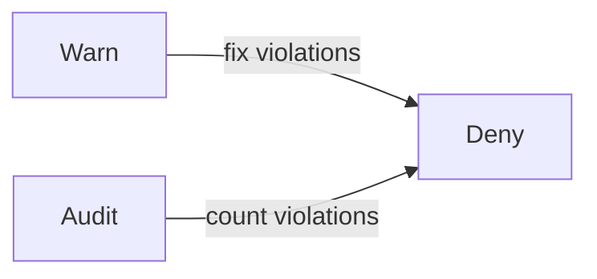

# Requiring Digests And Rolling Out A Policy

An approved registry does not fix a moving tag. If the registry owner, or an attacker with push rights, pushes new content under an existing tag, every pod that starts later runs the new content from an approved registry. A second rule closes that gap: every image must be referenced by its digest. A strict rule like this one breaks workloads that exist today, so this chapter also shows how to roll it out in steps without breaking the cluster.

## A rule that tests the shape of the reference

An image written with a digest ends with `@sha256:` and 64 hexadecimal characters. The CEL function `matches` tests a string against a regular expression in the RE2 syntax. The expression `i.matches('@sha256:[0-9a-f]{64}$')` is true only when the image ends with that pattern. The anchor `$` matters: without it, the pattern could match in the middle of a string and a trailing tag could follow. The policy tests the same list of images as before, with the containers and the init containers.

The rule checks the shape of the reference. It does not check that the digest exists in the registry or that it is the approved one. A pod with a digest of 64 zeros passes the rule, and the pull then fails. Deciding which digests are approved needs evidence, which comes from signatures and from the build system.

Save this as `validatingadmissionpolicy-require-image-digest.yaml`:

```yaml
apiVersion: admissionregistration.k8s.io/v1
kind: ValidatingAdmissionPolicy
metadata:
  name: require-image-digest
spec:
  failurePolicy: Fail
  matchConstraints:
    resourceRules:
      - apiGroups: [""]
        apiVersions: ["v1"]
        operations: ["CREATE", "UPDATE"]
        resources: ["pods"]
  variables:
    - name: images
      expression: >-
        object.spec.containers.map(c, c.image) +
        (has(object.spec.initContainers) ? object.spec.initContainers.map(c, c.image) : [])
  validations:
    - expression: "variables.images.all(i, i.matches('@sha256:[0-9a-f]{64}$'))"
      message: "Every image must be referenced by digest (repository@sha256:...)."
```

The API server type checks the expression when you create the policy. If the expression has a syntax error, it rejects the policy. A type problem, such as a misspelled field, does not stop the policy: the result is stored in `status.typeChecking`, and the policy keeps running. Apply it:

<!-- astrona:playground:renew -->

```sh
kubectl apply -f validatingadmissionpolicy-require-image-digest.yaml
```

Then check the result:

```sh
kubectl get validatingadmissionpolicy require-image-digest -o jsonpath='{.status.typeChecking}'
```

An empty result means that the type check found no problem. The policy still does nothing until a binding exists.

## Rolling out with Warn first

A new rule that denies at once can stop a deployment pipeline. The three actions in `validationActions` give a safe order. `Warn` admits the request and returns a warning to the client, so the team sees the problem in the output of `kubectl`. `Audit` admits the request and records an annotation in the audit event, which lets a platform team count violations across the cluster if audit logging is turned on. `Deny` rejects the request. A common plan starts with `Warn` and `Audit`, fixes the violations and then switches to `Deny`.

Save this as `validatingadmissionpolicybinding-require-image-digest-dockyard.yaml`:

```yaml
apiVersion: admissionregistration.k8s.io/v1
kind: ValidatingAdmissionPolicyBinding
metadata:
  name: require-image-digest-dockyard
spec:
  policyName: require-image-digest
  validationActions: ["Warn"]
  matchResources:
    namespaceSelector:
      matchLabels:
        kubernetes.io/metadata.name: dockyard
```

Apply it:

```sh
kubectl apply -f validatingadmissionpolicybinding-require-image-digest-dockyard.yaml
```

Then check the result. The binding needs a few seconds before the API server uses it. The image below is a tag, so it breaks the rule, but the action is only `Warn`:

```sh
kubectl -n dockyard run warn-check --image=ghcr.io/stefanprodan/podinfo:6.15.0 --dry-run=server
```

The command succeeds with the line `pod/warn-check created (server dry run)`. Before it, `kubectl` prints a line that starts with `Warning:` and carries the message of the policy. The request was admitted.

## Switching the binding to Deny

After the team fixed its workloads, the binding changes to `Deny`. The binding object already exists, so one patch changes the field:

```sh
kubectl patch validatingadmissionpolicybinding require-image-digest-dockyard --type=merge -p '{"spec":{"validationActions":["Deny"]}}'
```

The command prints `validatingadmissionpolicybinding.admissionregistration.k8s.io/require-image-digest-dockyard patched`. Run the dry run again after a few seconds. This time the command fails with a message that contains `denied request`, and a pod whose image ends with a 64-character digest is still admitted:

```sh
kubectl -n dockyard run deny-check --image=ghcr.io/stefanprodan/podinfo:6.15.0 --dry-run=server
kubectl -n dockyard run digest-check --image=ghcr.io/stefanprodan/podinfo@sha256:0123456789abcdef0123456789abcdef0123456789abcdef0123456789abcdef --dry-run=server
```

The first command is denied. The second is admitted by this policy, even though that digest does not exist in the registry: a dry run never pulls an image, and the rule only tests the shape.



The diagram shows the rollout order: observe with `Warn` and `Audit` first, then enforce with `Deny`.

## Scope, exceptions and the cluster components

A policy that matches every namespace also matches `kube-system`, where the cluster components run. A pod there that the policy rejects can stop a component from restarting. For this reason a binding usually selects the application namespaces by label and leaves the system namespaces out. An existing pod keeps running after a policy is created, because admission runs only when a pod is created or updated, but a restart creates a new pod, and the policy then applies.

Exceptions need a reason and an owner. A binding can select namespaces with a label such as `image-policy: enforced`, so that moving a namespace in or out is a visible change to a label. A policy can also exempt a known set of images. Every exception widens the gap that the rule was meant to close, so keep them few and review them.

You now know how to require a digest at admission and how to introduce a strict rule in steps. The remaining question is how a cluster decides that a digest is the right one, because a rule on the shape of the reference cannot check a signature.

## Common pitfalls

> [!WARNING]
> A digest rule checks the format, not whether the digest is approved. The `$` anchor must end the pattern. `Warn` and `Audit` never reject a pod. A rule that matches `kube-system` can stop system components from restarting. Existing pods are not changed by a new policy; only pods created or updated afterwards are checked.
