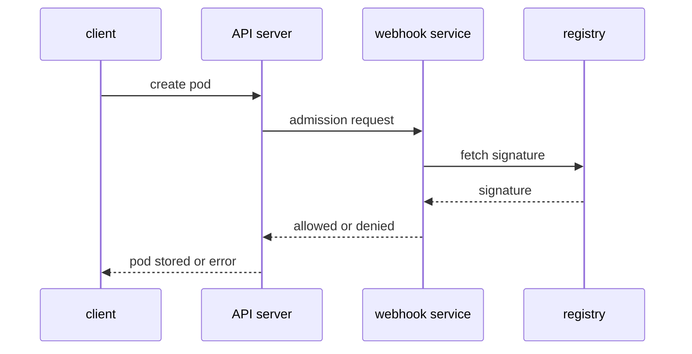

# Verifying Signatures And Scanning In The Pipeline

A policy that tests the registry name and the shape of a digest cannot tell whether the content is the one the company approved. Two more controls answer that question: a signature check before the pod is admitted, and a scan that runs in the delivery pipeline and again on what is stored. This chapter explains how each control works, where it sits in the path of an image, and what it cannot prove. It has no commands, because the tools that sign and scan images are not part of a plain Kubernetes cluster.

## Signing: binding an identity to a digest

A signature is created from a digest. The signer holds a private key, or receives a short-lived certificate after logging in to an identity provider, which is the keyless model of the Sigstore project. The tool `cosign` is the common client for this. It signs the digest and stores the signature in the registry beside the image, as another small artifact, so the signature travels with the repository.

A verifier checks the signature against something it already trusts: a public key, or an expected identity such as a build pipeline of one repository. If the signature is valid and matches the trusted key or identity, the verifier knows that this holder signed this exact digest. The check fails closed: no signature, a signature from another key and a changed image all fail the same way.

A signature has limits. It does not say that the code is free of defects. It does not say when the signer last reviewed the code. If the signing key leaks, the attacker can sign malicious images, so key storage and rotation matter. In the keyless model, the trust moves to the identity provider and to a public transparency log that records each signing event.

## Where verification can run

Verification can run in three places, and a mature setup uses more than one. The pipeline verifies before it promotes an image from the build repository to the production repository. A node-level tool can verify before a container starts. The most common place for a Kubernetes cluster is admission, because it covers every pod that anyone creates.

The built-in `ValidatingAdmissionPolicy` cannot do it. Its expressions run inside the API server and cannot call a registry or read a signature. The cluster needs an admission step that can reach out. There are two standard ways.

The first is the `ImagePolicyWebhook` admission plugin. The API server sends an `ImageReview` object, which lists the images of a pod, to an external backend over HTTPS, and the backend answers allowed or denied. The plugin is not enabled by default and the administrator turns it on and configures it with the API server flags.

The second is a dynamic admission webhook: a `ValidatingWebhookConfiguration` or `MutatingWebhookConfiguration` tells the API server to send matching requests to a service. Policy engines such as Kyverno, and the Sigstore policy-controller, use this mechanism. The service fetches the signature from the registry, checks it, and answers. A mutating webhook can also replace a tag in the pod with the digest that it verified, so the pod runs exactly what was checked.

The diagram shows that the webhook service, not the API server, talks to the registry and decides on the signature.

## What happens when the verifier is down

An external verifier is a new dependency in the path of every pod creation. The field `failurePolicy` on a webhook decides what the API server does when the webhook does not answer. With `Fail`, the request is rejected, which is safe but can stop pod creation across the cluster during an outage. With `Ignore`, the request is admitted without the check, so an attacker who can break the webhook can bypass the rule.

Teams limit the damage with several measures: run more than one replica of the webhook, exclude the namespace of the webhook itself and of the system components so that the webhook can restart, and set a short timeout. Each measure involves a trade-off between availability and enforcement, and the exam expects you to name the trade-off.

## Scanning: known problems in known components

A scanner unpacks an image, lists the operating system packages and the application dependencies, and compares them with vulnerability databases. The output is a list of findings, each with a Common Vulnerabilities and Exposures (CVE) identifier and a severity. Trivy and Grype are common scanners, and they are named here as concepts: this cluster does not install them.

A scan sees only what is known. A flaw that nobody has published is not in the database. A scan also cannot see a logic error in the application's own code, such as a missing authorization check. A finding does not always mean the application is exploitable, because the vulnerable function may never be called. For that reason a team decides per finding: fix it, accept it with a written reason, or block the image.

When the scan runs matters. A scan in the pipeline stops a known bad image before it is pushed. A scan of the stored images finds problems that were published after the push, and a scan of what runs in the cluster tells the team where to act. A gate that only scans once leaves a growing set of unknown problems.

## Attestations: signed statements about an image

A signature on a digest says only that someone vouches for the image. An attestation is a signed statement about the image, attached to the same digest. The statement can say that the image was built from a given source revision by a given build system (provenance), that a scan found no critical findings on a given date, or that the image has a given SBOM. A verifier can then require not only a valid signature but also the right statement from the right identity.

The attestation ties each claim to the digest. A scan report without that tie can describe a different image than the one in the cluster. A policy that says "only run images whose digest has a provenance statement from our build pipeline and a scan statement newer than seven days" turns the process into a rule that the cluster can check.

## Promotion between repositories

Many organizations keep two repositories: one that every build pushes to, and one that production pulls from. A promotion step copies an image from the first to the second only after the checks pass. The copy keeps the digest, so signatures and attestations stay valid. The cluster is then allowed to pull only from the production repository, and an approved-registry rule in admission enforces that.

This design removes a whole class of mistakes. A developer cannot run an untested build in production, because the registry rule rejects the pod. The promotion step is the only writer to the production repository, so its credential is the one to protect most. A reviewer follows the chain from the pod to the digest, to the signature, to the build that created it and to the source revision.

## Detecting what already runs

A control at admission checks new pods only. The cluster can hold pods that started before the policy existed, from an image that has since turned out to be vulnerable. A periodic inventory lists the images of all running pods by digest and compares them with the approved list and the latest scan results. The pod status field `imageID` is the source for this inventory, and tools that read it can report pods that run unknown digests.

When a finding appears, the response uses the same path in reverse: find the pods that run the digest, rebuild the image from a fixed base, sign and promote it, and roll the Deployments to the new digest. Because Deployments refer to digests, the update is a visible change in the manifest, and the history shows which digest ran when.

## Choosing the control for a scenario

Exam scenarios describe a failure and ask which control would have stopped it. The mapping below helps to reason about them. Each row names the failure, the control that fits and the limit of that control.

| Failure | Control that fits | Limit |
| --- | --- | --- |
| A pod runs an image from a public registry | Approved-registry rule at admission | Does not check the content |
| A tag was moved to new content | Reference by digest | Does not say the digest is approved |
| An attacker pushed an image to the registry | Signature verification at admission | The signing key must stay safe |
| A library in an image has a known flaw | Scan in the pipeline and of stored images | Sees known flaws only |
| A password is inside an image layer | Revoke the credential, rebuild without it | Hiding the file is not enough |
| The verifier webhook is down | `failurePolicy` choice, replicas, exclusions | Availability and enforcement conflict |

Read a scenario by naming the step of the path where the failure entered, and then choose the control that sits at that step.

## Putting the controls together

No single control covers the path from source to running container. The build system produces the image with provenance and an SBOM and signs the digest. The registry restricts who can push. The pipeline scans and refuses images with blocked findings. The cluster admits only pods from approved registries, by digest, with a valid signature. At the end of the path, the pod runs with least privilege, so a defect that no control found still has a limited effect.

You now know what a signature check and a scan prove, where each runs, and what a verifier outage does to enforcement. A real review of an image supply chain is the sum of these controls, and a gap in any one of them is a place where an unapproved artifact can enter.

## Common pitfalls

> [!WARNING]
> A valid signature does not mean the code is safe. A policy written with `ValidatingAdmissionPolicy` cannot verify a signature. A webhook with `failurePolicy: Ignore` lets pods through when the webhook is down. A clean scan only covers the vulnerabilities known on the day of the scan. Verifying one image and deploying another weakens every check.
