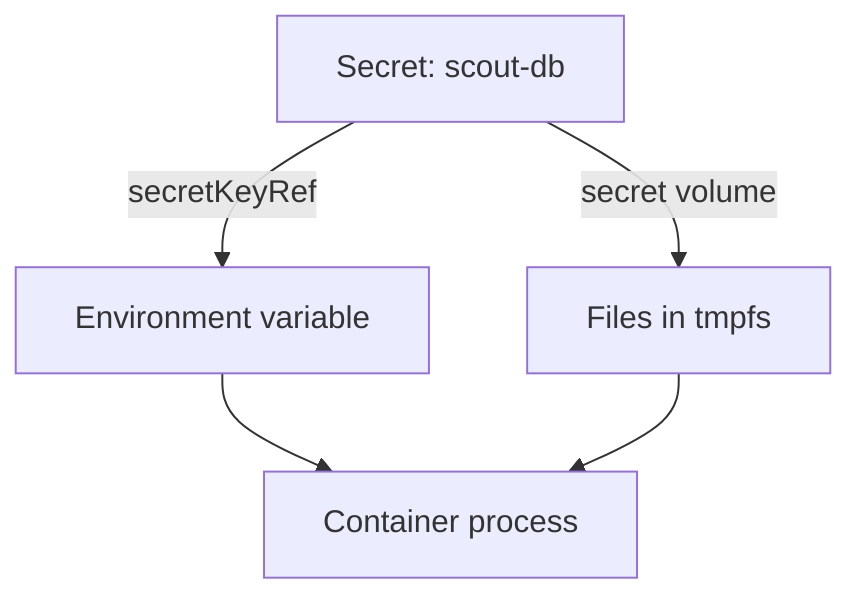

# Delivering Credentials To A Workload

The `scout` application reads a database password at startup. The password must reach the process, but it must not travel in the image, in the pod template or in a log line, because every one of those places has readers who should never see it. This part explains the ways Kubernetes delivers a credential, what each one exposes, and what a Secret does and does not protect.

## Places where a credential must not live

A credential is a value that proves identity or grants access: a password, a token, an API key or a private key. Four places cause most leaks.

A container image keeps every file that the build wrote. A password in the source code, in a build argument or in a copied configuration file stays in the image layers. Everyone who can pull the image can extract it, and deleting the file in a later layer does not remove it from the earlier layer.

A literal value in a pod template, such as `env` with `value: "my-password"`, is stored in the Deployment object. Anyone who may `get` or `list` Deployments in the namespace reads it. The value also appears in the ReplicaSets that the Deployment creates and in the output of `kubectl get pod -o yaml`.

A ConfigMap is made for non-confidential settings. It has no separate access rules in practice: users who read configuration read the credential, and tools often print ConfigMaps.

Command arguments and logs are copied into process lists, error reports and log storage, which many people can read.

## What a Secret is

A Secret is a Kubernetes object that holds a small amount of sensitive data, such as a password or a token, so the data stays out of the image and the pod template. It lives in a namespace and has keys. Each key holds one value. Kubernetes handles it differently from a ConfigMap in a few ways: the kubelet keeps Secret volumes in memory (a `tmpfs` file system) on the node, `kubectl describe` does not print the values, and RBAC can grant access to Secrets separately from other objects.

A Secret is not encrypted by default. The `data` field holds the values encoded in base64, which is a way to write bytes as text and gives no protection. The API server stores the object unencrypted in etcd, the cluster database, unless the administrator turns on encryption at rest. Anyone who can `get` the Secret through the API, or who can read etcd, can read the value.

The field `stringData` accepts plain text values when you write a Secret. The API server encodes them into `data` when it saves the object, and it never returns `stringData`.

## Two ways to give a Secret to a pod

A pod can use a Secret as an environment variable or as a volume. The kubelet, the agent on each node, reads the Secret from the API server and prepares it before the container starts.



The diagram shows that both ways start from the same Secret object and end in the same process. The differences are in what happens afterwards.

An environment variable is set once, when the container starts. The process reads it with the normal environment calls. The value does not change while the container runs, so a rotated Secret reaches the pod only after a restart. Environment variables are also inherited by every child process and are often printed by crash reporters and diagnostic endpoints.

A Secret volume mounts each key as a file. The kubelet updates the files after the Secret changes, with a delay of up to the kubelet sync period. A volume mounted with `subPath` does not receive updates. The field `defaultMode` sets the file permissions. Mounting with `readOnly: true` stops the process from changing the files.

Security guidance prefers files for credentials that rotate, because the process can read the new value without a restart. Both ways expose the value to a process that is compromised, so neither replaces limiting what the pod can do.

## Read a leaked credential

The playground has a Deployment `legacy-report` that uses the bad pattern. Read its pod template:

<!-- astrona:playground:renew -->

```sh
kubectl -n starfleet get deployment legacy-report -o jsonpath='{.spec.template.spec.containers[0].env}'
```

The command prints a JSON list with the variable `DB_PASSWORD` and its value in plain text. Anyone who may read Deployments in `starfleet` now has the password, even if they may not read Secrets.

Read the Secret `scout-db` the same way. The value is encoded, and one more command decodes it:

```sh
kubectl -n starfleet get secret scout-db -o jsonpath='{.data.password}'
kubectl -n starfleet get secret scout-db -o jsonpath='{.data.password}' | base64 -d
```

The first command prints text made of letters and digits that is not the password. The second prints the password. This proves that base64 is an encoding. The Secret protects the value only through the access rules on the object.

## See who may read a Secret

RBAC decides who may `get` a Secret. A common mistake is a Role that allows `get`, `list` or `watch` on all Secrets in a namespace. The `list` and `watch` verbs return the full content of every Secret, not only the names. The playground gives the `shuttle` service account such a Role. Ask the API server what `shuttle` may do:

```sh
kubectl auth can-i get secrets -n starfleet --as=system:serviceaccount:starfleet:shuttle
```

The command prints `yes`. A compromised `shuttle` process could read the database password even though it never needs it. The fix is to remove the grant, or to restrict it with `resourceNames` to the one Secret the workload really needs.

## Use the Secret from a pod

Save this as `pod-scout-client.yaml`. It reads `password` from `scout-db` through an environment variable and through a read-only volume. It uses the `scout` service account and does not mount a service account token, because this pod does not call the Kubernetes API:

```yaml
apiVersion: v1
kind: Pod
metadata:
  name: scout-client
  namespace: starfleet
spec:
  serviceAccountName: scout
  automountServiceAccountToken: false
  containers:
    - name: client
      image: curlimages/curl:8.22.0
      command: ["sh", "-c", "while true; do sleep 30; done"]
      env:
        - name: DB_PASSWORD
          valueFrom:
            secretKeyRef:
              name: scout-db
              key: password
      volumeMounts:
        - name: db-credentials
          mountPath: /etc/scout-db
          readOnly: true
  volumes:
    - name: db-credentials
      secret:
        secretName: scout-db
```

Apply it:

```sh
kubectl apply -f pod-scout-client.yaml
```

Then check the result. Wait until the pod is ready, and then describe it:

```sh
kubectl -n starfleet wait --for=condition=Ready pod/scout-client --timeout=120s
kubectl -n starfleet describe pod scout-client
```

In the `Environment` section the variable appears as `DB_PASSWORD: <set to the key 'password' in secret 'scout-db'>`. The pod template holds a reference, not the value. Anyone who reads only the pod or the Deployment learns that a Secret is used, but not what it contains.

## Rotation and Immutability

Rotation means replacing a credential with a new one. Change the Secret and look at both delivery ways. Save this as `secret-scout-db.yaml`:

```yaml
apiVersion: v1
kind: Secret
metadata:
  name: scout-db
  namespace: starfleet
type: Opaque
stringData:
  password: rotated-password
```

Apply it:

```sh
kubectl apply -f secret-scout-db.yaml
```

Then check the result. Read the variable and the file in the pod. Repeat the file read after about a minute:

```sh
kubectl -n starfleet exec scout-client -- sh -c 'echo "$DB_PASSWORD"; cat /etc/scout-db/password'
```

The variable still prints the old password, because the process environment was fixed at start. The file shows the new password once the kubelet has synced the volume, which can take up to about a minute or more. Rotation at the credential issuer, for example the database, must happen as well. Changing the Secret object alone does not change the password that the database accepts.

A Secret can be marked `immutable: true`. The API server then rejects changes to `data`, and a new Secret must replace it. This stops an accidental edit and reduces the load on the API server.

This part showed how a credential reaches a process and where it leaks. A Secret keeps the value out of the image and the pod template, and RBAC decides who may read it. The open question is how a team knows that the code and the libraries that use the credential are free of known flaws.

## Common pitfalls

> [!WARNING]
> - **Calling base64 encryption.** Base64 is an encoding. Without encryption at rest and tight RBAC, a Secret is readable by anyone with API access.
> - **Putting a literal value in an environment variable of a pod template.** The Deployment, its ReplicaSets and its pods all keep the value.
> - **Giving `list` or `watch` on Secrets to a workload.** Both verbs return every Secret in scope.
> - **Expecting an environment variable to follow a rotated Secret.** Only a restart changes it. A volume without `subPath` is updated.
> - **Treating a Secret as the only control.** A compromised process can read its own environment and files.
