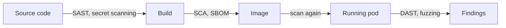

# Testing Code And Dependencies

The team behind `scout` ships a new version every week. Most of the running code is not written by the team: it comes from libraries, a base image and a language runtime. A flaw in any of them becomes a flaw in `scout`. This part explains the kinds of analysis a team runs on its code and its dependencies, what evidence each one gives, and how to read exactly which image a pod runs.

## Why analysis happens before the cluster

Security testing finds flaws while they are cheap to fix. A flaw found in a code review costs one edit. The same flaw found after release costs an incident. The activities below run at different times in the delivery pipeline, and each one sees a different kind of problem. None of them proves that the application is secure. Each one produces evidence about one aspect.

## Kinds of analysis

Static Application Security Testing (SAST) reads the source code or the compiled code without running it. It looks for patterns that are known to be unsafe, such as a query built from strings or a hard-coded password. It runs early, on every change, and it points to a line of code. It cannot see problems that only appear when the application runs with real configuration, and it reports some findings that are not real.

Dynamic Application Security Testing (DAST) sends requests to a running application and watches the responses, like an attacker without the source. It finds problems in the deployed behaviour: missing authorization on a route, an error page that leaks details, a weak header. It needs a running instance and cannot say which line of code is at fault.

Software Composition Analysis (SCA) compares the libraries and packages in an application with a database of known vulnerabilities. A known vulnerability gets an identifier in the Common Vulnerabilities and Exposures (CVE) list. SCA answers one question: does this component version have a published flaw? It does not find new flaws and does not say whether the application calls the vulnerable function.

Fuzzing feeds a program with large numbers of random or malformed inputs and watches for crashes, hangs and memory errors. It finds parsing and boundary flaws that nobody wrote a test for.

Secret scanning searches source code and history for credentials that someone committed by mistake. A found credential counts as exposed, even after the commit is removed, and must be revoked at the issuer.

Code review by a second person and penetration testing by a security specialist add human judgement. They find logic flaws, such as a missing ownership check, that tools find poorly.

## Where each analysis runs

The analyses fit different stages of a delivery pipeline, which is the automated chain that builds, tests and releases the application.



The diagram shows that source analysis happens before the build, component analysis happens on the image, and requests to the running application test the behaviour. The image is scanned again while it runs, because the list of known vulnerabilities grows.

## Dependencies and the software bill of materials

A dependency is a library or package that the application uses. A direct dependency is one the team chose. A transitive dependency is one that a dependency brings along, and a typical application has many more transitive dependencies than direct ones.

A Software Bill of Materials (SBOM) is a list of the components in an artifact, with their names and versions. It is an inventory. A scanner uses the inventory to look up vulnerabilities, and the team uses it when a new CVE appears, to find every image that contains the component. An inventory alone does not report a vulnerability. A scan result is a statement about one point in time, so a team keeps scanning images that are already deployed, because new CVEs are published every day.

Updating a dependency can also introduce a problem. A patched library can change a default or an interface. The team runs its tests after the update and releases it through the same pipeline as other code.

## Read what a pod really runs

A tag such as `6.15.0` is a label that the image publisher can move to a different image. A digest is a hash of the image content, written `sha256:` followed by the hash, and it cannot point to a different image. A pod that names an image by digest always runs the same bytes. Verification of a signature or a scan result applies to a digest, not to a tag.

List the images that run in the cluster. This is a small inventory of the container layer:

<!-- astrona:playground:renew -->

```sh
kubectl get pods -A -o jsonpath='{range .items[*]}{.metadata.namespace}{"\t"}{.metadata.name}{"\t"}{range .spec.containers[*]}{.image}{" "}{end}{"\n"}{end}'
```

The output has one line per pod with the namespace, the pod name and the image reference. Every image reference in the playground uses a tag.

Now read the identifier of the image that the node really started for `scout`. The container runtime stores it in the pod status:

```sh
kubectl -n starfleet get pods -l app=scout -o jsonpath='{.items[0].status.containerStatuses[0].imageID}'
```

The value is the identifier of the image content that the node used and it contains a `sha256` digest. This is the value a team compares with a scan report or a signature. If the pod used the tag only, two pods created on different days could carry different identifiers under the same tag.

Find the containers that are not pinned to a digest, with `jq`:

```sh
kubectl get pods -A -o json | jq -r '.items[] | .metadata.namespace as $ns | .metadata.name as $pod | .spec.containers[] | select(.image | contains("@sha256:") | not) | "\($ns)/\($pod) \(.image)"'
```

The command lists every container whose image reference has no `@sha256:` part. In a real cluster this is a first check that the pods use fixed content. A reference with a digest looks like `registry/name@sha256:<DIGEST>`, and the digest comes from the registry or from the output of the build.

## Rolling out and rolling back an update

A Deployment records each version of its pod template as a revision. Read the history of `scout`:

```sh
kubectl -n starfleet rollout history deployment/scout
```

The output lists the revisions. When a patched dependency breaks behaviour, `kubectl rollout undo deployment/scout` returns to the previous revision. The history is a record of what ran and when, and it supports the traceability that a team needs between source code, dependencies and the deployed artifact.

This part showed that the code layer includes what the team did not write, and that testing produces evidence of different kinds. A tag names an image, a digest identifies it, and a scan is true only for the content it scanned. The next topic leaves the code and looks at what the platform can still do to limit a compromised process.

## Common pitfalls

> [!WARNING]
> - **Reading a clean scan as proof of safety.** It says that no known vulnerability was found in the scanned components. Unknown flaws and logic errors remain.
> - **Scanning only once at build time.** New CVEs appear after release.
> - **Trusting a tag.** A tag can move. A digest identifies the content.
> - **Using SAST as the only test.** It does not see configuration, runtime behaviour or missing ownership checks.
> - **Ignoring transitive dependencies.** Most components in an image come from them.
