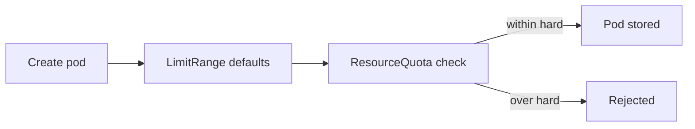

# Resource Limits And Bounded Work

A single request to `scout` can ask for expensive work: a huge report, a loop that never ends or a flood of requests from one client. A process that is allowed to take all the memory of its node will starve every other pod on that node. This part explains how Kubernetes bounds the resources of a container and of a namespace, what happens when a bound is reached, and which limits the application code must still set itself.

## Requests and limits

A resource request is the amount of processor time or memory that the scheduler reserves for a container. The scheduler places the pod only on a node that has this much unreserved. A resource limit is the most that the container may use at run time. The two are set per container under `resources`.

The two resources behave differently when a container reaches its limit. Processor time is compressible: a container above its CPU limit is throttled, which means it runs slower, and it keeps running. Memory is not compressible. A container that uses more memory than its limit is stopped by the kernel Out Of Memory (OOM) killer. The pod status then shows the reason `OOMKilled` and the exit code 137, and the kubelet restarts the container according to the restart policy.

A memory limit therefore protects the node and the neighbours of the pod. It does not protect the application: the process that hit the limit still dies, and a repeated attack can keep it restarting.

## Quality of service classes

Kubernetes assigns every pod one of three quality of service (QoS) classes from its requests and limits. The class decides which pods the kubelet evicts first when a node runs out of memory.

- `Guaranteed`: every container has a CPU and memory request and limit, and the request equals the limit.
- `Burstable`: at least one container has a request or limit, but the pod does not meet the Guaranteed rule.
- `BestEffort`: no container has any request or limit. These pods are evicted first.

Look at the classes in the playground:

<!-- astrona:playground:renew -->

```sh
kubectl -n starfleet get pods -o custom-columns=NAME:.metadata.name,QOS:.status.qosClass
```

The `scout`, `probe` and `shuttle` pods show `Burstable`, because their templates set requests and a memory limit. The `loose-agent` and `tight-agent` pods show `BestEffort`, because their templates set nothing. A `BestEffort` pod can use any memory that is free on the node, and it is the first to be evicted.

## LimitRange: defaults for every container

Teams forget to set limits. A LimitRange is a namespaced object that sets default requests and limits for containers in its namespace, and it can set minimum and maximum values. The API server applies the defaults at admission, which is the step where the API server mutates and validates a request before it stores the object. A container that has no value receives the default. A container that sets its own value keeps it, if it is inside the minimum and maximum.

Save this as `limitrange-container-defaults.yaml`:

```yaml
apiVersion: v1
kind: LimitRange
metadata:
  name: container-defaults
  namespace: starfleet
spec:
  limits:
    - type: Container
      defaultRequest:
        memory: 32Mi
      default:
        memory: 64Mi
```

Apply it:

```sh
kubectl apply -f limitrange-container-defaults.yaml
```

Then check the result with a pod that has no resources. Save this as `pod-limit-test.yaml`:

```yaml
apiVersion: v1
kind: Pod
metadata:
  name: limit-test
  namespace: starfleet
spec:
  serviceAccountName: scout
  automountServiceAccountToken: false
  containers:
    - name: client
      image: curlimages/curl:8.22.0
      command: ["sh", "-c", "while true; do sleep 30; done"]
```

Apply it and read the resources of the stored pod:

```sh
kubectl apply -f pod-limit-test.yaml
kubectl -n starfleet get pod limit-test -o jsonpath='{.spec.containers[0].resources}'
```

The pod template has no `resources` field, yet the stored pod has a memory request of `32Mi` and a memory limit of `64Mi`. The API server added them. A LimitRange does not change pods that already run, so only new pods receive the defaults. Delete the test pod:

```sh
kubectl -n starfleet delete pod limit-test
```

## ResourceQuota: a cap for the namespace

A LimitRange bounds one container. A ResourceQuota bounds the total of a namespace: the number of objects, and the sum of requests and limits of all pods. When a new object would push a total over the `hard` value, the API server rejects the request with a `403 Forbidden` error whose message starts with `exceeded quota`. Quotas protect a shared cluster from one team or one runaway controller.



The diagram shows the order in which the API server handles a new pod: defaults first, then the quota check, so a default value counts against the quota.

If a quota tracks CPU or memory, every new pod must state that value, or a LimitRange must supply it. Otherwise the API server rejects the pod. That is why the LimitRange comes first.

Save this as `resourcequota-starfleet.yaml`. The namespace runs five pods now, so a limit of five means that the next pod will not fit:

```yaml
apiVersion: v1
kind: ResourceQuota
metadata:
  name: starfleet-quota
  namespace: starfleet
spec:
  hard:
    pods: "5"
    limits.memory: 1Gi
```

Apply it:

```sh
kubectl apply -f resourcequota-starfleet.yaml
```

Then check the result. Try the test pod again, and read the quota status:

```sh
kubectl apply -f pod-limit-test.yaml
kubectl -n starfleet describe resourcequota starfleet-quota
```

The first command fails with a `Forbidden` error that contains `exceeded quota: starfleet-quota`. The second shows the `Used` and `Hard` columns for `pods` and `limits.memory`.

A quota also affects rollouts. A rolling update creates a new pod before it removes the old one. With the pod count at its hard value, the new pod is rejected, and the ReplicaSet records `FailedCreate` events. A quota needs a margin for rollouts.

## Bounding work in the code

Resource limits stop one workload from taking the node. They do not stop expensive requests that use the memory the pod is allowed to use. The code must bound its own work: a maximum request size, a timeout for each request, a limit on the number of results, and a limit on concurrent work per caller. A proxy can rate limit requests, but only the application knows which operation is expensive.

Kubernetes bounds batch work with fields of the Job object. `backoffLimit` caps the number of retries of failed pods, `activeDeadlineSeconds` caps the total run time, and a CronJob with `concurrencyPolicy: Forbid` skips a run when the previous one is still active. These fields prevent runaway repetition. They cannot make a repeated operation safe: the code of the job must still handle being run twice, for example with an idempotency key.

This part showed the resource boundaries of a workload: limits on a container, defaults from a LimitRange and totals from a ResourceQuota. Together with the container settings, they bound both what a compromised process can do and how much of the node it can use. Neither protects the data that the application itself is allowed to read.

## Common pitfalls

> [!WARNING]
> - **Setting a CPU limit and expecting the process to stop.** The kernel throttles processor time and keeps the process running. Only memory leads to a kill.
> - **Adding a ResourceQuota on memory with no LimitRange.** Pods without a value are rejected.
> - **Setting a quota with no margin.** Rolling updates and restarts need one extra pod.
> - **Expecting a LimitRange to change running pods.** It applies at admission, to new pods.
> - **Treating limits as protection for data.** They bound the resources a workload uses, not what it reads.
